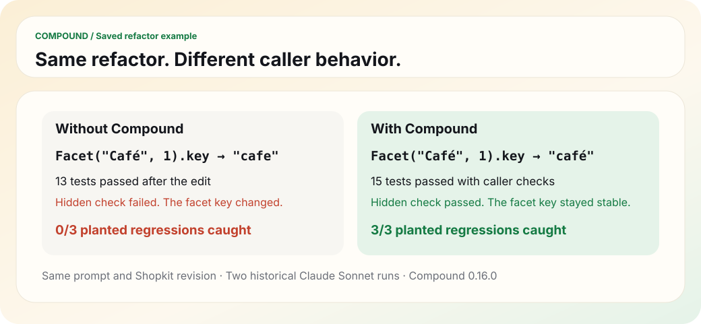
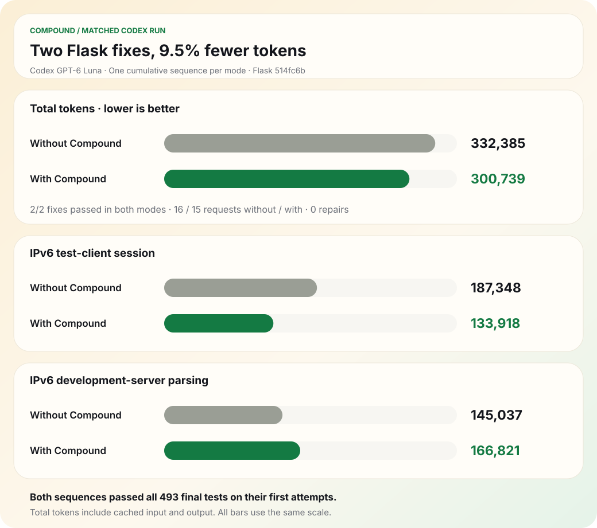
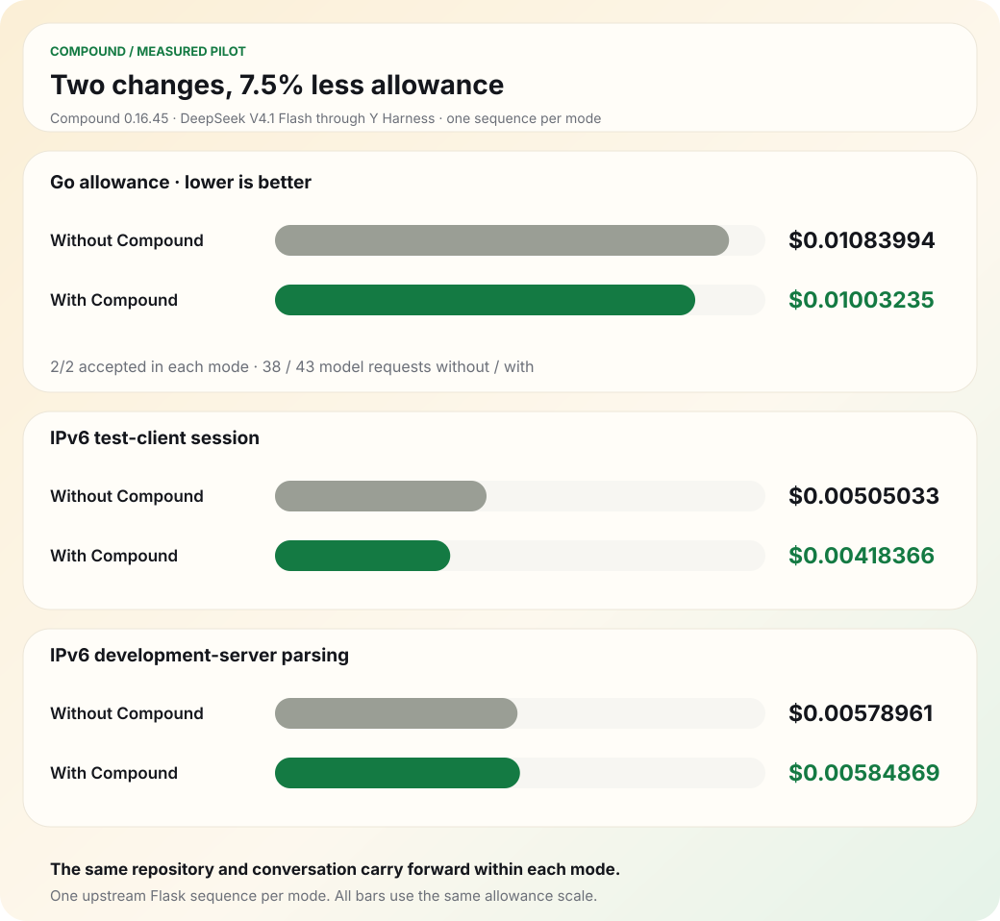
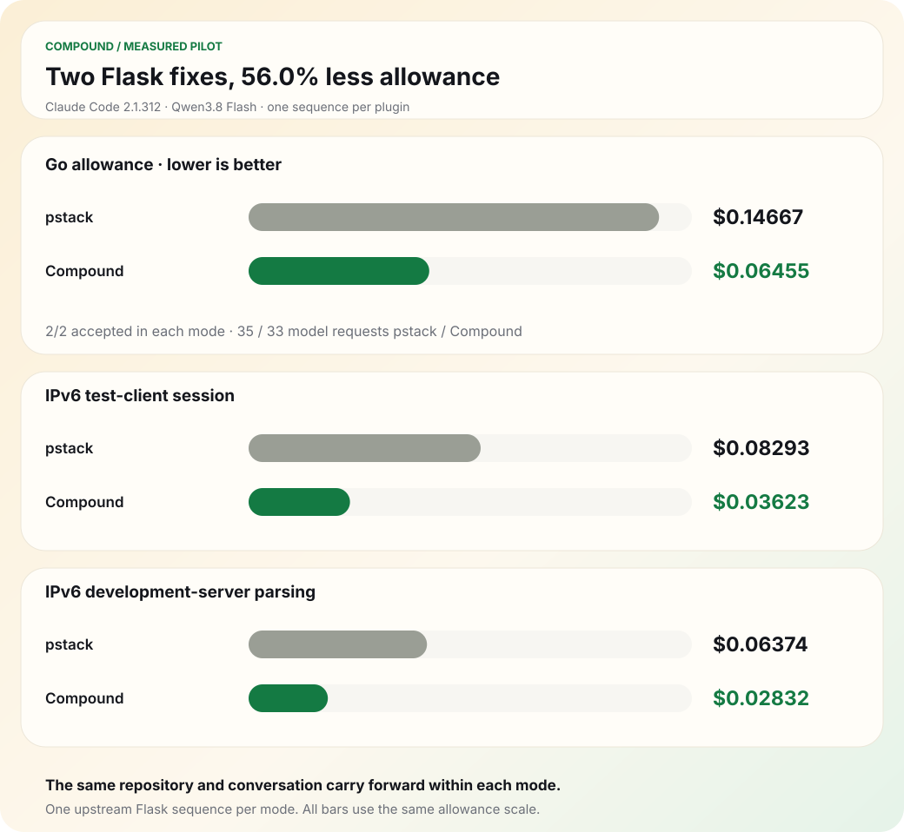
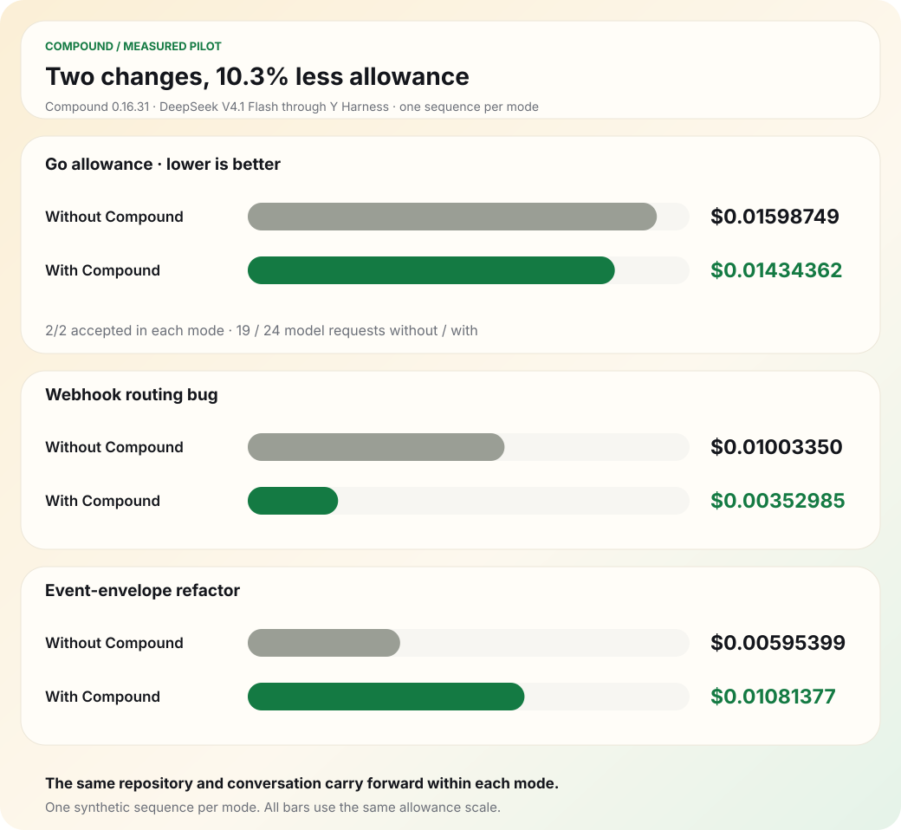
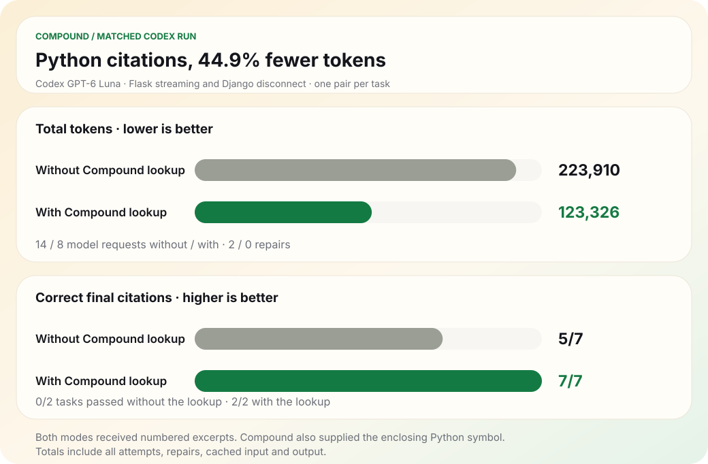
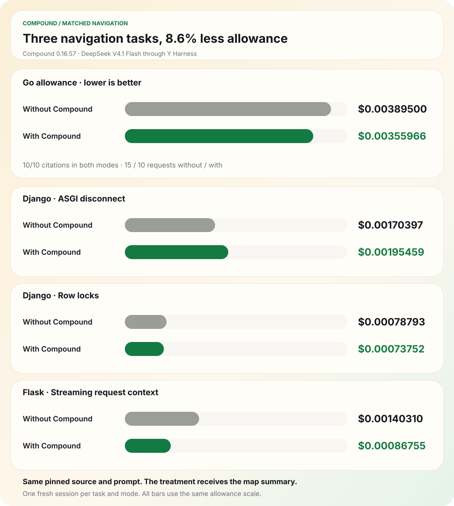

<h1 align="center">Compound Skills</h1>

<p align="center"><strong>Make your coding agent show its work.</strong><br>It has your agent reproduce a bug and show the new test failing before fixing it, keep every caller's behavior through a refactor, and commit without AI co-author lines. Plus a live map of your code.</p>

<p align="center">Free, open-source (MIT) plugin for Claude Code, Codex and Cursor · needs Python 3.11+ and Git<br>Version 0.16.77 · Claude Code benchmarks: 31 October–1 November 2026 · DeepSeek workflows: 2–4 November 2026 · not affiliated with Every's Compound Engineering plugin</p>

<p align="center"><a href="#quick-start">Quick start</a> · <a href="#at-a-glance">Results</a> · <a href="#install">Install</a> · <a href="#benchmark">Benchmark</a> · <a href="#the-code-map">Code map</a> · <a href="#limits">Limits</a></p>



## Quick start

Install at **User** scope in each app you use. Open a new chat, then run the one-time setup command for that app.

| App | Install | One-time setup | Check saved guidance |
| --- | --- | --- | --- |
| Claude Code | [Install commands](#claude-code) | `/compound-skills:setup-global` | `/compound-skills:status-global` |
| Codex | [Install commands](#codex) | `$setup-global` | `$status-global` |
| Cursor | [Install steps](#cursor) | `/setup-global` | `/status-global` |

**Try a first task.** Open a fresh chat in a repository with a small working-tree diff. Send this as an ordinary message.

> Review my current diff for regressions. Cite the callers or tests that support each finding. Leave files unchanged.

Look for source-backed findings or a clear report that the review found none, along with the checks and their limits.

If the checkout is clean, replace [feature] with a behavior you recognize and send this message.

> Trace [feature] from its entry point to its implementation and tests. Cite file paths and lines. Leave files unchanged.

Look for a trace through source files and the nearest tests, with gaps called out. Setup reports saved guidance and optional map access separately. Use the status command above to check saved guidance if the first task behaves unexpectedly.

Day to day, ask for the task in your own words. Project `setup` is optional. It saves guidance for the checkout and prepares the local map.

## At a glance

| Measured outcome | Without Compound | With Compound |
| --- | ---: | ---: |
| [Held-out refactors completed correctly](#refactor-correctness) | 20/30 | 30/30 |
| [Planted refactor regressions caught by the tests](#refactor-correctness) | 6/90 | 90/90 |
| [Bug-fix runs that showed the regression fail before the edit](#real-bugs) | 1/48 | 48/48 |
| [Three Django and Flask navigation tasks](#navigation-cost-on-django-and-flask) | 10/10 citations | 10/10 citations · 8.6% less Go allowance |
| [Two consecutive upstream Flask fixes](#two-consecutive-flask-fixes) | 2/2 fixes | 2/2 fixes · 7.5% less Go allowance |

The refactor and bug-fix counts come from Compound 0.16.0 on Claude Code. The navigation and Flask comparisons used DeepSeek V4.1 Flash through Y Harness on 0.16.57 and 0.16.45, respectively. [Full results and costs](#benchmark)

## Install

### Claude Code

```text
/plugin marketplace add tobenwarrior/compound-skills
/plugin install compound-skills@compound-skills
```

### Codex

```sh
codex plugin marketplace add tobenwarrior/compound-skills
codex plugin add compound-skills@compound-skills
```

### Cursor

1. Open **Customize → Plugins → Add → From GitHub Repository**.
2. Enter `https://github.com/tobenwarrior/compound-skills`, choose **User** scope, then **Import**.
3. Click **Add** or **Install** beside `compound-skills`, and keep its `compound-default` rule set to **Always** in **Customize → Rules** (set it to **Manual** to turn Compound off). See [Cursor's plugin docs](https://cursor.com/docs/plugins).

The install smoke test checks saved guidance, a local map and map state recovery in temporary Codex and Claude Code homes. It uses the installed helpers directly. A separate offline Codex check verifies that a fresh chat receives the saved rule. The first task above lets you check how your model applies it. [Install smoke test](bench/README.md#installed-plugin-smoke-test)

<a id="what-it-changes-on-your-machine"></a>
<details>
<summary>What it changes on your machine</summary>

- **Claude Code and Codex:** `setup-global` sets up each of them whose configuration folder exists, from whichever app you run it, and names any it skipped: the rule `~/.claude/rules/compound-skills.md` (it respects `CLAUDE_CONFIG_DIR`), and a marked section in `$CODEX_HOME/AGENTS.md` and in an existing nonempty `AGENTS.override.md`. To set up one app only, or an app whose folder does not exist yet, say so when you run it.
- **Claude Code permissions:** On macOS and Linux, `setup-global` can install a stable map-query launcher and scope guide reads to Compound's own plugin cache. Those approvals follow the enabled user installation across updates. If you previously approved versioned paths, run `setup-global` once in Claude Code to migrate them. Ask `status-global` to check map permissions and the launcher.
- **Cursor:** the plugin carries its own `compound-default` rule; `setup-global` writes no Cursor rule.
- **Optional map access:** `~/.cache/compound-skills` (`COMPOUND_SKILLS_STATE_DIR` moves it) holds the map's cache and a record of repository assessments. After saving routing, the agent can add this folder to Codex's `sandbox_workspace_write.writable_roots` in `config.toml` and to Cursor's `additionalReadwritePaths` in `~/.cursor/sandbox.json`, following the [activation guide](skills/compound/references/activation.md): back up and validate each file, and keep every other setting. If access is blocked, the agent reports it separately and the saved guidance still applies.
- **The map service** listens on `127.0.0.1:43127` (`COMPOUND_MAP_PORT` changes the port). It starts on the first map query of a task that may edit files, or on `map`, and runs until `map stop` or you log out. Project lists, maps and source previews require a local credential. The browser opens through a private launch file in your user cache. Access expires when the service restarts.
- **A project `setup`** adds a marked section to that project's `AGENTS.md`, a file you would commit, and the same section to a nonempty `AGENTS.override.md` or, when a `CLAUDE.md` would hide `AGENTS.md` from Claude Code, to `.claude/rules/compound.md`. It prepares the local map and limits repository writes to the managed guidance files. Request `compound tidy` separately for assessment and verified cleanup.
- **Not included:** hooks, MCP servers, other background processes, or network access. Compound's scripts connect to nothing but 127.0.0.1, and the map page loads nothing from elsewhere. Your code still goes to your model provider, as with any coding agent.

After updating, use `compound refresh` in a configured project or `compound refresh global` for saved defaults. Refresh updates marked rules only. Start a fresh chat to load them.

These are instructions to the agent, not enforcement; project instructions and your explicit requests take priority ([activation](skills/compound/references/activation.md)).

</details>

### Remove it

1. Run `compound disable global` from any app. It removes only the sections and rule files setup wrote, and the agent removes the Claude Code allow rules.
2. In Cursor, set `compound-default` to **Manual**, or remove the plugin.
3. Run `map stop` if the map service is running.
4. Uninstall the plugin in each app (in Claude Code, `/plugin uninstall compound-skills@compound-skills`).
5. Delete `~/.cache/compound-skills`, and its entry in Codex's `writable_roots` and Cursor's `additionalReadwritePaths` if you want them gone too.
6. In a project where you ran `setup`, run `compound disable` there to remove the managed guidance sections.

## Use it

To try Compound for one chat before saving settings, use the `compound` command for your app.

<details>
<summary>Exact commands by app</summary>

| What you want | Claude Code | Codex | Cursor |
| --- | --- | --- | --- |
| Turn it on for every project (once, from any app) | `/compound-skills:setup-global` | `$setup-global` | `/setup-global` |
| Check saved global guidance | `/compound-skills:status-global` | `$status-global` | `/status-global` |
| Initialize the current project | `/compound-skills:setup` | `$setup` | `/setup` |
| Assess and clean up the current project | `/compound-skills:compound tidy` | `$compound tidy` | `/compound tidy` |
| Open the code map | `/compound-skills:map` | `$map` | `/map` |
| Check or stop the map | `/compound-skills:map status` or `/compound-skills:map stop` | `$map status` or `$map stop` | `/map status` or `/map stop` |
| Refresh saved guidance | `/compound-skills:compound refresh global` | `$compound refresh global` | `/compound refresh global` |
| Work in an existing repository | `/compound-skills:compound contribute` | `$compound contribute` | `/compound contribute` |
| Use it in this chat only | `/compound-skills:compound` | `$compound` | `/compound` |
| Remove the global setting | `/compound-skills:compound disable global` | `$compound disable global` | `/compound disable global` |

</details>

Run `compound contribute` by itself for a read-only orientation. Add a task, such as `compound contribute add CSV export to the reports page`, to have Compound follow the project’s conventions, reuse its existing patterns, and keep the diff focused on the feature. [Existing repositories](skills/compound/references/design.md#existing-repositories)

### Project solutions and PR reminders

Ask `compound solutions search <terms>` to find a saved diagnosis or fix in the project's generated index. Lookup returns a capped shortlist. When a reusable lesson is worth saving, capture a short note and refresh the index. [Note format and commands](skills/compound/references/solutions.md)

Opt in to a short reminder during Compound PR authoring with `git config --local compound.prReminder true`. It prompts you to consider a reusable lesson and leaves the PR workflow unblocked. [Reminder details](skills/compound/references/git.md#optional-pr-reminder)

## Benchmark

The Codex, DeepSeek and historical Claude Code runs use different runtimes and models. Compare modes within a round. The historical harness in [bench/](bench/README.md) runs headless Claude Code in isolated sandboxes, one CPU per run, and grades what each run did and left behind. Run records stay local because they hold full transcripts; the commands [below](#reproduce-and-inspect) rerun the Claude Code rounds. The tasks are Python projects.

### Two consecutive Flask fixes on Codex

With GPT-6 Luna in Codex CLI 0.162.1, Compound used **11.4% fewer total tokens** across two consecutive upstream Flask fixes. Both modes passed **2/2 fixes on their first attempts**, including both hidden regressions and all 493 final tests.



Both modes started in clean Git checkouts at Flask commit `514fc6b`, with identical prompts, tools and medium reasoning. Each carried its checkout and conversation into the second task. The Compound run used commit `dc0f525`. This was one sequence per mode with normal provider caching. Total tokens include cached input and output. [Attempts, usage and grades](bench/diagram_sources/comparison_codex_flask_current_luna.json)

### Two consecutive Flask fixes

With DeepSeek V4.1 Flash through Y Harness, Compound 0.16.45 used **7.5% less OpenCode Go allowance** across two upstream Flask fixes. Both modes passed **2/2 fixes on the first attempt**, including both hidden regressions and all 493 final tests.



Without Compound used **$0.01083994** in Go allowance and **$0.01806659** at API list price across **38 model requests**. With Compound used **$0.01003235** and **$0.01672060** across **43 requests**. Total agent time was 257 s without Compound and 275 s with it. All four attempts are included. Neither mode needed a repair or incurred an additional cash charge under the subscription. The test-client session fix used 17.2% less allowance with Compound. The development-server fix used 1.0% more. [All attempts, usage and grades](bench/diagram_sources/comparison_flask_v01645.json)

Both modes started from Flask commit `514fc6b`, received the same prompts and used the same tools and model settings. Each carried its checkout and conversation into the second task. Both workspaces had network access disabled. The provider cache was left in its normal state and covered 95.0% of input tokens without Compound and 97.1% with Compound. This was one two-fix sequence per mode. [Workload and grading](bench/README.md#consecutive-upstream-flask-fixes)

### Compound vs pstack on two Flask fixes

Compound’s 0.16.74 development snapshot used **56.0% less OpenCode Go allowance** than pstack 0.15.36. Both passed **2/2 fixes**, including both hidden regressions, the new regression tests and all 494 final tests.



Compound used **$0.06455134** across **33 model requests** and passed on both initial attempts. pstack used **$0.14667321** across **35 requests**, including its timed-out first attempt and the successful repair. All five attempts are included. Both incurred $0 in additional cash charges. [All attempts, usage and grades](bench/diagram_sources/comparison_pstack_flask_v01674.json)

Both started at Flask commit `514fc6b` and ran the same prompts in Claude Code 2.1.312 with Qwen3.8 Flash at low effort. Each carried its accepted patch and conversation into the second fix. The two arms had a $0.15 allowance guard each, with $0.04 reserved from initial attempts for repairs. This was one two-fix sequence per plugin under normal provider caching.

### Fresh two-change comparison

With DeepSeek V4.1 Flash through Y Harness, Compound 0.16.31 used **10.3% less OpenCode Go allowance** across two consecutive changes. Both modes finished **2/2 changes on the first try**. They fixed a URL-encoded webhook route, then extracted a helper while preserving the live and replay policies. The second grade rechecked the earlier fix. Both modes retained the original tests, and their added regression failed on the original source and passed after the fix.



Without Compound used **$0.01598749** of allowance and **$0.02664584** at API list price. With Compound used **$0.01434362** and **$0.02390599**. The bug fix used less allowance with Compound and the follow-up refactor used more. There were **19 model requests without and 24 with Compound**, with zero repairs and $0 in additional cash charges in both modes under the existing subscription. [All attempts, usage and grades](bench/diagram_sources/comparison_dispatch_v01631.json).

Each mode started from the same previously benchmarked synthetic Python fixture, with the same prompts, editing tools and model settings. Code and conversation carried forward within each mode. The mode that ran first for the bug fix ran second for the refactor. The provider cached 69.7% of input tokens without Compound and 91.8% with Compound. This was one two-task sequence per mode with normal provider caching. Savings over longer workflows remain unmeasured on this version. [Workload and grading](bench/README.md#fresh-dispatchkit-sequence).

### Completed workflow: six changes with repairs

On 2–3 November 2026, DeepSeek V4.1 Flash through Y Harness completed all three invoicekit bug fixes and all three shopkit refactors in both modes. Each repository kept its code changes and native conversation across three tasks. **Both modes finished 6/6 changes correctly**, passing cumulative hidden checks, the original suite and their final suites; no original test was removed or weakened. Each mode needed one semantic repair on the slug refactor after changing a facet key from `café` to `cafe`.


**The bug-fix sequence used 15.5% less allowance with Compound:** $0.00685117 versus $0.00810803, with all three changes accepted in each mode and no repairs. Across the complete six-change workload, recorded minimums were **$0.03457468 without / $0.05793600 with Compound**. One provider response in each mode did not report final usage. These are lower bounds, not exact totals; the result **does not establish cheaper overall performance**. All completed responses reported a $0 cash charge under the existing Go subscription; missing charges remain unknown. [Numeric data, including every attempt](bench/diagram_sources/workflow.json).

<details>
<summary>Workflow setup, continuation and all experiment usage</summary>

The task groups and order were fixed before running: refund, leap-year and December-date fixes; then slug, retry and money-parser refactors. Mode order was counterbalanced within each task. Each mode started from the same frozen fixture revision and used the same prompts, tools, high reasoning setting, 8,192-token output cap and per-invocation limits. The treatment added only Compound's native skill provider and routing rule. The frozen Compound commit was `a467e56`; Y Harness was `71e8e99`. Tools ran through its SSH filesystem and subprocess providers in isolated Linux containers. Keyless checks exercised the actual read, search, write, edit and confined Bash tools and verified that host plans, graders and opposite-mode states were unavailable. No paid judge, title-model request or subagent tool ran.

A control provider timeout paused the comparison on 2 November. On 3 November, the owner authorized completion from the saved states under a bounded continuation plan; no successful task was rerun or failed attempt discarded. A treatment transport failure also required recovery. Both modes retained the original model, source, prompts and settings, with identical repair opportunities. All implementation, failed, repair and transport-recovery requests remain counted. The completed workflow used **133 model requests**, 61 without and 72 with Compound. Two responses have unreported costs.

Two earlier setup trials were invalid and excluded from performance comparisons: the first exposed benchmark-control files; the second had an incomplete shell/search integration and non-original initial states. They remain in the experiment audit. **All workflow experiment trials together:** 236 observed model requests; known usage of **$0.17377358 Go allowance / $0.28962264 API list-price usage / $0 recorded cash charge**, with **four responses of unknown final cost**. These amounts are not a complete bill. Preparation, preflights, grading and diagram rendering used no models.

This is one sequence per mode and repository on previously used synthetic Python fixtures. Provider caches were not reset, and the comparison resumed the next day after an outage. It measures these completed changes and actual repairs; it does not establish universal or months-long savings. Raw session records stay private; the public data retains source pins, prompt hashes, per-attempt grades, recorded usage and explicit unknowns. The earlier two-task pilot below is a separate experiment.

</details>

### Earlier two-task pilot: Compound 0.16.7


On 2 November 2026, DeepSeek V4.1 Flash through Y Harness completed the refund bug fix and retry-helper refactor once in each mode. Each pair used the same fixture revision, project path, prompt, tools, high reasoning setting, 8,192-token output cap and limits. Order was without/with for the refund and with/without for the refactor. The treatment added Compound's native skill provider and global routing rule; the control had neither. No paid judges, provider retries, title-model calls or subagent sessions ran.


**Matched total:** $0.02106263 without versus $0.01893280 with Compound in provider-reported Go allowance, **10.1% less in this pilot**. API list-price usage was $0.03510438 versus $0.03155470. Both modes had a **$0 cash charge** under the existing subscription: consuming less allowance does not lower the fixed monthly fee. These are saved API response amounts, not token-price estimates; [OpenCode's accounting documentation](https://opencode.ai/v2/docs/console/api/inference#cost) distinguishes the fields.


All four valid runs passed the task-specific hidden checks, the original suite on the changed code and the run's final suite; the refactor also removed the duplicate retry loops. Mutation checks measure test strength, not extra successful tasks. These were **previously used development fixtures, one pair each**; provider caches were not reset. The result cannot separate sampling and cache variation from a general effect or establish cheaper behavior on other tasks or over the long run.

One invalid setup attempt did not activate editing tools and stopped at its request cap. Its $0.00686204 allowance is excluded from the matched comparison. **All experiment attempts**, including that failure: 70 model requests, $0.04685747 allowance, $0.07809583 API list-price usage and $0 cash charge. The [saved numeric data](bench/diagram_sources/pilot.json) includes both matched and all-attempt totals and the frozen source pins; private request records and transcripts are not published.

### Refactor correctness

**Compound's clearest measured advantage is preserving behavior across callers.** Three held-out refactors ask the agent to merge helpers with subtly different URL, retry and money-parsing behavior. Across 15 runs per mode and model, Compound completed **15/15 correctly with each model**, versus **10/15 without Compound**. Its new tests caught **45/45 planted wrong refactors with each model**, versus 6/45 and 0/45 without it.


These are Compound 0.16.0 / Claude Code results. All control failures came from one of the three tasks, so this is evidence for caller-sensitive refactors, not a universal success rate. The cost was **1.64× the cost without Compound**, task-weighted, with each model. [Tasks, controls and scoring](bench/historical-comparisons.md#held-out-refactors).

### Real bugs

Twelve upstream bugs across Flask, Click, attrs, packaging and marshmallow, two runs per bug and model. Both modes received the same pre-fix source and symptom report; upstream regression tests stayed hidden.


Compound changed the verification process much more than the number of bugs fixed. The task-weighted cost was **1.09× with Opus and 1.14× with Sonnet**; median time was 66 versus 41 seconds and 36 versus 24 seconds. These 0.16.0 runs precede the prompt reductions and routing changes now shipped. [Every bug, result and upstream fix](bench/historical-comparisons.md#real-bugs).

### Reviews, questions and cost

The historical review task showed **no finding advantage**: both modes found all three defects. In the side-by-side 0.16.0 round, reviews cost 1.61× the cost without Compound with Opus and 2.21× with Sonnet. Questions covered a median of 11/11 key points with Opus and 9/11 with Sonnet in both modes. Compound keeps reviews and questions on the saved rule. Reviews use runtime probes only for findings that source cannot settle or for required checks, and stop probing after a denial. The latest prompt changes have not been measured in new agent runs. [Review evidence](bench/historical-comparisons.md#where-it-doesnt-help-reviews).

The allowance savings apply to the measured two-change runs and three-bug sequence. The completed six-change workflow has incomplete billing records. Every cost comparison includes failed implementations and repairs.

### Removing extra model work

The saved Y Harness / DeepSeek V4.1 Flash workflow used **72 requests with Compound versus 61 without**. The largest gap was the slug refactor, 24 versus 16, including repairs. The [call audit](bench/diagram_sources/work_audit.json) links those steps to known-file navigation, unrelated reads, behavior changes, rejected edits and overlapping verification.

0.16.9 makes focused map text omit candidates without query evidence, keeps full ranking and metadata in JSON/the viewer, and tightens prompts around caller baselines, edit prerequisites and extra probes. Replaying the saved slug query produces **6 navigation suggestions instead of 12**, with identical full ranked metadata; two of the four unrelated modules read in the trace are no longer suggested. The regression remains the bug reproduction, and the final suite is still required. These are code/output checks and saved failure evidence, **not a new measurement of model calls or total savings**. [Replay and limits](bench/README.md#saved-model-work-audit).

### Reproduce and inspect

The main graphics use exactly two modes: **without Compound** (the runtime's ordinary tools and defaults) and **with Compound** (the same setup plus Compound's routing and skill). A map ranking chart compares ordinary word search with Compound's map; it does not measure an agent completing a task. Compare within an experiment, since models, versions and workloads differ.

The [historical methodology](bench/historical-comparisons.md) retains all plain-rule controls, other-plugin comparisons, map-on/off ablations, individual results and scoring corrections. The [benchmark guide](bench/README.md) documents source pins, task fixtures and reproduction commands. Public [pilot](bench/diagram_sources/pilot.json) and [workflow](bench/diagram_sources/workflow.json) data contain recorded usage and grades; raw transcripts stay local.

With the [Linux requirements](bench/README.md#requirements) in place, this runs stock and the current checkout on the same real bugs and held-out refactors. It makes paid model calls; no such run was made for this README update:

```sh
python3 bench/bench.py setup
python3 bench/bench.py run --label check --arms without,with --tasks real,heldout --models sonnet
python3 bench/bench.py report --label check
```

## The code map


- **Explore it.** Hover a file to light up its connections, drag it to pull its neighbors along, and scroll or pinch to zoom.
- **See what a change touches.** **Impact** shows the files that import the one you picked, directly or through other files, as far as the map resolves imports. **Trace** finds how two files connect, and **Changed** shows your Git edits and their neighbors.
- **Read without switching apps.** Search files, folders, and symbols, preview source, and copy a compact summary into your chat. An exact indexed path returns a compact file outline in agent text and comes first in the ranked map. [Path-query replay](bench/README.md#exact-path-queries).
- **Your agent can ask it first.** The agent uses named files and current context directly, and queries the map only to locate unknown files or dependencies. It reuses an unchanged map for the same question. In the 0.16.0 round it did so in 20 of the 36 refactor and review runs; each held-out refactor names its two files, and Sonnet usually skipped the query there.
- **Languages.** Imports are linked for Python, JavaScript, TypeScript, Go, and Rust. Symbols are outlined for those plus Java, C, C++, C#, Ruby, PHP, Swift, and Kotlin.


The viewer and README charts share the hey.trading cream-and-green theme, including source previews and mobile panels. After updating the plugin, reopen `map` to refresh the service’s assets and reload any existing browser tab.

The map opens at `http://127.0.0.1:43127/` and keeps its data in your user cache, outside the repository. If the browser cannot launch, `map` prints a private launch link. Reopen `map` after a service restart. Coverage and limits: [code maps](skills/compound/references/map.md).

### Query overhead

The map helps when files or dependencies are unknown. For named files or symbols, use the source or native navigation directly. Warm queries reuse the index, check for edits and preserve the viewer's saved focus. [Index work](bench/README.md#warm-map-query-work) · [Viewer state](bench/README.md#saved-viewer-focus)

Warm summaries took a median **110 ms on Flask** and **355 ms on Django** in a local replay, with one index-status request per query. The benchmark appendix includes the source pins, baseline and unchanged summary hashes. [Local latency replay](bench/README.md#index-completion-wait)

Short summaries prioritize complete file paths before symbol detail. The map can spend part of its existing byte budget looking deeper when evidence is missing. [Summary coverage](bench/README.md#focused-summary-coverage) · [Source-only lookups](bench/README.md#source-only-map-lookups) · [Mixed-keyword lookups](bench/README.md#mixed-keyword-lookups)

### Exact Python citations on Codex

Select the `map` skill and ask for the file, enclosing symbol, and line. From a Python repository in `codex exec`, use the qualified skill name.

```sh
codex exec --sandbox read-only '$compound-skills:map Trace request teardown. Cite the file, enclosing symbol, and line.'
```

The lookup can check known lines and literal statements together in one read-only command. [Lookup syntax](skills/compound/references/map.md#symbol-lookup)

On two navigation tasks, GPT-6 Luna got **7/7 source citations** right with Compound’s Python lookup, versus **5/7** with source excerpts alone. The lookup run used **44.9% fewer total tokens** across all six attempts and two repairs.



Both modes used the same pinned Flask and Django checkouts, prompts and read-only settings. They searched for the relevant files and used the same benchmark command to get numbered excerpts. The Compound backend used `--match` to also return the enclosing symbol and its line range. All cited lines appeared in lookup output. The control wrapper printed a Git warning, and one malformed control invocation needed a retry. The recorded totals include both. This was one fresh session per task and mode with normal caching. [Per-attempt data and grades](bench/diagram_sources/comparison_codex_python_citations.json)

### Navigation cost on Django and Flask

Three tasks traced Django’s ASGI disconnect handling, Django’s row locks, and Flask’s request context during streaming. Each mode used the same pinned source, task prompt, read-only tools and DeepSeek V4.1 Flash settings in Y Harness. Each task started a fresh session. The treatment received the Compound 0.16.57 map summary alongside the prompt.



Without Compound, the three tasks used **$0.00389500** in Go allowance and **$0.00649165** at API list price across **15 requests**. With the map, they used **$0.00355966** and **$0.00593276** across **10 requests**. Both modes passed all three tasks on their first attempts and incurred $0 in additional cash charges. Disconnect handling cost more with the map. Row locks and Flask streaming cost less. [All attempts, usage and grades](bench/diagram_sources/comparison_navigation_v01657.json)

Provider caching was left in its normal state. Cached input was 74.2% without the map and 61.5% with it. The grader checks the paths, symbols and lines for ten source statements. This comparison covers one attempt per task and mode. [Workload and method](bench/README.md#multi-step-navigation-preflight)

### Does it find the files a change touches?

**Without Compound: 67%. With Compound's map: 74%.** This is the average share of a commit's changed source files present in the top four results, over 240 held-out commits from Flask, Click, Hono and Gin. Both modes use the same commit title and parent snapshot. The control skips common words and lists tests last, so it is the stronger saved word-search baseline.


The map combines path and symbol matches, bounded content reads and import connections. This result is **7 percentage points more file recall**, not a measured coding-task speedup. Gains were small on Click and Gin; the control already found many targets. The snapshots had no history, so co-change hints contributed nothing. [Ranking method, per-repository results and weaker controls](bench/historical-comparisons.md#map-file-ranking).

The earlier map ablation mostly used tasks that named the files to edit. Removing the query reduced cost by about 2%, within the noise of that sample. [Map ablation](bench/historical-comparisons.md#does-the-map-query-pay-for-itself).

## Limits

- **Agent tasks are Python projects.** Historical rounds used headless Claude Code; the latest small pilot and workflow used DeepSeek through Y Harness. Codex results cover the two Flask fixes and the controlled Python citation comparison. File-ranking checks also include TypeScript and Go.
- **Small samples.** 2 runs per real bug, 5 per held-out refactor and 3 per review or question, for each arm and model, can miss small effects; the review and question cost multiples rest on 3 pairs each, and on 2 in the smaller second round.
- **0.16.0 was chosen after seeing this round.** Its always-on rule was written after the first runs of these real bugs and refactors, then measured on the same tasks just after the other arms; the second round ran it beside them, on the same tasks, so neither is a held-out test of the rule. The refactor guide it loads was written before the held-out refactors.
- **Three held-out refactors.** Stock and the rule failed only one of them, the slugs refactor, but failed it in all 20 of their runs; more refactor tasks would show how often such a trap comes up.
- **An easy review.** Every arm found all three planted defects in every review, so that task could show neither a gain nor a loss.
- **Tuned on the controlled tasks.** In the 0.14.0 rounds, Compound's rule sentence and refactor guide were revised after earlier runs of the same six tasks.
- **The habit measures are Compound's own checklist,** and the plain rule names them too; the outcomes are what tests and the judge measured.
- **The judge** is Claude Opus 5.5, also one of the agents under test.
- **Other plugins.** The historical comparisons used Compound 0.14.0. The newer pstack comparison covers one two-fix Flask sequence. Compound’s author selected the workloads and ran the comparisons.
- **Map scope.** The Y Harness result uses prepared map summaries. The Codex result measures the Python statement lookup through a shared benchmark command. The earlier coding ablation showed little change. Ranking was tuned on other Flask, Click and Hono commits.
- **Instructions, not enforcement.** Compound asks the agent; it cannot force it.

## Reference

### What each guide asks for

Compound has one short guide for each kind of work and tells the agent to read the one that fits; the benchmark exercised the debug, refactor, review, investigate and Git guides.

| Workflow | What the guide asks for |
| --- | --- |
| [Investigate](skills/compound/references/investigate.md) | Trace how the code really behaves before answering |
| [Design and implement](skills/compound/references/design.md) | Start from how callers will use it and make states and ownership explicit |
| [Debug](skills/compound/references/debug.md) | Reproduce the bug, find the cause, and add a regression test |
| [Refactor](skills/compound/references/refactor.md) | Record current behavior, then prove it did not change |
| [Performance](skills/compound/references/performance.md) | Measure before and after on the same workload |
| [Review](skills/compound/references/review.md) | Trace changed caller edge cases and report concrete triggers and impacts |
| [Verify](skills/compound/references/verify.md) | Run checks that could prove the change wrong and say what is unverified |
| [Repository hygiene](skills/compound/references/repo-hygiene.md) | Flag clutter, oversized files, unused scripts, and `.gitignore` gaps |
| [Git and pull requests](skills/compound/references/git.md) | Write clear commits and PRs with real check results and human authorship |

### What loads when

- **Every request:** the always-on rule and the plugin's skill list. The historical rule added about 510 tokens. The Flask comparison uses the shorter rule from 0.16.45.
- **Scoped extractions with known callers and behavior:** the always-on rule. Start in the checkout, add missing caller cases, establish one baseline, preserve each caller’s policy, and finish after required checks and diff review.
- **Changes with unclear local conventions, broader refactors, new features, performance work and PR authoring:** the `compound` skill and needed references. Query the map only for unknown files or dependencies.
- **When a task needs it:** the matching guide. The refactor guide covers extractions that need more investigation of callers or behavior. The verification guide covers independent verification or an unresolved evidence gap.
- **Local bug fixes, reviews and questions:** the always-on rule usually suffices. Reviews use source evidence first and run only necessary permitted checks. A denial ends probing, and review findings alone do not start the bug-fix workflow. In the second 0.16.0 round, the skill loaded in 1 of 24 bug-fix runs and in none of 8 review and question runs. Typing `compound` still loads the skill, and the review guide, for a review.
- **One chat only:** typing `compound` alone applies the always-on rule's habits to every task in that chat and the skill to the same kinds of work, as a saved setup does.

SKILL.md also holds engineering guidance: use supplied code and known files first, query the map only for unknown files or dependencies, delegate independent work when useful, and keep frontend tooltips to at most two visible lines. Explicit review-only requests go directly to the review guide. For a local bug in a new checkout, start with the nearest source and test. Open the contribution guide when local conventions could affect the patch.

The always-on rule as `setup-global` saves it. The Y Harness Flask and Dispatchkit charts use the rules from 0.16.45 and 0.16.31, respectively.

> Review requested diff once. Trace each changed caller. Verify changed lifecycle paths run in tests. Report findings promptly. Probe with permission. After denial, source only. Use listed skill paths. Honor host-required first reads for edit targets. Verify changed inputs at the real receiver before edits. Check falsy defaults. For bugs, run the regression before source edits and confirm the expected failure. Run the final full suite once with the scoped diff. Use it for included regressions. Scoped extractions stay here. Batch caller and test reads. Cover missing input and failure boundaries through existing callers. Pass baseline before source edits, preserve policies, then retest. Use project runner. Prevent bytecode (`PYTHONDONTWRITEBYTECODE=1`). Diagnose setup failures. Stop Git after no-repository errors. Use `map` lookup for unverified Python citations. Load `compound` for unclear conventions, broad refactors, features, performance, PR authoring. Follow project/user instructions. Omit AI commit credits.

### Commits

Your project's conventions come first; otherwise subjects follow Conventional Commits (`fix: …`). The exception is AI credit: the always-on rule asks for commits without AI co-author trailers or generated-by lines, even when a template or earlier commits have them, and the [Git guide](skills/compound/references/git.md) keeps human co-authors, sign-offs, factual AI-use disclosures your project requires, and your configured Git identity. Compound defers to explicit project instructions, so if your organization requires an AI co-author line, say so in `AGENTS.md` or `CLAUDE.md`, for example: “Add a Co-authored-by trailer for the AI assistant to every commit.” We have not tested that override.

## Credits

Adapted selectively from Lauren Tan's [pstack](https://github.com/cursor/plugins/tree/main/pstack), which is also one of the benchmark arms, with lineage from earlier Karpathy-inspired guidelines and the Claude-Mem local-service concept. Not affiliated with Every or its Compound Engineering plugin. See [SOURCES.md](SOURCES.md), [third-party notices](THIRD_PARTY_NOTICES.md), the [changelog](CHANGELOG.md) and the [MIT license](LICENSE).

<!-- README SVGs are generated; see bench/diagram_sources/README.md. -->
