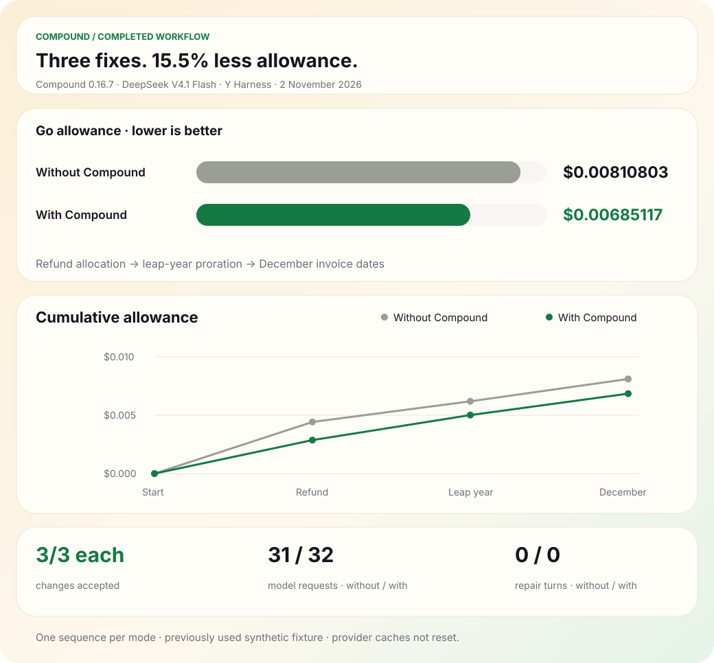
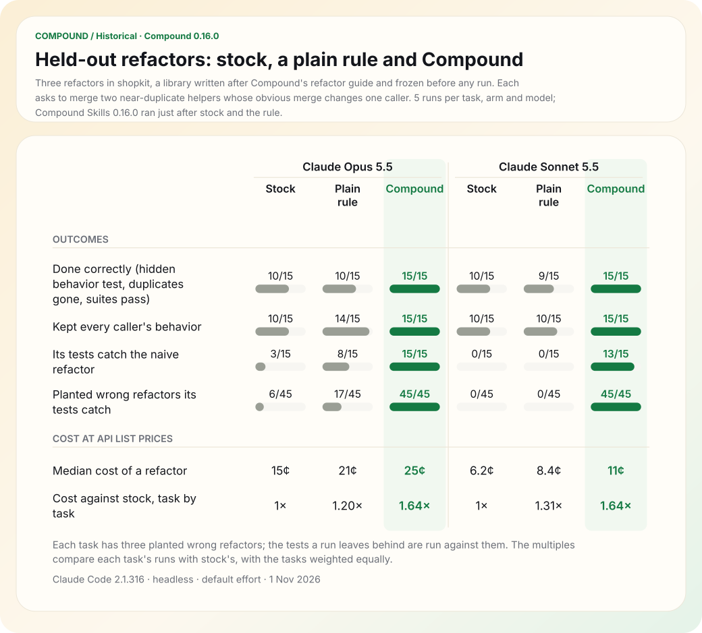
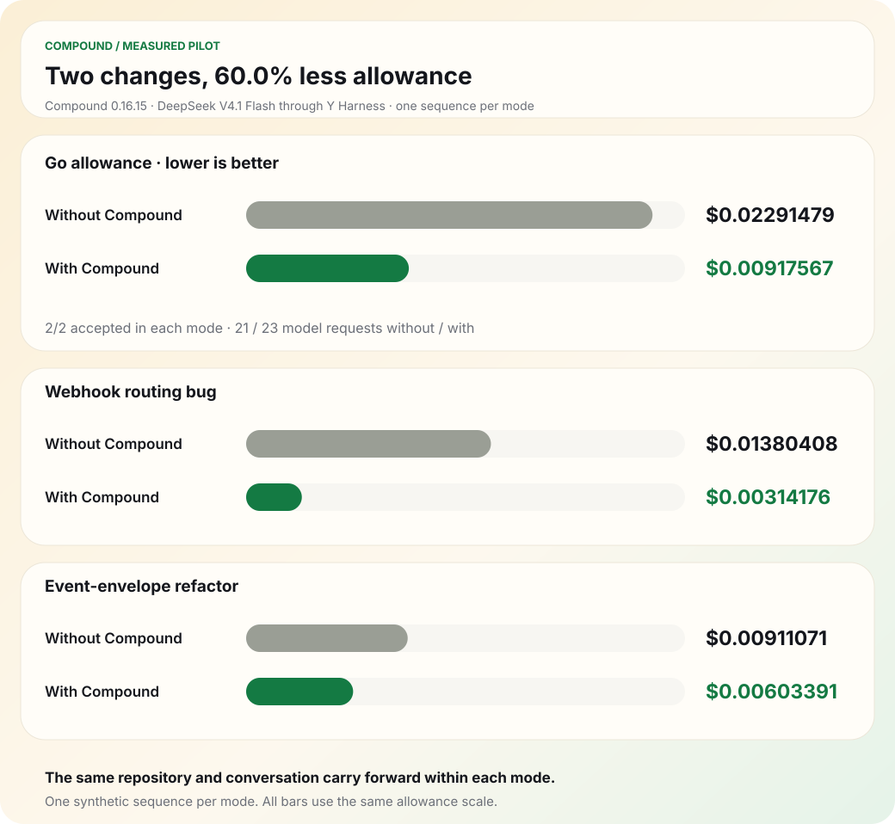
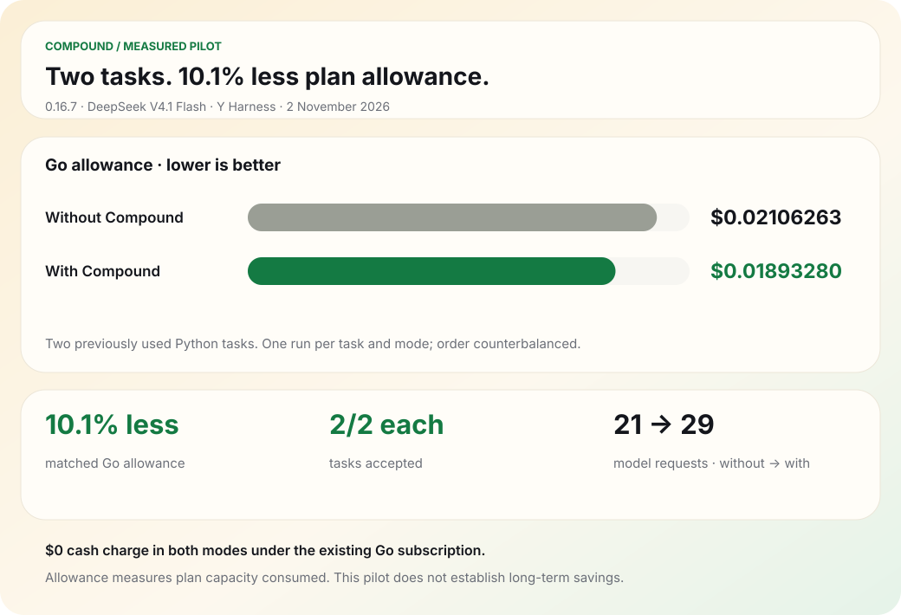
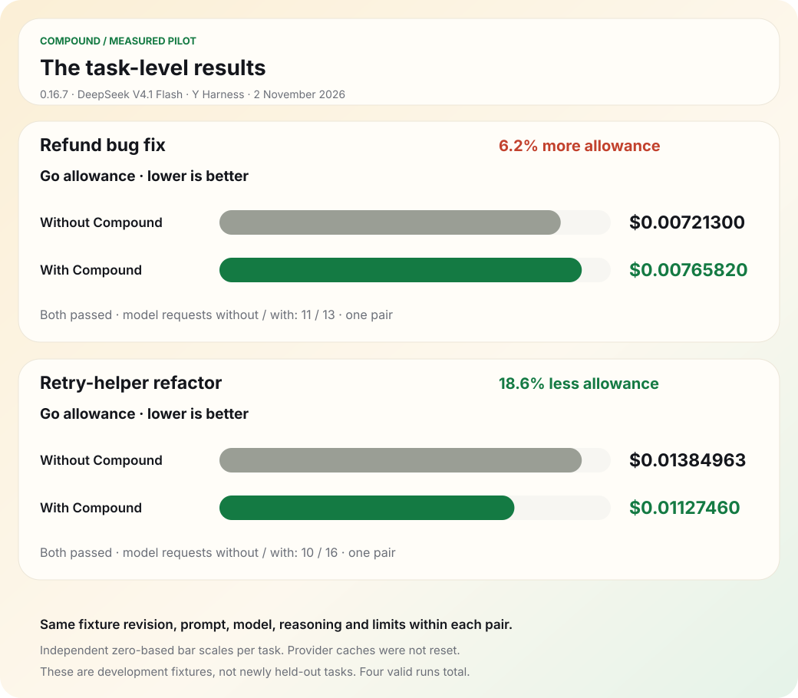
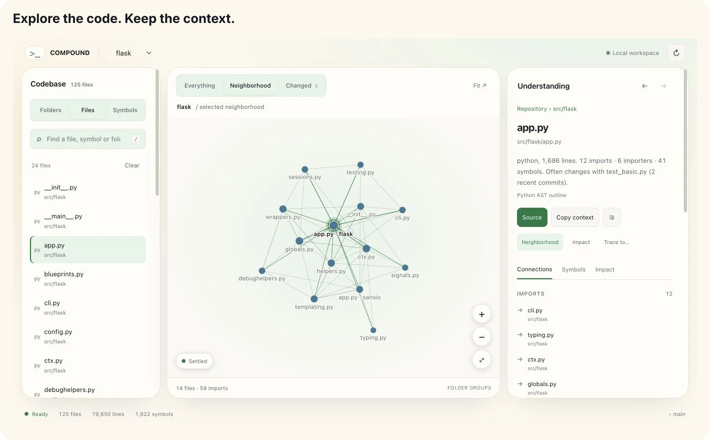
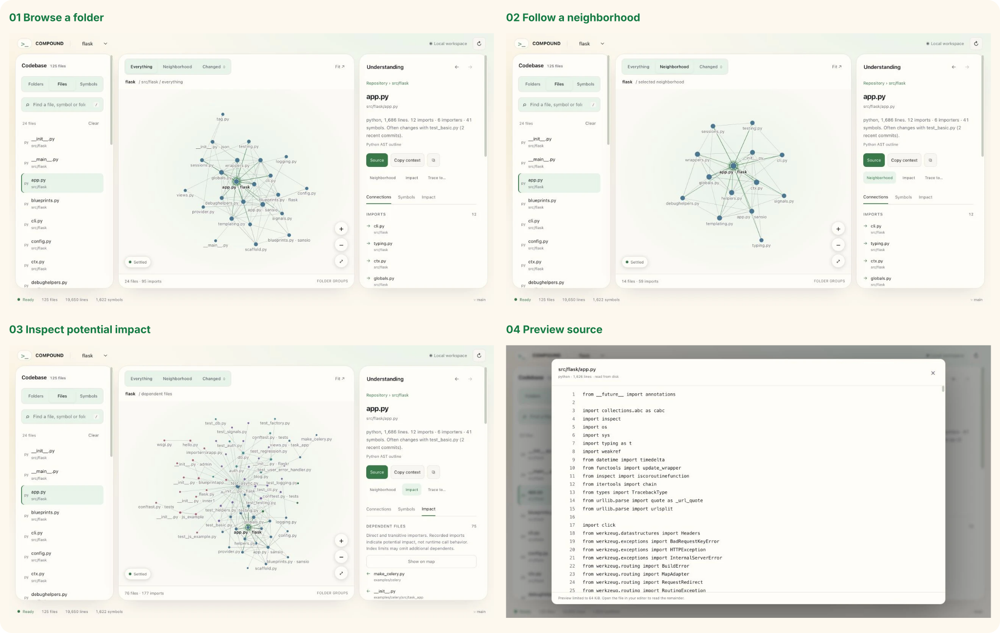
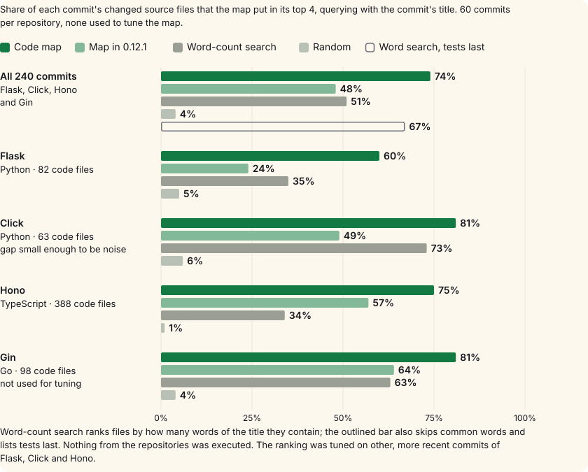

<h1 align="center">Compound Skills</h1>

<p align="center"><strong>Make your coding agent show its work.</strong><br>It has your agent reproduce a bug and show the new test failing before fixing it, keep every caller's behavior through a refactor, and commit without AI co-author lines. Plus a live map of your code.</p>

<p align="center">Free, open-source (MIT) plugin for Claude Code, Codex and Cursor · needs Python 3.11+ and Git<br>Version 0.16.17 · Claude Code benchmarks: 31 October–1 November 2026 · DeepSeek workflows: 2–4 November 2026 · not affiliated with Every's Compound Engineering plugin</p>

<p align="center"><a href="#should-you-use-it">Should you use it?</a> · <a href="#install">Install</a> · <a href="#benchmark">Benchmark</a> · <a href="#the-code-map">Code map</a> · <a href="#limits">Limits</a></p>

Turn it on once and every project gets task-specific guidance: bug fixes reproduce the defect with a failing regression test before source edits, then run the final suite; refactors pin current behavior; reviews inspect source first and stop reproduction work after execution is denied. Commits omit AI co-author lines, and the final response lists checks and limits. For refactors, new features, performance work and PR authoring, the agent also loads Compound's skill: a short guide for that kind of work and a local map of the code.

**Fresh two-change pilot — Compound 0.16.15:** **60.0% less OpenCode Go allowance**, with **2/2 changes correct in both modes**. This was one synthetic Python sequence per mode. [Results and scope](#fresh-two-change-comparison).

**Earlier bug-fix sequence — Compound 0.16.7:** a sequence of three bug fixes on the invoicekit fixture consumed **15.5% less OpenCode Go allowance**, with **3/3 changes correct in both modes**. The full six-change workflow is now completed in both modes, including repairs; two unreported provider costs prevent an exact overall savings claim. [Results and scope](#completed-workflow-six-changes-with-repairs).



**Where Compound stands out:** in the larger historical refactor benchmark, both models completed 15/15 caller-sensitive refactors correctly with Compound, versus 10/15 without it. The tests Compound left behind caught every planted wrong refactor. That is the strongest measured reason to use it; those runs also cost more. [Refactor results](#refactor-correctness).



## Should you use it?

Use Compound when a change needs evidence that behavior is preserved: a failing regression before a bug fix, caller comparisons before a refactor, and final checks that cover the edited code. Its map helps when you do not yet know where a feature lives or how files connect. Named files and known symbols go straight to the source or native navigation, so a map query does not become a mandatory extra step.

- **Refactors:** 30/30 correct across two models, versus 20/30 without Compound, in the historical held-out tasks. Tests caught 90/90 planted wrong refactors, versus 6/90. [Correctness and cost](#refactor-correctness).
- **Bug fixes:** nearly the same number fixed, with a new test shown failing before source edits in 48/48 runs, versus 1/48 without Compound. [Real bugs](#real-bugs).
- **File discovery:** the map found 74% of changed source files in its top four, versus 67% for a word search that also skips common words and lists tests last, over 240 held-out commits. [Map evidence](#does-it-find-the-files-a-change-touches).
- **Cost.** The fresh two-change pilot used 60.0% less Go allowance with both modes correct. The earlier three-bug sequence used 15.5% less. Historical refactors cost more, and the six-change workflow has unreported charges. [All workload results](#benchmark).

The larger historical runs used Compound 0.16.0 in Claude Code on Python projects. The DeepSeek results shown here used 0.16.7 or 0.16.15 through Y Harness. Prompt and code changes since those runs are distinguished from measured outcomes. [Limits](#limits).

**What changes on your machine:** `setup-global` installs Compound's default routing in supported hosts and Claude Code allow rules for its own guides and map query. The map uses a user cache outside your repository and a service on `127.0.0.1:43127`; its scripts connect only to loopback. Project cleanup runs only when you explicitly request `setup`. Commits follow project conventions and omit AI co-author/generated-by lines. [Installation and removal details](#what-it-changes-on-your-machine).

For the bug-fix habits alone, a small user rule is also a reasonable option; its measured results and the exact rule remain in the [historical controls](bench/historical-comparisons.md#isnt-this-just-a-rule-in-claudemd). Every's Compound Engineering and pstack provide larger planning and orchestration workflows; their separately measured results remain in the [historical comparison](bench/historical-comparisons.md#compared-with-other-plugins).

## Install

1. Install the plugin at **User** scope in each app you use (below).
2. Start a new chat (`/reload-plugins` also works in Claude Code) and turn Compound on for every project, once, from any app:<br>
   `/compound-skills:setup-global` in Claude Code<br>
   `$setup-global` in Codex<br>
   `/setup-global` in Cursor
3. Start a new chat and just ask for what you want.

To try it first without saving any setting, type `compound` in one chat (`/compound-skills:compound` in Claude Code, `$compound` in Codex, `/compound` in Cursor). After updating the plugin, run `setup-global` again: saved rules keep their old text, and `status-global` warns when they are out of date.

### Claude Code

```text
/plugin marketplace add tobenwarrior/compound-skills
/plugin install compound-skills@compound-skills
```

### Codex

```sh
codex plugin marketplace add tobenwarrior/compound-skills
codex plugin add compound-skills@compound-skills
```

### Cursor

1. Open **Customize → Plugins → Add → From GitHub Repository**.
2. Enter `https://github.com/tobenwarrior/compound-skills`, choose **User** scope, then **Import**.
3. Click **Add** or **Install** beside `compound-skills`, and keep its `compound-default` rule set to **Always** in **Customize → Rules** (set it to **Manual** to turn Compound off). See [Cursor's plugin docs](https://cursor.com/docs/plugins).

### What it changes on your machine

- **Claude Code and Codex:** `setup-global` sets up each of them whose configuration folder exists, from whichever app you run it, and names any it skipped: the rule `~/.claude/rules/compound-skills.md` (it respects `CLAUDE_CONFIG_DIR`), and a marked section in `$CODEX_HOME/AGENTS.md` and in an existing nonempty `AGENTS.override.md`. To set up one app only, or an app whose folder does not exist yet, say so when you run it.
- **Claude Code permissions:** `setup-global` also has the agent add allow rules to `~/.claude/settings.json`, so the map query and Compound's guides need no approval in each task: `Bash(python3 -B <skill folder>/scripts/code_map.py:*)`, the same without `-B`, and `Read(//<skill folder>/**)`. They name the installed folder, which changes when the plugin updates, so run `setup-global` again after an update.
- **Cursor:** the plugin carries its own `compound-default` rule; `setup-global` writes no Cursor rule.
- **State folder:** `~/.cache/compound-skills` (`COMPOUND_SKILLS_STATE_DIR` moves it) holds the map's cache and a record of which repositories a project `setup` assessed. During `setup-global`, the agent also adds this folder to Codex's `sandbox_workspace_write.writable_roots` in `config.toml` and to Cursor's `additionalReadwritePaths` in `~/.cursor/sandbox.json`, following the [activation guide](skills/compound/references/activation.md): back up and validate each file, and keep every other setting. The agent makes these two edits, not Compound's scripts.
- **The map service** listens on `127.0.0.1:43127` (`COMPOUND_MAP_PORT` changes the port). It starts on the first map query of a task that may edit files, or on `map`, and runs until `map stop` or you log out. Web pages from other sites cannot query it, but any program or user on your machine can read its maps and source previews while it runs; on a shared machine, run `map stop` when you are done.
- **A project `setup`** adds a marked section to that project's `AGENTS.md`, a file you would commit, and the same section to a nonempty `AGENTS.override.md` or, when a `CLAUDE.md` would hide `AGENTS.md` from Claude Code, to `.claude/rules/compound.md`. It then assesses the project and may simplify or remove files it judges obsolete or redundant, tests included, as uncommitted changes for you to review; each deletion goes through your app's normal approval.
- **Not included:** hooks, MCP servers, other background processes, or network access. Compound's scripts connect to nothing but 127.0.0.1, and the map page loads nothing from elsewhere. Your code still goes to your model provider, as with any coding agent.

These are instructions to the agent, not enforcement; project instructions and your explicit requests take priority ([activation](skills/compound/references/activation.md)).

### Remove it

1. Run `compound disable global` from any app. It removes only the sections and rule files setup wrote, and the agent removes the Claude Code allow rules.
2. In Cursor, set `compound-default` to **Manual**, or remove the plugin.
3. Run `map stop` if the map service is running.
4. Uninstall the plugin in each app (in Claude Code, `/plugin uninstall compound-skills@compound-skills`).
5. Delete `~/.cache/compound-skills`, and its entry in Codex's `writable_roots` and Cursor's `additionalReadwritePaths` if you want them gone too.
6. In a project where you ran `setup`, run `compound disable` there to remove its sections; its cleanup was ordinary file changes, which Git can show and revert.

## Use it

Each command takes your app's prefix, for example `/compound-skills:map` in Claude Code, `$map` in Codex and `/map` in Cursor.

| What you want | Command |
| --- | --- |
| Turn it on for every project (once, from any app) | `setup-global` |
| Check that it is on | `status-global` |
| Assess and tidy the current project (the only time it changes files you did not name) | `setup` |
| Open the code map | `map` |
| Check or stop the map service | `map status`, `map stop` |
| Use it in this chat only | `compound` |
| Remove the global setting | `compound disable global` |

<details>
<summary>Exact command for each app</summary>

| What you want | Claude Code | Codex | Cursor |
| --- | --- | --- | --- |
| Turn it on for every project (once, from any app) | `/compound-skills:setup-global` | `$setup-global` | `/setup-global` |
| Check that it is on | `/compound-skills:status-global` | `$status-global` | `/status-global` |
| Assess and tidy the current project | `/compound-skills:setup` | `$setup` | `/setup` |
| Open the code map | `/compound-skills:map` | `$map` | `/map` |
| Use it in this chat only | `/compound-skills:compound` | `$compound` | `/compound` |
| Remove the global setting | `/compound-skills:compound disable global` | `$compound disable global` | `/compound disable global` |

</details>

## Benchmark

The DeepSeek workflows and larger historical rounds below use different runtimes and models; compare modes within a round. The historical harness in [bench/](bench/README.md) runs headless Claude Code in isolated sandboxes, one CPU per run, and grades what each run did and left behind. Run records stay local because they hold full transcripts; the commands [below](#reproduce-and-inspect) rerun the Claude Code rounds. The tasks are Python projects.

### Fresh two-change comparison

On a fresh dispatchkit fixture, Compound 0.16.15 used **60.0% less OpenCode Go allowance** with DeepSeek V4.1 Flash through Y Harness. Both modes completed **2/2 changes**. The sequence fixed a URL-encoded webhook route, then extracted a helper while preserving live and replay policies. The second grade rechecked the earlier fix. Both modes kept the original tests, and the new regression failed on the original source and passed on the changed source.



Without Compound used **$0.02291479** of allowance and **$0.03819131** of API list-price usage. With Compound used **$0.00917567** and **$0.01529278**. All four initial attempts passed. The runs used 21 model requests without and 23 with Compound. The recorded cash charge was $0 in both modes under the existing plan. [Complete usage and grades](bench/diagram_sources/comparison_dispatch_v01615.json).

Each mode had one sequence in an isolated copy of the same small Python repository. Source changes and conversation carried forward, and mode order reversed for the second task. The provider reported 65.9% of input tokens cached without Compound and 91.9% with Compound. Caches were left in their normal state. This pilot measures those billed runs. General and long-term savings need evidence across more projects and repetitions. [Workload and grading](bench/README.md#fresh-dispatchkit-sequence).

### Completed workflow: six changes with repairs

On 2–3 November 2026, DeepSeek V4.1 Flash through Y Harness completed all three invoicekit bug fixes and all three shopkit refactors in both modes. Each repository kept its code changes and native conversation across three tasks. **Both modes finished 6/6 changes correctly**, passing cumulative hidden checks, the original suite and their final suites; no original test was removed or weakened. Each mode needed one semantic repair on the slug refactor after changing a facet key from `café` to `cafe`.


**The bug-fix sequence used 15.5% less allowance with Compound:** $0.00685117 versus $0.00810803, with all three changes accepted in each mode and no repairs. Across the complete six-change workload, recorded minimums were **$0.03457468 without / $0.05793600 with Compound**. One provider response in each mode did not report final usage. These are lower bounds, not exact totals; the result **does not establish cheaper overall performance**. All completed responses reported a $0 cash charge under the existing Go subscription; missing charges remain unknown. [Numeric data, including every attempt](bench/diagram_sources/workflow.json).

<details>
<summary>Workflow setup, continuation and all experiment usage</summary>

The task groups and order were fixed before running: refund, leap-year and December-date fixes; then slug, retry and money-parser refactors. Mode order was counterbalanced within each task. Each mode started from the same frozen fixture revision and used the same prompts, tools, high reasoning setting, 8,192-token output cap and per-invocation limits. The treatment added only Compound's native skill provider and routing rule. The frozen Compound commit was `a467e56`; Y Harness was `71e8e99`. Tools ran through its SSH filesystem and subprocess providers in isolated Linux containers. Keyless checks exercised the actual read, search, write, edit and confined Bash tools and verified that host plans, graders and opposite-mode states were unavailable. No paid judge, title-model request or subagent tool ran.

A control provider timeout paused the comparison on 2 November. On 3 November, the owner authorized completion from the saved states under a bounded continuation plan; no successful task was rerun or failed attempt discarded. A treatment transport failure also required recovery. Both modes retained the original model, source, prompts and settings, with identical repair opportunities. All implementation, failed, repair and transport-recovery requests remain counted. The completed workflow used **133 model requests**, 61 without and 72 with Compound. Two responses have unreported costs.

Two earlier setup trials were invalid and excluded from performance comparisons: the first exposed benchmark-control files; the second had an incomplete shell/search integration and non-original initial states. They remain in the experiment audit. **All workflow experiment trials together:** 236 observed model requests; known usage of **$0.17377358 Go allowance / $0.28962264 API list-price usage / $0 recorded cash charge**, with **four responses of unknown final cost**. These amounts are not a complete bill. Preparation, preflights, grading and diagram rendering used no models.

This is one sequence per mode and repository on previously used synthetic Python fixtures. Provider caches were not reset, and the comparison resumed the next day after an outage. It measures these completed changes and actual repairs; it does not establish universal or months-long savings. Raw session records stay private; the public data retains source pins, prompt hashes, per-attempt grades, recorded usage and explicit unknowns. The earlier two-task pilot below is a separate experiment.

</details>

### Earlier two-task pilot: Compound 0.16.7



On 2 November 2026, DeepSeek V4.1 Flash through Y Harness completed the refund bug fix and retry-helper refactor once in each mode. Each pair used the same fixture revision, project path, prompt, tools, high reasoning setting, 8,192-token output cap and limits. Order was without/with for the refund and with/without for the refactor. The treatment added Compound's native skill provider and global routing rule; the control had neither. No paid judges, provider retries, title-model calls or subagent sessions ran.



**Matched total:** $0.02106263 without versus $0.01893280 with Compound in provider-reported Go allowance, **10.1% less in this pilot**. API list-price usage was $0.03510438 versus $0.03155470. Both modes had a **$0 cash charge** under the existing subscription: consuming less allowance does not lower the fixed monthly fee. These are saved API response amounts, not token-price estimates; [OpenCode's accounting documentation](https://opencode.ai/v2/docs/console/api/inference#cost) distinguishes the fields.


All four valid runs passed the task-specific hidden checks, the original suite on the changed code and the run's final suite; the refactor also removed the duplicate retry loops. Mutation checks measure test strength, not extra successful tasks. These were **previously used development fixtures, one pair each**; provider caches were not reset. The result cannot separate sampling and cache variation from a general effect or establish cheaper behavior on other tasks or over the long run.

One invalid setup attempt did not activate editing tools and stopped at its request cap. Its $0.00686204 allowance is excluded from the matched comparison. **All experiment attempts**, including that failure: 70 model requests, $0.04685747 allowance, $0.07809583 API list-price usage and $0 cash charge. The [saved numeric data](bench/diagram_sources/pilot.json) includes both matched and all-attempt totals and the frozen source pins; private request records and transcripts are not published.

### Refactor correctness

**Compound's clearest measured advantage is preserving behavior across callers.** Three held-out refactors ask the agent to merge helpers with subtly different URL, retry and money-parsing behavior. Across 15 runs per mode and model, Compound completed **15/15 correctly with each model**, versus **10/15 without Compound**. Its new tests caught **45/45 planted wrong refactors with each model**, versus 6/45 and 0/45 without it.


These are Compound 0.16.0 / Claude Code results. All control failures came from one of the three tasks, so this is evidence for caller-sensitive refactors, not a universal success rate. The cost was **1.64× the cost without Compound**, task-weighted, with each model. [Tasks, controls and scoring](bench/historical-comparisons.md#held-out-refactors).

### Real bugs

Twelve upstream bugs across Flask, Click, attrs, packaging and marshmallow, two runs per bug and model. Both modes received the same pre-fix source and symptom report; upstream regression tests stayed hidden.


Compound changed the verification process much more than the number of bugs fixed. The task-weighted cost was **1.09× with Opus and 1.14× with Sonnet**; median time was 66 versus 41 seconds and 36 versus 24 seconds. These 0.16.0 runs precede the prompt reductions and routing changes now shipped. [Every bug, result and upstream fix](bench/historical-comparisons.md#real-bugs).

### Reviews, questions and cost

The historical review task showed **no finding advantage**: both modes found all three defects. In the side-by-side 0.16.0 round, reviews cost 1.61× the cost without Compound with Opus and 2.21× with Sonnet. Questions covered a median of 11/11 key points with Opus and 9/11 with Sonnet in both modes. Compound now keeps reviews and questions out of the full engineering skill and stops reproduction work after execution is denied. The latest prompt changes have not been measured in new agent runs. [Review evidence](bench/historical-comparisons.md#where-it-doesnt-help-reviews).

The fresh two-change pilot, the DeepSeek bug sequence and the earlier pilot show scoped allowance savings; the completed six-change workflow does not establish overall savings. Neither the historical correctness gains nor smaller map summaries establish that Compound is always cheaper. We include failed implementations and repairs when comparing cost.

### Removing extra model work

The saved Y Harness / DeepSeek V4.1 Flash workflow used **72 requests with Compound versus 61 without**. The largest gap was the slug refactor, 24 versus 16, including repairs. The [call audit](bench/diagram_sources/work_audit.json) links those steps to known-file navigation, unrelated reads, behavior changes, rejected edits and overlapping verification.

0.16.9 makes focused map text omit candidates without query evidence, keeps full ranking and metadata in JSON/the viewer, and tightens prompts around caller baselines, edit prerequisites and extra probes. Replaying the saved slug query produces **6 navigation suggestions instead of 12**, with identical full ranked metadata; two of the four unrelated modules read in the trace are no longer suggested. The regression remains the bug reproduction, and the final suite is still required. These are code/output checks and saved failure evidence, **not a new measurement of model calls or total savings**. [Replay and limits](bench/README.md#saved-model-work-audit).

### Reproduce and inspect

The main graphics use exactly two modes: **without Compound** (the runtime's ordinary tools and defaults) and **with Compound** (the same setup plus Compound's routing and skill). A map ranking chart compares ordinary word search with Compound's map; it does not measure an agent completing a task. Compare within an experiment, since models, versions and workloads differ.

The [historical methodology](bench/historical-comparisons.md) retains all plain-rule controls, other-plugin comparisons, map-on/off ablations, individual results and scoring corrections. The [benchmark guide](bench/README.md) documents source pins, task fixtures and reproduction commands. Public [pilot](bench/diagram_sources/pilot.json) and [workflow](bench/diagram_sources/workflow.json) data contain recorded usage and grades; raw transcripts stay local.

With the [Linux requirements](bench/README.md#requirements) in place, this runs stock and the current checkout on the same real bugs and held-out refactors. It makes paid model calls; no such run was made for this README update:

```sh
python3 bench/bench.py setup
python3 bench/bench.py run --label check --arms without,with --tasks real,heldout --models sonnet
python3 bench/bench.py report --label check
```

## The code map



- **Explore it.** Hover a file to light up its connections, drag it to pull its neighbors along, and scroll or pinch to zoom.
- **See what a change touches.** **Impact** shows the files that import the one you picked, directly or through other files, as far as the map resolves imports. **Trace** finds how two files connect, and **Changed** shows your Git edits and their neighbors.
- **Read without switching apps.** Search files, folders, and symbols, preview source, and copy a compact summary into your chat.
- **Your agent can ask it first.** The agent uses named files and current context directly, and queries the map only to locate unknown files or dependencies. It reuses an unchanged map for the same question. In the 0.16.0 round it did so in 20 of the 36 refactor and review runs; each held-out refactor names its two files, and Sonnet usually skipped the query there.
- **Languages.** Imports are linked for Python, JavaScript, TypeScript, Go, and Rust. Symbols are outlined for those plus Java, C, C++, C#, Ruby, PHP, Swift, and Kotlin.



The viewer and README charts share the hey.trading cream-and-green theme, including source previews and mobile panels. After updating the plugin, reopen `map` to refresh the service’s assets and reload any existing browser tab.

The map opens at `http://127.0.0.1:43127/` and keeps its data in your user cache, outside the repository. Coverage and limits: [code maps](skills/compound/references/map.md).

### Query overhead

The map is optional for agents: use named files and native symbol navigation directly; query it when the relevant files or dependencies are unknown. A warm index avoids reparsing unchanged source, but starting a service and ranking candidates still cost local time. Cache timings and smaller summaries are implementation measurements, not evidence of lower agent cost.

The current query implementation pins the repository directory once while reading candidate files, instead of walking all root ancestors for each candidate. Reads remain fresh and reject symlinks; ranking, candidate limits and returned paths are unchanged in the offline comparison. [Local profiling and reproduction](bench/README.md#profile-local-map-queries). Earlier [cache timings](bench/historical-comparisons.md#map-cache-timings) and [summary-density measurements](bench/historical-comparisons.md#map-summary-density) remain separate from the without/with comparisons.

### Does it find the files a change touches?

**Without Compound: 67%. With Compound's map: 74%.** This is the average share of a commit's changed source files present in the top four results, over 240 held-out commits from Flask, Click, Hono and Gin. Both modes use the same commit title and parent snapshot. The control skips common words and lists tests last, so it is the stronger saved word-search baseline.



The map combines path and symbol matches, bounded content reads and import connections. This result is **7 percentage points more file recall**, not a measured coding-task speedup. Gains were small on Click and Gin; the control already found many targets. The snapshots had no history, so co-change hints contributed nothing. [Ranking method, per-repository results and weaker controls](bench/historical-comparisons.md#map-file-ranking).

The saved agent map ablation mostly used tasks that named the files to edit. Removing the query changed little and reduced cost by about 2%, within noise. It neither establishes a large navigation benefit nor diagnoses a broken map. An unknown-file, multi-hop task would test that benefit more directly; it has not been measured here. [Map ablation](bench/historical-comparisons.md#does-the-map-query-pay-for-itself).

## Limits

- **Agent tasks are Python projects.** Historical rounds used headless Claude Code; the latest small pilot and workflow used DeepSeek through Y Harness. Codex and Cursor load the same skills but have not been benchmarked here. File-ranking checks also include TypeScript and Go.
- **Small samples.** 2 runs per real bug, 5 per held-out refactor and 3 per review or question, for each arm and model, can miss small effects; the review and question cost multiples rest on 3 pairs each, and on 2 in the smaller second round.
- **0.16.0 was chosen after seeing this round.** Its always-on rule was written after the first runs of these real bugs and refactors, then measured on the same tasks just after the other arms; the second round ran it beside them, on the same tasks, so neither is a held-out test of the rule. The refactor guide it loads was written before the held-out refactors.
- **Three held-out refactors.** Stock and the rule failed only one of them, the slugs refactor, but failed it in all 20 of their runs; more refactor tasks would show how often such a trap comes up.
- **An easy review.** Every arm found all three planted defects in every review, so that task could show neither a gain nor a loss.
- **Tuned on the controlled tasks.** In the 0.14.0 rounds, Compound's rule sentence and refactor guide were revised after earlier runs of the same six tasks.
- **The habit measures are Compound's own checklist,** and the plain rule names them too; the outcomes are what tests and the judge measured.
- **The judge** is Claude Opus 5.5, also one of the agents under test.
- **Other plugins** were measured only against 0.14.0, as we set them up, on tasks of our choosing, and the benchmark's author also wrote Compound; their larger workflows were not tested.
- **The map's** effect on outcomes was too small to measure; its ranking was tuned on other Flask, Click and Hono commits.
- **Instructions, not enforcement.** Compound asks the agent; it cannot force it.

## Reference

### What each guide asks for

Compound has one short guide for each kind of work and tells the agent to read the one that fits; the benchmark exercised the debug, refactor, review, investigate and Git guides.

| Workflow | What the guide asks for |
| --- | --- |
| [Investigate](skills/compound/references/investigate.md) | Trace how the code really behaves before answering |
| [Design and implement](skills/compound/references/design.md) | Start from how callers will use it and make states and ownership explicit |
| [Debug](skills/compound/references/debug.md) | Reproduce the bug, find the cause, and add a regression test |
| [Refactor](skills/compound/references/refactor.md) | Record current behavior, then prove it did not change |
| [Performance](skills/compound/references/performance.md) | Measure before and after on the same workload |
| [Review](skills/compound/references/review.md) | Report concrete problems with location, trigger, and impact |
| [Verify](skills/compound/references/verify.md) | Run checks that could prove the change wrong and say what is unverified |
| [Repository hygiene](skills/compound/references/repo-hygiene.md) | Flag clutter, oversized files, unused scripts, and `.gitignore` gaps |
| [Git and pull requests](skills/compound/references/git.md) | Write clear commits and PRs with real check results and human authorship |

### What loads when

- **Every request:** the always-on rule and the plugin's skill list. The benchmarked rule added about 510 tokens; the shorter rule below has not been remeasured in a host.
- **Refactors, new features, performance work and PR authoring:** the `compound` skill and needed references. Query the map only for unknown files or dependencies.
- **When a task needs it:** the matching guide. Behavior-preserving extractions use the refactor guide for caller checks and helper design. The verification guide covers independent verification or an unresolved evidence gap.
- **Bug fixes, reviews and questions:** only the always-on rule. Reviews inspect source first, execute only necessary permitted checks, and stop execution after denial; review findings do not start the bug-fix workflow. In the second 0.16.0 round, the skill loaded in 1 of 24 bug-fix runs and in none of 8 review and question runs. Typing `compound` still loads the skill, and the review guide, for a review.
- **One chat only:** typing `compound` alone applies the always-on rule's habits to every task in that chat and the skill to the same kinds of work, as a saved setup does.

SKILL.md also holds engineering guidance: use supplied code and known files first, query the map only for unknown files or dependencies, delegate independent work when useful, and keep frontend tooltips to at most two visible lines. Explicit review-only requests go directly to the review guide. Read it before you turn Compound on.

The always-on rule, word for word, as `setup-global` saves it (compacted after the recorded runs; billed cost and behavioral equivalence have not been remeasured):

> Review-only: inspect diff/callers/tests; execute only for unresolved findings when permitted; after denial, stop repro work and continue from source. Bug fixes: one defect-specific failing regression is the reproduction before source edits; run the final full suite. Refactors: preserve differing caller policies explicitly; characterize callers before baseline; compare afterwards. Use documented test commands; inspect setup errors before retrying. Prevent untracked test outputs with supported options. Omit AI co-author/generated-by commit lines. Read narrowly; honor current-turn read/edit prerequisites. For refactors, new features, performance and PR authoring, load `compound`; read relevant references. Follow project instructions and user scope. Report checks/limits and Compound load failures.

### Commits

Your project's conventions come first; otherwise subjects follow Conventional Commits (`fix: …`). The exception is AI credit: the always-on rule asks for commits without AI co-author trailers or generated-by lines, even when a template or earlier commits have them, and the [Git guide](skills/compound/references/git.md) keeps human co-authors, sign-offs, factual AI-use disclosures your project requires, and your configured Git identity. Compound defers to explicit project instructions, so if your organization requires an AI co-author line, say so in `AGENTS.md` or `CLAUDE.md`, for example: “Add a Co-authored-by trailer for the AI assistant to every commit.” We have not tested that override.

## Credits

Adapted selectively from Lauren Tan's [pstack](https://github.com/cursor/plugins/tree/main/pstack), which is also one of the benchmark arms, with lineage from earlier Karpathy-inspired guidelines and the Claude-Mem local-service concept. Not affiliated with Every or its Compound Engineering plugin. See [SOURCES.md](SOURCES.md), [third-party notices](THIRD_PARTY_NOTICES.md), the [changelog](CHANGELOG.md) and the [MIT license](LICENSE).

<!-- README SVGs are generated; see bench/diagram_sources/README.md. -->
