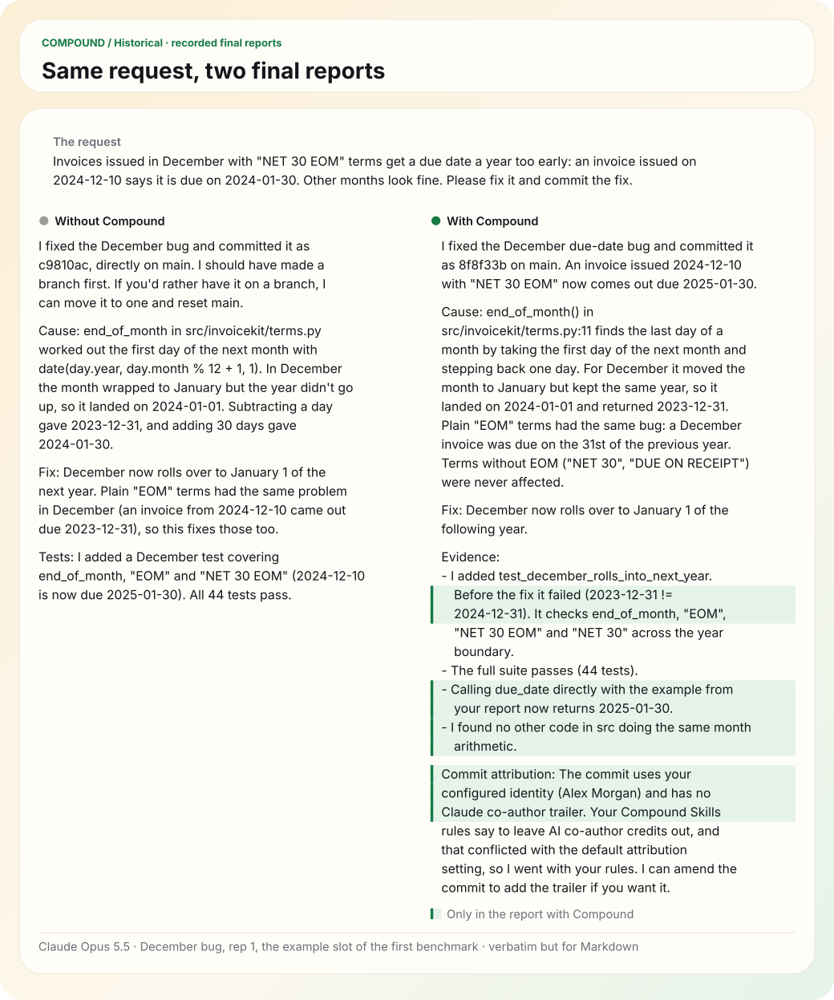
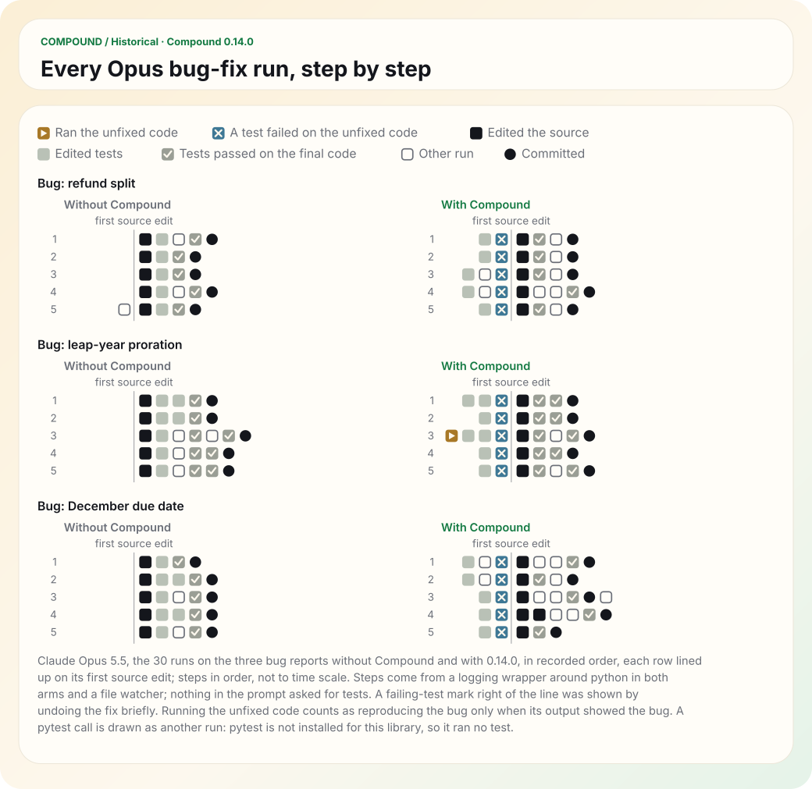
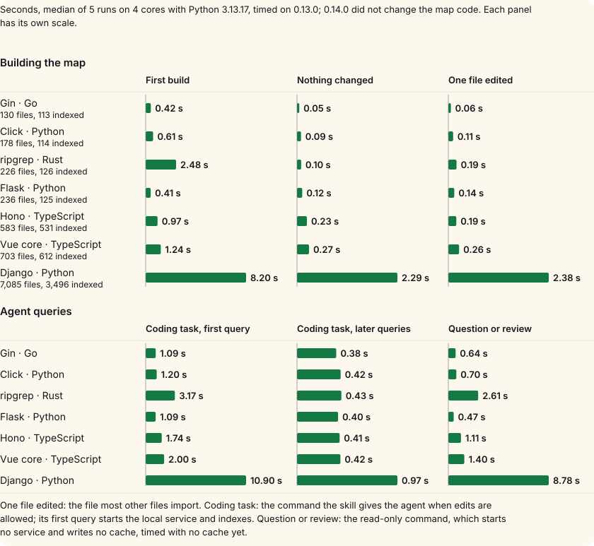
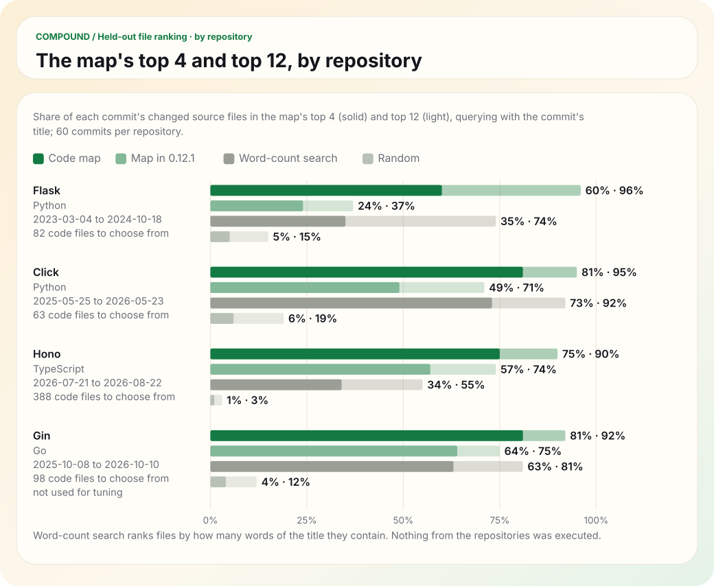

<h1 align="center">Compound Skills</h1>

<p align="center"><strong>Make your coding agent show its work.</strong><br>It has your agent reproduce a bug and show the new test failing before fixing it, keep every caller's behavior through a refactor, and commit without AI co-author lines. Plus a live map of your code.</p>

<p align="center">Free, open-source (MIT) plugin for Claude Code, Codex and Cursor · needs Python 3.11+ and Git<br>Version 0.16.0 · benchmarked in Claude Code 2.1.316 and 2.1.312 on 31 October and 1 November 2026 · not affiliated with Every's Compound Engineering plugin</p>

<p align="center"><a href="#should-you-use-it">Should you use it?</a> · <a href="#install">Install</a> · <a href="#benchmark">Benchmark</a> · <a href="#the-code-map">Code map</a> · <a href="#limits">Limits</a></p>

Turn it on once and every project gets an always-on rule: reproduce a reported bug, show a new test failing on the unfixed code before you edit the source, run the full test suite after your last change, pin behavior before a refactor, commit without AI co-author lines, and list what you ran and did not verify. For refactors, new features, performance work and pull requests, the agent also loads Compound's skill: a short guide for that kind of work and a local map of the code.

We measured it against stock Claude Code and against a plain five-sentence rule asking for the same debugging habits, on the same tasks, with Claude Opus 5.5 and Claude Sonnet 5.5:

- **Refactors.** On 3 refactors written after Compound's guides and frozen before any run, 15 runs per model, Compound did all 15 correctly with both Opus and Sonnet. The rule did 10 and 9, and stock 10 and 10. The tests Compound's runs left behind caught all 45 planted wrong refactors with each model, against 17 and 0 for the rule's.
- **Bug fixes.** On 12 real bugs fixed upstream in 2026, with each fix's own tests hidden, all three fixed about as many. Compound and the rule both reproduced the bug and showed a failing test before the fix, which stock almost never did. Bug by bug, Compound cost 0.89× the rule's cost with Opus and 1.04× with Sonnet, and 1.09× and 1.14× stock's.

[Should you use it?](#should-you-use-it) · [Limits](#limits)

<p align="center">
  <picture>
    <source media="(prefers-color-scheme: dark)" srcset=".github/assets/benchmark-heldout-dark.svg">
    
  </picture>
</p>

## Should you use it?

**Yes, for Python work in Claude Code, unless most of it is reviews.** Compound got every held-out refactor right where stock Claude Code and a plain rule got about a third of theirs wrong, and it makes bug fixes come with evidence first, a reproduction and a test shown failing on the unfixed code, as the plain rule does and for about the rule's cost. In money, that is 1.09× to 1.14× stock's cost per bug fix and about 1.6× per refactor; questions cost about the same as stock, and reviews cost more for no measured gain. If you only want the bug-fix habits, [the plain rule](#isnt-this-just-a-rule-in-claudemd) gives you most of them.

All numbers come from runs of [bench/](bench/README.md) in headless Claude Code at default effort, on Python projects. The 0.16.0 numbers below are from 1 November 2026, in Claude Code 2.1.316; a [smaller second round](#second-round-side-by-side) in 2.1.312 ran every arm side by side and agrees with them; [earlier rounds](#earlier-rounds-with-0140) measured 0.14.0.

| Stock / plain rule / Compound 0.16.0 | Claude Opus 5.5 | Claude Sonnet 5.5 |
| --- | --- | --- |
| [3 held-out refactors](#held-out-refactors), 15 runs: done correctly | 10 / 10 / 15 | 10 / 9 / 15 |
| Held-out refactors: planted wrong refactors their tests catch, of 45 | 6 / 17 / 45 | 0 / 0 / 45 |
| [12 real bugs](#real-bugs), 24 runs: fixed, upstream's hidden tests pass | 20 / 20 / 20 | 19 / 18 / 18 |
| Real bugs: a new test shown failing before the fix | 1 / 24 / 24 | 0 / 18 / 24 |
| Real bugs: whole suite run on the final code | 18 / 23 / 22 | 10 / 24 / 24 |
| Real bugs: commits without an AI co-author line | 0 / 0 / 24 | 0 / 0 / 24 |
| [Cost against stock](#cost-and-time): a real-bug fix | 1× / 1.23× / 1.09× | 1× / 1.09× / 1.14× |
| Cost against stock: a held-out refactor | 1× / 1.20× / 1.64× | 1× / 1.31× / 1.64× |
| Cost against stock: [a question about Django](#where-it-doesnt-help-reviews), 3 runs | 1× / 1.10× / 1.05× | 1× / 0.97× / 1.17× |
| Cost against stock: [a Flask review](#where-it-doesnt-help-reviews), 2 runs in the second round, same findings | 1× / 1.57× / 1.61× | 1× / 2.28× / 2.21× |

**What you get**

- **Refactors that keep every caller's behavior.** On each held-out refactor, the obvious merge of two helpers changes one caller: product URLs or search keys, retrying a card charge after a lost connection, or the refunds API's validation. Compound's refactor guide has the agent pin each caller's current behavior with a test first. It got all three right in all 30 of its runs, while stock and the rule failed the product-URL one in all 20 of theirs. [Held-out refactors](#held-out-refactors)
- **Bug fixes with the evidence first.** The agent reproduces the bug, shows a new test failing before it edits the source, and runs the whole suite. A plain rule does much the same; Compound adds commits without AI co-author lines, which Claude Code's own `attribution` setting can also give you. [Real bugs](#real-bugs)
- **A map of your code.** On 240 commits held out from tuning, an average of 74% of the source files each commit changed were in the map's top 4, against 67% for a word search that skips common words and lists tests last. The agent queries it when the skill loads; in runs that left the query out, the habits were the same, one fewer bug was fixed, and cost was 2% lower, within noise, so it stays. [Does the map pay?](#does-the-map-query-pay-for-itself)

**What it costs**

- **About 9% (Opus) to 14% (Sonnet) more per bug fix than stock, and about 1.6× per refactor.** Bug by bug, a fix cost 1.09× and 1.14× stock's cost, about what the plain rule costs; a held-out refactor cost 1.64× with each model, against 1.20× and 1.31× for the rule, which got about a third of them wrong. A median fix took 66 seconds with Opus against stock's 41, and 36 against 24 with Sonnet. On a subscription, the extra comes out of your usage limits.
- **Reviews cost more for no measured gain.** Reviews and questions do not load the skill: on a held-out review, loading it found nothing the always-on rule alone did not (the same score in all 10 pairs), and leaving it out cut a review's cost to 0.75× (95% interval 0.72–0.78). The rule's extra steps remain: a Flask review cost 1.61× stock with Opus and 2.21× with Sonnet, about what the plain rule costs, for the same findings. [Where it doesn't help](#where-it-doesnt-help-reviews)
- **No extra permission prompts from Compound itself.** `setup-global` adds Claude Code allow rules for Compound's own map query and guides. In 12 held-out refactor runs under Claude Code's default permission mode with only those rules, loading the skill, the map query and reading guides never asked for approval; running tests still asks, as it does without Compound. Run `setup-global` from Claude Code: the rules name Claude Code's own copy of the plugin.
- **About 510 tokens on every request in the recorded runs** for the always-on rule and the plugin's skill list, against 210 for the plain rule.

**What it changes**

- **It asks the agent to stay in scope.** Compound tells the agent to change only what a request covers. The one command that may tidy or delete files you did not name is a project `setup`, and it runs only when you type it; `setup-global` turns Compound on without touching your projects.
- **Commits** follow your project's conventions, defaulting to subjects such as `fix: …`, with one exception: Compound leaves out AI co-author trailers and generated-by lines even when a template or earlier commits add them.
- **Your machine** gets Compound's rule for the installed apps among Claude Code and Codex (Cursor's comes with the plugin), Claude Code allow rules for Compound's own map query and guides, a cache folder, and a map service on `127.0.0.1:43127`. There are no hooks and no MCP servers, and Compound's scripts connect to nothing but 127.0.0.1. [What it writes and how to remove it](#what-it-changes-on-your-machine)

**Skip it, or use it in one chat only, if** most of your agent work is reviews, you are close to your plan's usage limit, or you need evidence for languages other than Python or for Codex or Cursor, where it has not been measured.

**Alternatives.** For the bug-fix habits alone, copy [the plain rule](#isnt-this-just-a-rule-in-claudemd) into `~/.claude/rules/` and set Claude Code's `attribution` setting to drop co-author lines: on the real bugs it matched Compound's fixes at about the same cost, though with Sonnet it skipped showing the failing test first in 6 of 24 runs, and it got about a third of the held-out refactors wrong. Every's Compound Engineering and pstack offer larger planning, review and orchestration workflows; in the 0.14.0 round, started with their own commands, they reproduced bugs first too, at 2–11× Compound 0.14.0's cost per Opus fix ([earlier rounds](#earlier-rounds-with-0140)).

## Install

1. Install the plugin at **User** scope in each app you use (below).
2. Start a new chat (`/reload-plugins` also works in Claude Code) and turn Compound on for every project, once, from any app:<br>
   `/compound-skills:setup-global` in Claude Code<br>
   `$setup-global` in Codex<br>
   `/setup-global` in Cursor
3. Start a new chat and just ask for what you want.

To try it first without saving any setting, type `compound` in one chat (`/compound-skills:compound` in Claude Code, `$compound` in Codex, `/compound` in Cursor). After updating the plugin, run `setup-global` again: saved rules keep their old text, and `status-global` warns when they are out of date.

### Claude Code

```text
/plugin marketplace add tobenwarrior/compound-skills
/plugin install compound-skills@compound-skills
```

### Codex

```sh
codex plugin marketplace add tobenwarrior/compound-skills
codex plugin add compound-skills@compound-skills
```

### Cursor

1. Open **Customize → Plugins → Add → From GitHub Repository**.
2. Enter `https://github.com/tobenwarrior/compound-skills`, choose **User** scope, then **Import**.
3. Click **Add** or **Install** beside `compound-skills`, and keep its `compound-default` rule set to **Always** in **Customize → Rules** (set it to **Manual** to turn Compound off). See [Cursor's plugin docs](https://cursor.com/docs/plugins).

### What it changes on your machine

- **Claude Code and Codex:** `setup-global` sets up each of them whose configuration folder exists, from whichever app you run it, and names any it skipped: the rule `~/.claude/rules/compound-skills.md` (it respects `CLAUDE_CONFIG_DIR`), and a marked section in `$CODEX_HOME/AGENTS.md` and in an existing nonempty `AGENTS.override.md`. To set up one app only, or an app whose folder does not exist yet, say so when you run it.
- **Claude Code permissions:** `setup-global` also has the agent add allow rules to `~/.claude/settings.json`, so the map query and Compound's guides need no approval in each task: `Bash(python3 -B <skill folder>/scripts/code_map.py:*)`, the same without `-B`, and `Read(//<skill folder>/**)`. They name the installed folder, which changes when the plugin updates, so run `setup-global` again after an update.
- **Cursor:** the plugin carries its own `compound-default` rule; `setup-global` writes no Cursor rule.
- **State folder:** `~/.cache/compound-skills` (`COMPOUND_SKILLS_STATE_DIR` moves it) holds the map's cache and a record of which repositories a project `setup` assessed. During `setup-global`, the agent also adds this folder to Codex's `sandbox_workspace_write.writable_roots` in `config.toml` and to Cursor's `additionalReadwritePaths` in `~/.cursor/sandbox.json`, following the [activation guide](skills/compound/references/activation.md): back up and validate each file, and keep every other setting. The agent makes these two edits, not Compound's scripts.
- **The map service** listens on `127.0.0.1:43127` (`COMPOUND_MAP_PORT` changes the port). It starts on the first map query of a task that may edit files, or on `map`, and runs until `map stop` or you log out. Web pages from other sites cannot query it, but any program or user on your machine can read its maps and source previews while it runs; on a shared machine, run `map stop` when you are done.
- **A project `setup`** adds a marked section to that project's `AGENTS.md`, a file you would commit, and the same section to a nonempty `AGENTS.override.md` or, when a `CLAUDE.md` would hide `AGENTS.md` from Claude Code, to `.claude/rules/compound.md`. It then assesses the project and may simplify or remove files it judges obsolete or redundant, tests included, as uncommitted changes for you to review; each deletion goes through your app's normal approval.
- **Not included:** hooks, MCP servers, other background processes, or network access. Compound's scripts connect to nothing but 127.0.0.1, and the map page loads nothing from elsewhere. Your code still goes to your model provider, as with any coding agent.

These are instructions to the agent, not enforcement; project instructions and your explicit requests take priority ([activation](skills/compound/references/activation.md)).

### Remove it

1. Run `compound disable global` from any app. It removes only the sections and rule files setup wrote, and the agent removes the Claude Code allow rules.
2. In Cursor, set `compound-default` to **Manual**, or remove the plugin.
3. Run `map stop` if the map service is running.
4. Uninstall the plugin in each app (in Claude Code, `/plugin uninstall compound-skills@compound-skills`).
5. Delete `~/.cache/compound-skills`, and its entry in Codex's `writable_roots` and Cursor's `additionalReadwritePaths` if you want them gone too.
6. In a project where you ran `setup`, run `compound disable` there to remove its sections; its cleanup was ordinary file changes, which Git can show and revert.

## Use it

Each command takes your app's prefix, for example `/compound-skills:map` in Claude Code, `$map` in Codex and `/map` in Cursor.

| What you want | Command |
| --- | --- |
| Turn it on for every project (once, from any app) | `setup-global` |
| Check that it is on | `status-global` |
| Assess and tidy the current project (the only time it changes files you did not name) | `setup` |
| Open the code map | `map` |
| Check or stop the map service | `map status`, `map stop` |
| Use it in this chat only | `compound` |
| Remove the global setting | `compound disable global` |

<details>
<summary>Exact command for each app</summary>

| What you want | Claude Code | Codex | Cursor |
| --- | --- | --- | --- |
| Turn it on for every project (once, from any app) | `/compound-skills:setup-global` | `$setup-global` | `/setup-global` |
| Check that it is on | `/compound-skills:status-global` | `$status-global` | `/status-global` |
| Assess and tidy the current project | `/compound-skills:setup` | `$setup` | `/setup` |
| Open the code map | `/compound-skills:map` | `$map` | `/map` |
| Use it in this chat only | `/compound-skills:compound` | `$compound` | `/compound` |
| Remove the global setting | `/compound-skills:compound disable global` | `$compound disable global` | `/compound disable global` |

</details>

## Benchmark

Every agent result comes from [bench/](bench/README.md). It runs headless Claude Code in isolated sandboxes, one CPU per run, and grades what each run did and left behind. The run records stay local because they hold full transcripts; the commands [below](#how-we-measured-and-check-our-numbers) rerun them. All tasks are Python projects, in Claude Code 2.1.316 at default effort.

- **0.16.0 round, 1 November 2026:** stock, the plain rule, Compound before its 0.16.0 redesign, and that version without its map query ran side by side on 12 real bugs (2 runs per bug, arm and model), 3 held-out refactors (5 runs each) and a Flask review (3 runs). The redesign, which is 0.16.0, ran just after them on the same tasks and is paired with them by task, model and repetition. Stock, the rule and 0.16.0 then ran side by side on a Django question and a plain question (3 runs each).
- **Second 0.16.0 round, 1 November 2026:** stock, the plain rule, Compound before its redesign and 0.16.0 as shipped started together in every group, in Claude Code 2.1.312, on the same 12 real bugs (1 run per bug, arm and model), 3 held-out refactors, the Flask review, the Django question and the plain question (2 runs each). [Second round](#second-round-side-by-side)
- **Earlier rounds with 0.14.0, 31 October 2026:** six controlled tasks written for this benchmark, which Compound was partly tuned on, against stock, the rule and two other plugins; and the same 12 real bugs against stock. [Earlier rounds](#earlier-rounds-with-0140)

Outcome measures are hidden tests, upstream's own tests, planted wrong fixes and refactors, and a blind judge. The habit measures check Compound's own instructions, so read them as compliance with its checklist.

### Held-out refactors

Three refactors in shopkit, a small library written after Compound's refactor guide and frozen in commit f2faf1f before any agent ran it. Each asks to merge two near-duplicate helpers whose obvious merge changes one caller:

- **Slugs:** product URLs strip accents and cap their length, while search facet keys keep letters and punctuation.
- **Retries:** a card charge must not be retried after a lost connection, since it may already have gone through, while webhook deliveries retry more often and back off further.
- **Money:** the supplier importer accepts `$` and accounting negatives such as `(12.00)` and rounds half up, while the refunds API rejects both and rounds half to even.

Hidden tests check every caller through the public API, and each task has three planted wrong refactors that the tests a run leaves behind should catch. Before any measured run, three agents asked to refactor carefully each passed every check, so each task can be done right as posed.

Compound got all three right in all 30 of its runs. Stock never got the slugs refactor right: in all 10 of its runs, the merged helper changed product URLs or facet keys. The rule did the same in all 5 Sonnet runs; with Opus, it kept the behavior in 4 runs by leaving both helpers in place, which the task asked it to remove, and changed it in the fifth. On retries and money, stock and the rule got 39 of 40 runs right; the miss was a Sonnet run with the rule that left the money helpers in place. The tests each run left behind tell the same story: Compound's caught all 45 planted wrong refactors with each model, the rule's 17 with Opus and 0 with Sonnet, and stock's 6 and 0; with Sonnet, no test left by stock or the rule caught the obvious merge. A refactor cost 1.64× with each model stock's cost, where the rule cost 1.20× and 1.31×.

### Real bugs

Each run got the project at the commit before the upstream fix, with its history and test suite, and a report that describes only the symptom. The fix's own new tests stayed hidden, and the project's whole suite had to pass.

<picture>
  <source media="(prefers-color-scheme: dark)" srcset=".github/assets/benchmark-real16-dark.svg">
  
</picture>

All three fixed about as many bugs: 20, 20 and 20 of 24 runs with Opus (stock, rule, Compound), and 19, 18 and 18 with Sonnet. Compound and the rule reproduced the bug and showed a new test failing before editing the source in nearly every run; stock did either in at most 2 runs per model, and showed a new test failing at any point in 14 Opus and 4 Sonnet runs, after its fix, with the fix set aside. With Sonnet, the rule skipped showing the failing test first in 6 runs where Compound did not (McNemar p = 0.03). Compound and the rule also ran the whole suite on the final code more often: 22 and 23 of 24 runs against stock's 18 with Opus, and 24 and 24 against 10 with Sonnet.

Bug by bug, the three fixed each bug equally often, except attrs with Sonnet. No run of the three fixed two bugs, because upstream's tests also cover a case the report did not mention: click's progress bar, which upstream also tests through `bar.update()` where the report describes a loop, and packaging's dependency groups, where upstream also requires a group included twice to be reported once. With Sonnet, every attrs fix by the rule and by Compound passed the project's suite but failed one of upstream's tests, which expects a class's `__replace__` to show its own name rather than `evolve`'s; one of stock's two runs passed it. The extra steps take time: a median fix took 66 seconds with Opus against stock's 41, and 36 against 24 with Sonnet.

<details>
<summary>The 12 bugs</summary>

- **flask**, fixed 2026-07-14: `app.run()` crashes on an IPv6 `SERVER_NAME` ([fix](https://github.com/pallets/flask/commit/7203feabf723)). Fixed in Opus 2 / 2 / 2; Sonnet 2 / 2 / 2 of 2 runs (stock / rule / Compound).
- **flask**, fixed 2026-07-14: the test client loses the session with an IPv6 `base_url` ([fix](https://github.com/pallets/flask/commit/de8429ffda8c)). Fixed in Opus 2 / 2 / 2; Sonnet 2 / 2 / 2 of 2 runs (stock / rule / Compound).
- **click**, fixed 2026-08-28: pickling a click option fails ([fix](https://github.com/pallets/click/commit/f58ca3e81424)). Fixed in Opus 2 / 2 / 2; Sonnet 2 / 2 / 2 of 2 runs (stock / rule / Compound).
- **click**, fixed 2026-08-15: a progress bar stops at 14/20 ([fix](https://github.com/pallets/click/commit/f316d5cb3aa8)). Fixed in Opus 0 / 0 / 0; Sonnet 0 / 0 / 0 of 2 runs (stock / rule / Compound).
- **attrs**, fixed 2026-08-02: defining a class renames `attrs.evolve` ([fix](https://github.com/python-attrs/attrs/commit/f53fc5440d7f)). Fixed in Opus 2 / 2 / 2; Sonnet 1 / 0 / 0 of 2 runs (stock / rule / Compound).
- **packaging**, fixed 2026-08-08: `platforms=[]` still yields this machine's platform tags ([fix](https://github.com/pypa/packaging/commit/4e79787a31c9)). Fixed in Opus 2 / 2 / 2; Sonnet 2 / 2 / 2 of 2 runs (stock / rule / Compound).
- **packaging**, fixed 2026-10-05: a later spelling of a `LicenseRef` overwrites the first ([fix](https://github.com/pypa/packaging/commit/2c87a33f6658)). Fixed in Opus 2 / 2 / 2; Sonnet 2 / 2 / 2 of 2 runs (stock / rule / Compound).
- **packaging**, fixed 2026-10-07: a pylock path with mixed separators fails to load ([fix](https://github.com/pypa/packaging/commit/fa52d7237a74)). Fixed in Opus 2 / 2 / 2; Sonnet 2 / 2 / 2 of 2 runs (stock / rule / Compound).
- **packaging**, fixed 2026-10-05: only the first malformed dependency group is reported ([fix](https://github.com/pypa/packaging/commit/959bb79c06cb)). Fixed in Opus 0 / 0 / 0; Sonnet 0 / 0 / 0 of 2 runs (stock / rule / Compound).
- **marshmallow**, fixed 2026-08-21: `TimeDelta` crashes on "nan" instead of reporting a validation error ([fix](https://github.com/marshmallow-code/marshmallow/commit/7dff08fcb7fb)). Fixed in Opus 2 / 2 / 2; Sonnet 2 / 2 / 2 of 2 runs (stock / rule / Compound).
- **marshmallow**, fixed 2026-08-08: `validate.URL` rejects a link with a fragment but no path ([fix](https://github.com/marshmallow-code/marshmallow/commit/902f99c4151d)). Fixed in Opus 2 / 2 / 2; Sonnet 2 / 2 / 2 of 2 runs (stock / rule / Compound).
- **marshmallow**, fixed 2026-10-18: `Pluck` ignores an empty `data_key` ([fix](https://github.com/marshmallow-code/marshmallow/commit/5761beab3985)). Fixed in Opus 2 / 2 / 2; Sonnet 2 / 2 / 2 of 2 runs (stock / rule / Compound).

The first four are Flask and click bugs fixed upstream between July and September 2026. The other eight were picked from fixes merged in August to October 2026 and frozen in commit c009f70 before any agent ran them. Before any run, setup's check found three problems, fixed in cd7da53: marshmallow puts the clock in some test ids, which setup now ignores; three reproduction patterns had an escaping mistake; and a werkzeug bug was dropped because its suite starts dev servers that hang in the sandbox.

</details>

### How 0.16.0 was chosen

This round first ran Compound as it was before 0.16.0, which loaded its skill, guides and map query for every engineering task, bug fixes included. On the real bugs it matched the rule's fixes and habits but cost 1.26× and 1.38× as much as the rule in the same groups; on the held-out refactors it got all 30 right. So 0.16.0 puts the bug-fix habits in Compound's always-on rule, in nearly the plain rule's words, adds "before you edit the source" and commits without AI co-author lines, and loads the skill only for refactors, new features, performance work, reviews and pull requests. In its runs, the skill loaded in 1 of 48 bug fixes and in none of 12 questions. A held-out review then showed the skill added nothing to reviews, so 0.16.0 as shipped loads it for refactors, new features, performance work and pull requests only ([below](#where-it-doesnt-help-reviews)).

We chose this design after seeing this round's results and then ran it on the same tasks, so its numbers here are a second measurement of a version tuned on the first, not a held-out test. Against the version before it, it fixed about as many bugs (20 and 18 of 24, against 20 and 19), reproduced the bug and showed the failing test first in every run, as before, ran the whole suite on the final code more often (22 and 24 of 24, against 18 and 19), and cost 0.71× and 0.75× as much per fix. On the held-out refactors it again did all 30 correctly and caught all 90 planted wrong refactors, at 1.07× with each model the earlier version's cost (95% intervals 1.01–1.13 with Opus and 0.98–1.17 with Sonnet).

### Second round, side by side

To remove the "ran just after" caveat, a second, smaller round started all four arms together in every group: stock, the plain rule, Compound before its redesign, and 0.16.0 as shipped, which no longer loads the skill for reviews. It ran in Claude Code 2.1.312, 1 run per real bug and 2 per held-out refactor, review and question, for each arm and model.

| Stock / plain rule / before the redesign / 0.16.0 | Claude Opus 5.5 | Claude Sonnet 5.5 |
| --- | --- | --- |
| Held-out refactors, 6 runs: done correctly | 4 / 4 / 6 / 6 | 4 / 2 / 5 / 6 |
| Held-out refactors: planted wrong refactors their tests catch, of 18 | 0 / 5 / 18 / 18 | 0 / 0 / 15 / 18 |
| Real bugs, 12 runs: fixed, upstream's hidden tests pass | 10 / 10 / 10 / 10 | 10 / 10 / 9 / 9 |
| Real bugs: reproduced and a new test shown failing before the fix | 0 / 11 / 12 / 12 | 0 / 11 / 12 / 11 |
| Real bugs: whole suite run on the final code | 9 / 12 / 12 / 12 | 3 / 12 / 9 / 11 |
| Real bugs: commits without an AI co-author line | 0 / 0 / 12 / 12 | 0 / 0 / 12 / 11 |
| Cost against stock: a real-bug fix | 1× / 1.17× / 1.44× / 1.16× | 1× / 1.26× / 1.50× / 1.20× |
| Cost against stock: a held-out refactor | 1× / 1.21× / 1.43× / 1.65× | 1× / 1.24× / 1.43× / 1.56× |
| Cost against stock: a Flask review | 1× / 1.57× / 1.91× / 1.61× | 1× / 2.28× / 3.30× / 2.21× |
| Cost against stock: a question about Django | 1× / 0.85× / 1.14× / 1.07× | 1× / 0.97× / 1.38× / 1.13× |

It agrees with the first round. Over both models, 0.16.0 did a held-out refactor correctly in 6 pairs where the rule did not and never the other way (McNemar p = 0.03), and in 4 pairs against stock's 0 (p = 0.13). All four arms fixed about as many bugs. 0.16.0 fixed one Sonnet bug fewer than stock and the rule: in that run, Claude Code refused its command to install Flask's dependencies into a new environment, so it could not run the code, and it stopped without editing, citing the rule's order to reproduce first, after naming the cause and a fix. It showed a new test failing before the fix in 23 of 24 pairs where stock did not (p < 0.001), and in 2 where the rule did not against 1 the other way. A fix cost 0.80× with each model what it cost before the redesign, and about what the rule costs (0.99× and 0.95×). The skill loaded in 1 of 0.16.0's 24 bug-fix runs, in none of its 8 review and question runs, and in all 12 of its refactor runs. Its commit count is out of 11 with Sonnet because of the run that stopped.

With one run per bug, the real-bug cost multiples have no meaningful interval; the refactor multiples rest on 6 pairs per model and the review and question multiples on 2.

### Does the map query pay for itself?

<picture>
  <source media="(prefers-color-scheme: dark)" srcset=".github/assets/benchmark-map-dark.svg">
  
</picture>

Compound's startup map query was measured on its own, before the redesign, with the rule for keeping it fixed before the run ([bench/README.md](bench/README.md#arms)): drop the query only if, without it, the agent fixed no fewer bugs and did no fewer refactors correctly beyond noise, kept the habits within two runs, and cost less, with the paired cost ratio's 95% upper bound at or below 1.0. Without it, one bug that Compound fixed went unfixed and nothing went the other way; the habits were identical (all 48 real-bug runs of each reproduced the bug and showed the failing test first); and runs cost 0.98× as much (95% interval 0.95–1.004, 78 pairs). The upper bound was above 1.0, so the query stays. Its effect on these outcomes is too small to measure in either direction; the map's case rests on finding files ([below](#does-it-find-the-files-a-change-touches)) and on the viewer.

### Isn't this just a rule in CLAUDE.md?

For bug fixes, mostly yes. One arm had no plugin and only this always-on rule, added as a user rule in `~/.claude/rules/`, where Compound's own rule goes:

> Before fixing a reported bug, reproduce it by running the code. Add a regression test and show that it fails on the unfixed code. Run the full test suite after your last change. Before a refactor, record current behaviour and compare afterwards. In your final message, list what you ran and what you did not verify.

On the 12 real bugs, the rule fixed as many bugs as Compound (20 and 18 of 24 runs with Opus and Sonnet, against 20 and 18), reproduced the bug first in 24 and 21, against Compound's 24 and 24, and showed a new test failing before the fix in 24 and 18, against 24 and 24. Compound cost 0.89× the rule's cost with Opus and 1.04× with Sonnet. Since 0.16.0, Compound's always-on rule asks for the same habits in nearly the same words and adds "before you edit the source"; with Sonnet, it showed the failing test first in 6 runs where the rule did not (McNemar p = 0.03). If those habits are all you want, copy the rule.

For refactors, no. On the held-out refactors the rule did 10 and 9 of 15 correctly, against Compound's 15 and 15, and its tests caught 17 and 0 of 45 planted wrong refactors, against 45 and 45. In the 0.14.0 round on the controlled refactor, the rule broke tax rounding in all 5 Sonnet runs, where Compound broke none.

Commit lines are the other difference: the rule did not ask about them, and Claude Code's own `attribution` setting (`"commit": ""` in `settings.json`) removes the co-author line without a plugin.

### Cost and time

To audit existing runs without model usage, run `python3 bench/bench.py cost-audit --label <saved-label>`. It includes recorded spend from unsuccessful, invalid and superseded attempts, and reports accepted and unresolved outcomes separately by task, model and arm. Spend per accepted result includes failed attempts; missing cost records make it unknown. These are first-attempt batches, not measured correction sessions or project-lifetime savings.

Cents and seconds are medians per run at API list prices, as Claude Code reports them. Multiples are geometric means of paired cost ratios with the tasks weighted equally, with 95% intervals. Arms that started together are paired by group; Compound 0.16.0, which ran just after the others on the real bugs, refactors and review, is paired with them by task, model and repetition.

| Compound 0.16.0 against stock | Claude Opus 5.5 | Claude Sonnet 5.5 |
| --- | --- | --- |
| A real-bug fix, 24 pairs | 1.09× (1.03–1.16) | 1.14× (1.05–1.24) |
| A held-out refactor, 15 pairs | 1.64× (1.52–1.77) | 1.64× (1.55–1.75) |
| A question about Django, 3 pairs | 1.05× (0.79–1.32) | 1.17× (0.88–1.34) |
| A Flask review, 3 pairs, with the skill loaded for reviews | 1.67× (1.23–2.32) | 2.91× (1.95–5.34) |
| A Flask review as shipped, 2 pairs, [second round](#second-round-side-by-side) | 1.61× (1.45–1.79) | 2.21× (1.50–3.26) |

Medians and multiples can disagree: with Opus, Compound's median fix cost 20.2¢ against stock's 20.9¢, but it cost more than stock on 8 of the 12 bugs. In the same groups as stock, the plain rule cost 1.23× and 1.09× stock per fix and 1.20× and 1.31× per refactor.

The extra steps take time: a median fix took 66 seconds with Opus against stock's 41, and 36 against 24 with Sonnet; a median refactor took 54 against 39, and 33 against 21.

The benchmarked always-on rule and the plugin's skill list added about 510 tokens to every request, measured on a plain question; the plain rule adds about 210. Questions don't load the skill, and none of Compound's 12 question runs did, so a question costs about what it does on stock. Reviews no longer load it either, but still cost more than stock for the same findings, about what the plain rule costs ([below](#where-it-doesnt-help-reviews)).

### Where it doesn't help: reviews

No measured gain. A blind judge graded every Flask review against a fixed key: every review in every arm, with both models, found all three planted defects, so this review was too easy to show a gain or a loss. With the skill loaded, Compound's reviews cost 1.67× stock with Opus and 2.91× with Sonnet, over 3 pairs each, and the judge counted 2 incorrect statements in Compound's six reviews against 2 in stock's. Every arm could read the code but not run it, and no review changed the repository.

So 0.16.0 stopped loading the skill for reviews, by a rule fixed in [bench/README.md](bench/README.md#arms) before the test ran: on a held-out review of a commit whose three helper merges each change one caller, 0.16.0 without the skill for reviews found as much as with it (the same score in all 10 pairs) and cost 0.75× as much (95% interval 0.72–0.78). In the [second round](#second-round-side-by-side), 0.16.0 as shipped found all three Flask defects in all 4 of its reviews and cost 1.61× and 2.21× stock, about what the plain rule costs; the rule missed one defect in one Sonnet review.

The question about Django, which no longer loads the skill, was answered as well with Compound as without: with Opus, every answer in every arm covered all 11 key points; with Sonnet, answers covered a median of 9 without Compound and 9 with it.

In the 0.14.0 rounds, which loaded the skill for questions too, the judge graded every Flask review and Django answer in two rounds of 5 runs per arm and model. Every review found all three planted defects in both arms (20 of 20 each). Opus covered all 11 Django key points in 9 of 10 answers without Compound and 7 of 10 with it; Sonnet's answers covered a median of 9 either way. The judge counted 13 incorrect statements without Compound and 9 with it for Opus, and 12 and 15 for Sonnet.

<picture>
  <source media="(prefers-color-scheme: dark)" srcset=".github/assets/benchmark-answers-dark.svg">
  
</picture>

### Earlier rounds with 0.14.0

These rounds measured Compound 0.14.0, which loaded its skill for every engineering task, bug fixes included. The [0.15.0 README](https://github.com/tobenwarrior/compound-skills/blob/18e647f/README.md#benchmark) reports them in full.

<details>
<summary>Six controlled tasks, the plain rule, the same 12 real bugs, and two other plugins</summary>

#### Six controlled tasks and the plain rule

A small billing library written for this benchmark, whose own tests miss its three bugs, and a refactor whose obvious version changes tax rounding; a Flask commit with three planted defects to review; a question about Django; and a plain question. Stock against Compound 0.14.0 in two rounds of 5 runs per task and model, the second also with the plain rule.

<picture>
  <source media="(prefers-color-scheme: dark)" srcset=".github/assets/benchmark-rule-dark.svg">
  
</picture>

On these tasks the rule reproduced every bug first and showed a failing test before the fix, as Compound 0.14.0 did. In the 22 of 30 Opus task runs and 24 of 30 Sonnet ones where stock, the rule and Compound started together, the rule cost 1.35× and 1.41× stock and Compound 1.54× and 1.78×. With Sonnet, the rule broke tax rounding in all 5 refactor runs, where Compound broke none; that refactor's guide had been revised after earlier runs of the same task, which is why the held-out refactors were written. We added the rule arm after the round began, so 10 of its 35 task runs with Opus and 7 with Sonnet (seven tasks, five runs each, counting the plain question) ran in a second pass, without stock and Compound beside them.

#### The same 12 real bugs against stock

With 0.14.0, the first four bugs ran 3 times per arm and model and the other eight twice. Compound reproduced the bug first in 28 of 28 Opus runs and 26 of 28 Sonnet runs, against 5 and 0 without it, and showed a new test failing before the fix in 28 and 26, against none without. Upstream's tests passed about equally often without and with Compound (23 and 23 of 28 runs with Opus; 23 and 21 of 28 runs with Sonnet).

#### Compared with other plugins

Every's Compound Engineering 3.34.0 (commit 3449230, 36 skills) and pstack 0.15.36 (commit 4dd1d05, its Claude Code copy, 58 skills), installed as their READMEs say, on the three bugs and the refactor. These are Compound's own habit measures, on tasks Compound was partly tuned on, run by Compound's author, and the others' default co-author lines count against them: read this as how each plugin behaves on this checklist, not as a ranking. With plain prompts, their skills did not run in any task and the results looked like stock Claude Code's, at a little more cost. Started with the command each one tells you to type, both reproduced bugs first (Every's in 12 of 12 runs, pstack in 9 of 12), at 2–11× Compound's cost per Opus bug fix and 1.5–2.8× per Sonnet fix in the same round, and both kept AI co-author lines.

<picture>
  <source media="(prefers-color-scheme: dark)" srcset=".github/assets/benchmark-compared-dark.svg">
  
</picture>

<details>
<summary>How each plugin ran</summary>

- **Every's Compound Engineering:** the repository's Claude Code plugin, unchanged. We skipped its optional `/ce-setup`, which writes a config file into the project. Commands: `/compound-engineering:ce-debug` for the bugs and `/compound-engineering:ce-work` for the refactor, as its skill descriptions direct. Its code review sends some reviewer agents to Sonnet even in Opus sessions; that cost is counted.
- **pstack:** the generated Claude Code copy in `cursor/plugins/harness/pstack/claude-code`. Its setup, `/setup-pstack`, writes a rule mapping roles to models; we wrote that rule with every role on the session's model, one of the choices it offers, so each run stayed on the model under test. Command: `/pstack:poteto-mode`, which its README says to use for anything that needs rigor.
- **Anthropic:** Claude Code's bundled debug, verify and code-review skills were available in every arm, stock included; Anthropic's public skills repository (checked at ca45fc4) holds document, design and API skills, none for debugging, testing or review.
- **Scope:** single bug fixes and a refactor on tasks Compound was partly tuned on; not their planning loops or parallel orchestration. The plain-prompt and command passes were separate rounds, each with its own stock and Compound arms.

</details>

#### Individual runs

<details>
<summary>One bug fix side by side, and the 30 Opus bug-fix runs step by step</summary>

An example chosen before the runs: repetition 1 of the December bug on Claude Opus 5.5, in the first 0.14.0 round. Both runs fixed the bug, added a test, noticed that plain EOM terms were wrong too and committed. The highlighted sentences appear only in the report with Compound.

<picture>
  <source media="(prefers-color-scheme: dark)" srcset=".github/assets/benchmark-reports-dark.svg">
  
</picture>

Only the report with Compound says “Before the fix it failed (`2023-12-31 != 2024-12-31`)” and that the commit “has no Claude co-author trailer”. The run without Compound also searched for the same month arithmetic and checked the reported example, but ran its tests only once, after the fix.

Each row below is one run, lined up on its first source edit; marks to the left happened before it.

<picture>
  <source media="(prefers-color-scheme: dark)" srcset=".github/assets/benchmark-steps-dark.svg">
  
</picture>

Without Compound, 14 of 15 runs started by editing the source; the other ran Python first, but only tried pytest, which is not installed for this library. With Compound, all 15 showed a failing test before their first source edit.

</details>

</details>

### How we measured, and check our numbers

Claude Code 2.1.316 in headless mode, Claude Opus 5.5 and Claude Sonnet 5.5 at default effort, on 31 October and 1 November 2026. The arms of a group started together in isolated sandboxes with identical paths, one CPU each, in rotating order. Compound 0.16.0 ran just after the other arms of its round, on the same tasks, Claude Code version and models. In the second round, in Claude Code 2.1.312, all four arms started together. Prompts never mention a plugin, except the commands the other plugins ask their users to type. Write tasks may run code and commit; read tasks may only read; web access and installs are blocked in every arm.

<details>
<summary>Method: arms, tasks, scoring, detectors and corrections</summary>

- **Arms.** Stock was Claude Code as installed, with its bundled skills. Compound ran as a plugin plus the always-on rule its `setup-global` writes. The rule arm had no plugin, only the rule quoted above as a user rule. The no-map arm was Compound before the redesign with the map query removed from its startup and its rule (`+variant:nomap` in [bench/](bench/README.md#arms)). The other plugins are described above.
- **Tasks.** The 12 real bugs and 3 held-out refactors above; a Flask commit with three planted defects to review; a question about Django's 7,085 files; a plain Python question; and, in the 0.14.0 rounds, a small billing library whose own tests miss its three bugs and a refactor whose obvious version changes tax rounding. No prompt asks for tests or mentions a plugin or the map; one real bug report says the user's own test fails.
- **Scoring.** Hidden tests; planted wrong fixes and refactors run against the tests each agent left; upstream's new tests and the whole suite on the real bugs; a logging wrapper around `python` that records what ran on which version of the code; and a blind judge (Claude Opus 5.5, also one of the agents under test) that must quote the answer for each point it awards, with three votes per answer, except one vote in the second 0.14.0 round.
- **Detectors.** The habit detectors were checked by two arm-blind AI labellers in our first benchmark, agreeing on 45 to 47 of 48 Opus traces and on all 48 Sonnet traces. A new test counts as shown failing before the fix only if it failed before the first source edit; stock often showed one failing only after its fix, with the fix set aside, which does not count.
- **Statistics.** Cost multiples are geometric means of paired ratios with the tasks weighted equally, with bootstrap 95% intervals; outcome differences use exact McNemar tests on the pairs that disagree.
- **Runs.** In the first 0.16.0 round, 2 runs per real bug, 5 per held-out refactor and 3 per review and question, for each arm and model; in the second, 1 per real bug and 2 per held-out refactor, review and question; in the 0.14.0 rounds, 10 per controlled task. None of the 1,334 runs this README cites was invalid.
- **Correction in the second round.** The check that a control arm never mentions Compound flagged two Opus control answers to the Django question, because Claude Code's own permission message spoke of a "compound command". The check now ignores that phrase, and both runs count.
- **Corrections in the 0.16.0 round.** The judge checks that each quote it gives is in the answer, and it rejected quotes that ran across two bullet points of a list. Two Sonnet reviews that name all three defects scored 0 and 1 of 3 this way: one by Compound before the redesign and one by 0.16.0. The check now ignores list markup, and we regraded every judged answer of every round from the stored votes; that changed those two scores to 3 of 3, and one review by an arm this README does not cite. A batch of held-out refactor runs was stopped by a time limit outside the benchmark; groups cut off mid-run had written no records and ran again in full.
- **Corrections in the 0.14.0 rounds.** In the first round, the judge's copy of the Flask commit showed an old commit id, so 40 votes called the id wrong; `bench.py report` leaves those complaints out, and the harness is fixed. One Sonnet group lost its log of Python calls when another benchmark started beside it; we gave every run its own logger and ran the group again. The rule arm's first groups ran in a second pass, after we added the arm. After the runs, we found the reproduction detector missed the short failure output of `pytest -q` (`1 failed, 50 passed`, `FAILED tests/…`); rescoring every arm's runs with the wider pattern raised Compound's real-bug reproductions from 24 to 28 with Opus and from 20 to 26 with Sonnet, and changed no stock run. We read the matching output of all 10 changed runs: each was a new test, named for the reported bug, failing before the first source edit.

</details>

You can rerun the headline yourself. With the [requirements](bench/README.md#requirements) in place (Linux with user namespaces, the `claude` CLI and a sign-in), this runs every real bug and held-out refactor once per arm with Sonnet, stock against this checkout, for about $2 at list prices:

```bash
python3 bench/bench.py setup
```

```bash
python3 bench/bench.py run --label check --arms without,with --tasks real,heldout --models sonnet
```

```bash
python3 bench/bench.py report --label check
```

## The code map


- **Explore it.** Hover a file to light up its connections, drag it to pull its neighbors along, and scroll or pinch to zoom.
- **See what a change touches.** **Impact** shows the files that import the one you picked, directly or through other files, as far as the map resolves imports. **Trace** finds how two files connect, and **Changed** shows your Git edits and their neighbors.
- **Read without switching apps.** Search files, folders, and symbols, preview source, and copy a compact summary into your chat.
- **Your agent can ask it first.** When the skill loads, the agent queries the map once before searching, unless the task names its files or supplies the code. In the 0.16.0 round it did so in 20 of the 36 refactor and review runs; each held-out refactor names its two files, and Sonnet usually skipped the query there.
- **Languages.** Imports are linked for Python, JavaScript, TypeScript, Go, and Rust. Symbols are outlined for those plus Java, C, C++, C#, Ruby, PHP, Swift, and Kotlin.


The map opens at `http://127.0.0.1:43127/` and keeps its data in your user cache, outside the repository. Coverage and limits: [code maps](skills/compound/references/map.md).

### How fast is it?

Of seven open-source repositories (Gin, Click, ripgrep, Flask, Hono, Vue core and Django), six build in under 2.5 seconds the first time and in under 0.3 seconds when nothing changed; Django, with 7,085 files, takes 8.20 and 2.29 seconds. Once the local service is running, an agent's later queries take about 0.4 seconds, and 0.97 on Django.

<picture>
  <source media="(prefers-color-scheme: dark)" srcset=".github/assets/map-speed-dark.svg">
  
</picture>

Median of 5 runs on 4 cores with Python 3.13.17, timed on 0.13.0; the map code has not changed since. To rerun: `python3 bench/bench.py map-speed --repos flask,click,hono,django,vue-core,gin,ripgrep`.

### Does it find the files a change touches?

On average, 74% of the source files a commit changed were in the map's top 4, against 67% for a word search that skips common words and lists tests last, 51% for a plain word count and 4% at random. That is over 240 real commits held out from tuning, 60 each from Flask, Click, Hono and Gin, each queried with its title. It was ahead of the plain count on 73 commits to 11; on Click the gap was small enough to be noise.

<picture>
  <source media="(prefers-color-scheme: dark)" srcset=".github/assets/map-retrieval-dark.svg">
  
</picture>

<details>
<summary>How the ranking works and how we tested it</summary>

It was clearly ahead on Flask (60% against 35%, ahead on 21 commits to the search's 4), Hono (75% against 34%, 27 commits to 0) and Gin (81% against 63%, 15 commits to 2). On Click it was slightly ahead (81% against 73%, 10 commits to 5), a gap small enough to be noise.

The map weighs the query's rarer words in file paths, symbols and the text of its 50 leading candidates, favors larger and widely imported code files, and lists tests lower unless the query mentions tests. We tuned it on the 60 most recent such commits of Flask, Click and Hono, and held out older ones; Gin, a Go project, was used only for this check, which ran at 0.13.0 with a script outside bench/. `python3 bench/bench.py map-retrieval` scores the same way on the most recent commits of Flask, Click and Hono, the ones the ranking was tuned on, so it compares versions rather than testing on held-out commits. Part of the gain comes from listing tests lower, since only non-test files were scored: a word search that also skips common words and lists tests last put 67% in its top 4, about level with the map on Click and Gin. Each commit's parent was copied into a fresh repository without history, so the map's co-change hints played no part. The newer ranking made later queries 0.03 to 0.09 seconds slower than in 0.12.1 and a coding task's first query 0.04 to 1.19 seconds slower.

<picture>
  <source media="(prefers-color-scheme: dark)" srcset=".github/assets/map-retrieval-detail-dark.svg">
  
</picture>

</details>

## Limits

- **Python projects in Claude Code only.** Every agent task is a Python project run in headless Claude Code; Codex and Cursor load the same skill files but were not measured.
- **Small samples.** 2 runs per real bug, 5 per held-out refactor and 3 per review or question, for each arm and model, can miss small effects; the review and question cost multiples rest on 3 pairs each, and on 2 in the smaller second round.
- **0.16.0 was chosen after seeing this round.** Its always-on rule was written after the first runs of these real bugs and refactors, then measured on the same tasks just after the other arms; the second round ran it beside them, on the same tasks, so neither is a held-out test of the rule. The refactor guide it loads was written before the held-out refactors.
- **Three held-out refactors.** Stock and the rule failed only one of them, the slugs refactor, but failed it in all 20 of their runs; more refactor tasks would show how often such a trap comes up.
- **An easy review.** Every arm found all three planted defects in every review, so that task could show neither a gain nor a loss.
- **Tuned on the controlled tasks.** In the 0.14.0 rounds, Compound's rule sentence and refactor guide were revised after earlier runs of the same six tasks.
- **The habit measures are Compound's own checklist,** and the plain rule names them too; the outcomes are what tests and the judge measured.
- **The judge** is Claude Opus 5.5, also one of the agents under test.
- **Other plugins** were measured only against 0.14.0, as we set them up, on tasks of our choosing, and the benchmark's author also wrote Compound; their larger workflows were not tested.
- **The map's** effect on outcomes was too small to measure; its ranking was tuned on other Flask, Click and Hono commits.
- **Instructions, not enforcement.** Compound asks the agent; it cannot force it.

## Reference

### What each guide asks for

Compound has one short guide for each kind of work and tells the agent to read the one that fits; the benchmark exercised the debug, refactor, review, investigate and Git guides.

| Workflow | What the guide asks for |
| --- | --- |
| [Investigate](skills/compound/references/investigate.md) | Trace how the code really behaves before answering |
| [Design and implement](skills/compound/references/design.md) | Start from how callers will use it and make states and ownership explicit |
| [Debug](skills/compound/references/debug.md) | Reproduce the bug, find the cause, and add a regression test |
| [Refactor](skills/compound/references/refactor.md) | Record current behavior, then prove it did not change |
| [Performance](skills/compound/references/performance.md) | Measure before and after on the same workload |
| [Review](skills/compound/references/review.md) | Report concrete problems with location, trigger, and impact |
| [Verify](skills/compound/references/verify.md) | Run checks that could prove the change wrong and say what is unverified |
| [Repository hygiene](skills/compound/references/repo-hygiene.md) | Flag clutter, oversized files, unused scripts, and `.gitignore` gaps |
| [Git and pull requests](skills/compound/references/git.md) | Write clear commits and PRs with real check results and human authorship |

### What loads when

- **Every request:** the always-on rule and the plugin's skill list. The benchmarked rule added about 510 tokens; the shorter rule below has not been remeasured in a host.
- **Refactors, new features, performance work and pull requests:** the `compound` skill ([SKILL.md](skills/compound/SKILL.md), about 660 words), once, then the map query.
- **When a task needs it:** one guide, such as the refactor guide for a refactor.
- **Bug fixes, reviews and questions:** only the always-on rule. In the second 0.16.0 round, the skill loaded in 1 of 24 bug-fix runs and in none of 8 review and question runs. Typing `compound` still loads the skill, and the review guide, for a review.
- **One chat only:** typing `compound` alone applies the always-on rule's habits to every task in that chat and the skill to the same kinds of work, as a saved setup does.

SKILL.md also holds a few rules for every task it loads for: run the map query even when the agent already knows where to look, unless the task names its files or supplies the code; delegate independent work to subagents when useful; and in frontend work keep every tooltip to at most two visible lines. Read it before you turn Compound on.

The always-on rule, word for word, as `setup-global` saves it (compacted after the recorded runs; billed cost and behavioral equivalence have not been remeasured):

> Reported bugs: run code to reproduce; add a regression test and show it failing before editing source. Run the full test suite after the final change. Refactors: test current behavior first; compare afterwards. Omit AI co-author trailers and generated-by commit lines. For refactors, new features, performance work and pull requests, first load installed Compound Skills `compound` with the host skill tool when available; read only its needed references. In your final message, list checks run and anything unverified. Follow project instructions and user scope; if Compound is unavailable, report it and follow project conventions.

### Commits

Your project's conventions come first; otherwise subjects follow Conventional Commits (`fix: …`). The exception is AI credit: the always-on rule asks for commits without AI co-author trailers or generated-by lines, even when a template or earlier commits have them, and the [Git guide](skills/compound/references/git.md) keeps human co-authors, sign-offs, factual AI-use disclosures your project requires, and your configured Git identity. Compound defers to explicit project instructions, so if your organization requires an AI co-author line, say so in `AGENTS.md` or `CLAUDE.md`, for example: “Add a Co-authored-by trailer for the AI assistant to every commit.” We have not tested that override.

## Credits

Adapted selectively from Lauren Tan's [pstack](https://github.com/cursor/plugins/tree/main/pstack), which is also one of the benchmark arms, with lineage from earlier Karpathy-inspired guidelines and the Claude-Mem local-service concept. Not affiliated with Every or its Compound Engineering plugin. See [SOURCES.md](SOURCES.md), [third-party notices](THIRD_PARTY_NOTICES.md), the [changelog](CHANGELOG.md) and the [MIT license](LICENSE).
