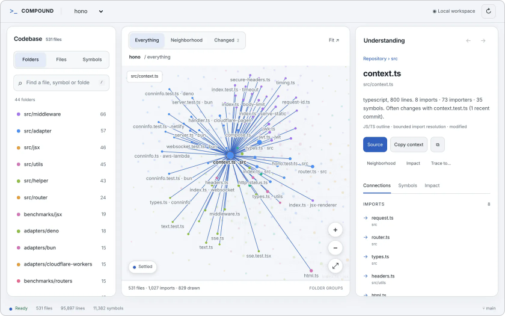
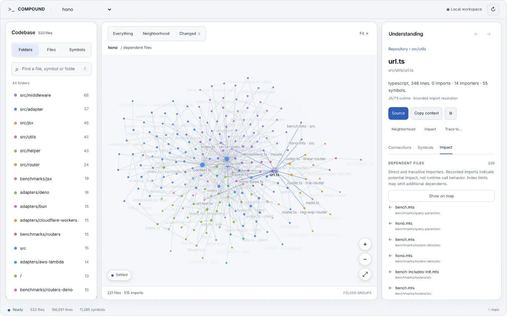
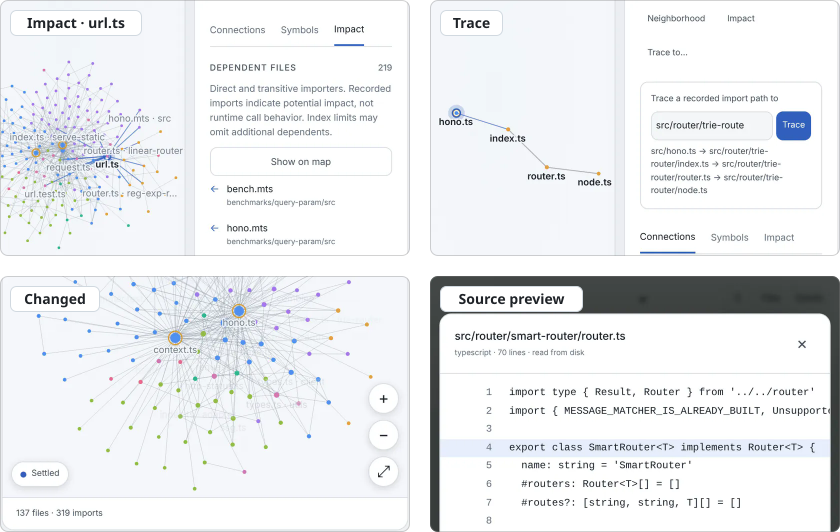

# Compound Skills

**Good engineering habits for your coding agent, plus a live map of your code.**

Compound Skills is a free, open-source plugin for **Codex, Cursor, and Claude Code**. Turn it on once and it gives your agent the same guidance in every project: reproduce a bug before fixing it, show the new test failing on the unfixed code, and leave AI co-author lines out of commits. In our Claude Code benchmark of three clearly reported bugs, Claude Opus 5.5 went from almost never doing the first two to doing them in most fixes, at about 1.4× the tokens and 1.45–1.97× the list-price cost per fix (medians for each bug; single fixes ranged from 1.27× to 2.47× the cost). Claude Sonnet 5.5 rarely did them either way.



## Why use it

![Scorecard with and without Compound. Claude Opus 5.5 reproduced the bug before changing code in 17 of 24 bug fixes with Compound against 0 of 24 without, and showed a failing test on the unfixed code in 23 of 24 against 1 of 24. Claude Sonnet 5.5: 4 and 5 of 24 against 0 of 24. Every run fixed its bug, the final code was tested in every run but one Sonnet refactor with Compound, the tests left behind caught about as many planted regressions, and no bug fix with Compound put an AI co-author line in its commit. On the refactor, Opus with Compound kept tax rounding in 8 of 8 runs against 5 of 8 but removed both helpers in 0 of 8 against 5 of 8; Sonnet removed both and changed tax rounding in every run. Weighting the six tasks equally, Compound used 1.28 times the tokens and 1.38 times the list-price cost with Opus, and 1.37 and 1.60 times with Sonnet](.github/assets/benchmark-habits.svg)

We gave Claude Code the same six tasks with and without Compound: three bug reports, a refactor, a code review and a question about Django. Each ran 8 times per arm and model, in pairs started together in isolated sandboxes ([how we measured](#how-we-measured)).

- **With Opus, it usually reproduced the bug before fixing it.** With Compound, Claude Opus 5.5 ran the failing case before touching the code in 17 of 24 bug fixes, against 0 of 24 without. It showed its new test failing on the unfixed code in 23 of 24, against 1 of 24; in 13 of them before writing the fix, in the rest by undoing the fix briefly. Claude Sonnet 5.5 read the same debugging guide in every bug fix but did these only 4 and 5 times out of 24, against 0 without: no clear difference (for reproducing first, the pre-registered test gave Holm-adjusted p = 0.25; the failing-test count was not tested).
- **No clear difference in fixes or test strength.** Every run fixed its bug, with or without Compound, and stock Claude Code also tested its final code. On the four coding tasks, the tests each run left behind caught about as many of the regressions planted for its task (3 for each bug, 2 for the refactor; 88 checks over the 32 runs per arm): with Opus 63 of 88 with Compound, 62 of 88 without; with Sonnet 42 of 88 in both arms.
- **On the refactor, Opus played it safe and stopped short.** The refactor asked to remove two rounding helpers so all rounding goes through one shared function, but the tax helper rounded differently, so a plain swap changes some tax amounts. With Compound, Opus kept tax rounding in all 8 runs but stopped to ask instead of finishing: none removed both helpers. Without it, 5 of 8 removed both: 2 kept tax rounding and 3 changed it, saying so; the other 3 stopped to ask. Sonnet removed both helpers and changed tax rounding in all 16 runs, and said so each time. No run in either arm left a test that would catch the change.
- **No AI co-author line.** In all 48 bug-fix runs with Compound, from either model, the commit had no AI co-author line, and 45 used Conventional Commits titles such as `fix: …`. Stock Claude Code added a co-author line in all 48 and used such titles in none; Claude Code's own `attribution` setting can also remove the line.
- **It costs more.** Weighting the six tasks equally (the geometric mean of all 48 paired ratios, 8 per task), Compound used 1.28× the tokens with Opus (95% interval 1.22–1.34) and 1.37× with Sonnet (1.29–1.45). At list prices, computed the same way but added after the runs, it cost 1.38× with Opus (1.33–1.44) and 1.60× with Sonnet (1.50–1.70). Summed over each model's 48 pairs, that was 1.28× the tokens and 1.34× the cost with Opus ($8.00 against $5.96), and 1.27× and 1.53× with Sonnet ($3.33 against $2.17). For each bug, the median Opus fix took about 1.4× the tokens, 1.45–1.97× the cost ($0.05–0.08 more) and 9–12 seconds longer; single fixes ranged from 1.27× to 2.47× the cost and from 3 seconds faster to 33 seconds slower. The always-loaded part was 369 tokens per request; naming the map step in the routing rule later added 9.
- **Local, installs in three apps.** The code map runs on your machine with Python 3.11+ and Git. The same guides install in Codex, Cursor, and Claude Code; we measured only Claude Code.

## Install

Install once at **User** scope in each app you use, then start a new chat (or run `/reload-plugins` in Claude Code).

**Codex**

```sh
codex plugin marketplace add tobenwarrior/compound-skills
codex plugin add compound-skills@compound-skills
```

**Claude Code**

```text
/plugin marketplace add tobenwarrior/compound-skills
/plugin install compound-skills@compound-skills
```

**Cursor**

1. Open **Customize → Plugins → Add → From GitHub Repository**.
2. Enter `https://github.com/tobenwarrior/compound-skills`, choose **User** scope, then **Import**.
3. Click **Add** or **Install** beside `compound-skills`, and keep its `compound-default` rule set to **Always** in **Customize → Rules** (set it to **Manual** to turn Compound off). See [Cursor's plugin docs](https://cursor.com/docs/plugins).

## Use it

| What you want | Codex | Cursor | Claude Code |
| --- | --- | --- | --- |
| Turn it on for every project (once, from any app) | `$setup-global` | `/setup-global` | `/compound-skills:setup-global` |
| Check that it is on | `$status-global` | `/status-global` | `/compound-skills:status-global` |
| Review and tidy the current project | `$setup` | `/setup` | `/compound-skills:setup` |
| Open the code map | `$map` | `/map` | `/compound-skills:map` |
| Use it in this chat only | `$compound` | `/compound` | `/compound-skills:compound` |
| Remove the global setting | `$compound disable global` | `/compound disable global` | `/compound-skills:compound disable global` |

After that, just ask for what you want. Before its first edit in a project, Compound asks the agent for a one-time check-up: review the structure and tests, apply only high-confidence cleanup (which can include deleting source, docs and tests it finds obsolete or redundant), verify it, and leave your uncommitted work alone. Its guide tells the agent not to stage or commit the cleanup just because the check-up ran. We have not measured the check-up itself. In 3 first-use runs with Opus where the first request was a bug fix, the agent read the check-up guide but skipped the check-up as going beyond the request, and said so in its report. It fixed the bug and left the uncommitted work alone, as stock Claude Code also did. In that first session it reproduced the bug first in 1 of 3 runs and showed a failing test in 2 of 3, against 7 and 8 of 8 on the same bug once set up, and used 1.46× the tokens of stock Claude Code. Questions and reviews are meant to stay read-only, and in our runs no review or question changed the repository, with or without Compound (23 of the 32 reviews wrote scratch files in /tmp while trying to run the code). Details: [activation](skills/compound/references/activation.md) and [check-up](skills/compound/references/onboarding.md).

## The code map



- **Explore it.** Hover a file to light up its connections, drag it to pull its neighbors along, and scroll or pinch to zoom.
- **See what a change touches.** **Impact** shows the files that import the one you picked, directly or through other files, as far as the map resolves imports. **Trace** finds how two files connect, and **Changed** shows your Git edits and their neighbors.
- **Read without switching apps.** Search files, folders, and symbols, preview source, and copy a compact summary into your chat.
- **Your agent can ask it too.** Before searching a repository, Compound has the agent query the map once, unless the task names its file, and offers lookups of where a symbol is defined and mentioned. With the 0.12.1 wording only 1 of the 96 benchmark runs queried the map, and none used the symbol lookup. After we reworded that step, 43 of 48 runs on questions and edits in Flask, Hono and Django did, against 0 of 48 with the old wording; questions cost 1.16× as much, edits about the same, and answers scored about the same ([how we measured](#how-we-measured)).
- **Languages.** Imports are linked for Python, JavaScript, TypeScript, Go, and Rust. Symbols are outlined for those plus Java, C, C++, C#, Ruby, PHP, Swift, and Kotlin.



![Code map timings on seven real repositories, median of 5 runs, on the current map. A first build takes 0.41 to 2.48 seconds on six repositories with 113 to 612 indexed files, and 8.20 on Django, which indexes 3,496 of its 7,085 files. With nothing changed it takes 0.05 to 0.27 seconds, and 2.29 on Django. In a coding task the agent's first query, which starts the local service and indexes, takes 1.09 to 3.17 seconds and 10.90 on Django; later queries take 0.38 to 0.43 seconds and 0.97 on Django. In questions and reviews the query starts no service and writes no cache; with no cache yet it takes 0.47 to 2.61 seconds and 8.78 on Django. The newer ranking made queries slower than in 0.12.1 timed the same way, by 0.03 to 0.09 seconds when warm and 0.04 to 1.19 seconds when cold](.github/assets/map-speed.svg)


**Does it find the files a change touches?** Usually, and more often than a plain word search. For 240 real commits that were not used to tune the map, 60 each from Flask, click, Hono and gin, we queried the map with each commit's title and checked whether the source files the commit changed came near the top. On average it put 74% of them in its top 4, against 51% for word-count search and 4% at random, and it was ahead on 73 commits to the search's 11. It was clearly ahead on Flask (60% against 35%, ahead on 21 commits to the search's 4), Hono (75% against 34%, 27 commits to 0) and gin (81% against 63%, 15 commits to 2). On click it was slightly ahead (81% against 73%, 10 commits to 5), a gap small enough to be noise. The map in 0.12.1 put 48% in its top 4 on the same commits.

The map weighs the query's rarer words in file paths, symbols and the text of its 50 leading candidates, favors larger and widely imported code files, and lists tests lower unless the query mentions tests. We tuned it on the 60 most recent such commits of Flask, click and Hono; gin, a Go project, was used only for this check. Part of the gain comes from listing tests lower, since only non-test files were scored: a word search that also skips common words and lists tests last put 67% in its top 4, about level with the map on click and gin. Each commit's parent was copied into a fresh repository without history, so the map's co-change hints played no part. The newer ranking costs a little time: timed back to back on the seven repositories above, queries took 0.03 to 0.09 seconds longer than in 0.12.1 when warm and 0.04 to 1.19 seconds longer when cold, slower on every repository, while repeat runs of the same version differed by up to 0.14 seconds (0.42 on Django). The map is built to show how files connect, which a word search does not; we have not measured how much that helps.

The map opens at `http://127.0.0.1:43127/` and keeps its data in your user cache, outside the repository. Coverage and limits: [code maps](skills/compound/references/map.md).

## Nine workflows

Compound has one short guide for each kind of work and tells the agent to read the one that fits. In our runs the agent read the matching guide in 78 of 96 runs with Compound; Opus skipped it in 7 of 8 Django questions and Sonnet in 6 of 8 refactors. The table says what each guide asks for; the benchmark below measured only some of it.

| Workflow | What the guide asks for |
| --- | --- |
| [Investigate](skills/compound/references/investigate.md) | Trace how the code really behaves before answering |
| [Design and implement](skills/compound/references/design.md) | Start from how callers will use it and make states and ownership explicit |
| [Debug](skills/compound/references/debug.md) | Reproduce the bug, find the cause, and add a regression test |
| [Refactor](skills/compound/references/refactor.md) | Record current behavior, then prove it did not change |
| [Performance](skills/compound/references/performance.md) | Measure before and after on the same workload |
| [Review](skills/compound/references/review.md) | Report concrete problems with location, trigger, and impact |
| [Verify](skills/compound/references/verify.md) | Run checks that could prove the change wrong and say what is unverified |
| [Repository hygiene](skills/compound/references/repo-hygiene.md) | Flag clutter, oversized files, unused scripts, and `.gitignore` gaps |
| [Git and pull requests](skills/compound/references/git.md) | Write clear commits and PRs with real check results and human authorship |

## How we measured


- **Agent.** Claude Code 2.1.314 in headless mode with Claude Opus 5.5 and Claude Sonnet 5.5 at default effort, on 31 October 2026. Tool approvals were granted the same way in both arms, and web access was off.
- **Without** was stock Claude Code. It ships its own debug, verify and code-review skills but used none of them in any run. **With** added Compound 0.12.1 as a plugin plus the global rule its `setup-global` writes; the one-time check-up was already recorded and the map cache started empty.
- **Isolation.** Every run got its own copy of the repository and of one shared Claude configuration, in a sandbox with identical paths in both arms that hid the other run and the answer keys. Both runs of a pair started together, on one CPU each.
- **Tasks.** Three bug reports and a refactor in a small Python billing library written for this test, whose own tests miss the bugs. A review of a Flask commit with three planted defects. A question about the HTTP QUERY support in Django's unreleased 6.2, across its 7,085 files. No prompt mentions tests, Compound or the map.
- **Scoring.** Hidden tests; 11 planted regressions (3 for each bug, 2 for the refactor) run against the tests each agent left on that task; a logging wrapper around `python` in both arms that records what ran on which version of the code; and a blind automated judge (Claude Opus 5.5, the same model as one of the agents under test) for the review and the question (three votes per answer, and a point counts only with a quote from the answer). The plan, prompts, answer keys and analysis were frozen before the runs. Two harness bugs found during the runs were fixed and logged without changing any task or key. Grading crashed on the first two Opus leap-year pairs, so those 4 finished runs were never scored and both pairs ran again. A faulty resume then repeated 3 finished pairs and was stopped during a fourth; a rule that ignores results set aside its 7 recorded runs, and that pair's other finished run was never scored. In all, 12 finished Opus runs were left out. After the analysis we corrected one descriptive count, which guides each agent read, for 3 runs that read a guide through a shell variable.
- **Detector check.** Two AI labellers per trace (Claude Opus 5.5 agents run by a labelling script, not people), each shown the trace with the arm hidden, labelled every bug-fix trace. On the first pass they agreed with the automated habit detectors on 44 (reproduced first), 44 (failing test shown) and 35 (final code tested) of 48 Opus traces, mostly because hiding the arm had also hidden test output. The 15 Opus traces with a disagreement were regenerated with that output kept and labelled again, after which agreement was 45, 47 and 46 of 48; on Sonnet's fuller traces they agreed on all 48 the first time. The six remaining disagreements came from five Opus runs with Compound. In three refund runs, the labellers saw the bug reproduced first where the detector's frozen pattern missed output printed as `-$99.99`; by the labels, Opus with Compound reproduced first in 20 of 24 runs. The other three came from two runs in which a test command was chained with a read of a Compound file, so hiding the arm removed it from the trace; the full logs show the failing test and the final passing run, so there the detector was right.

| Task | Model | Without → with Compound | Tokens with ÷ without | Cost with ÷ without | Time added |
| --- | --- | --- | --- | --- | --- |
| Three bug fixes, 24 runs per arm | Opus 5.5 | fixed 24 → 24 · reproduced first 0 → 17 · failing test shown 1 → 23 | 1.42–1.45× | 1.45–1.97× | 9–12 s |
| | Sonnet 5.5 | fixed 24 → 24 · reproduced first 0 → 4 · failing test shown 0 → 5 (no clear difference) | 1.02–1.32× | 1.15–1.56× | 0–5 s |
| Refactor, 8 runs per arm | Opus 5.5 | tax rounding kept 5 → 8 · both helpers removed 5 → 0 · both, safely 2 → 0 | 1.05× | 1.04× | 2 s |
| | Sonnet 5.5 | both helpers removed 8 → 8 · tax rounding kept 0 → 0 | 1.06× | 1.34× | 1 s |
| Review a Flask commit | Opus 5.5 | all 3 planted defects found 8 → 8 | 1.60× | 1.58× | 10 s |
| | Sonnet 5.5 | all 3 planted defects found 7 → 8 | 3.91× | 3.30× | 13 s |
| Question about Django, 11 key points | Opus 5.5 | median 11 → 11 | 0.84× (2 of 8 pairs higher) | 0.88× | −2 s |
| | Sonnet 5.5 | median 9 → 9 | 1.40× | 1.46× | 5 s |

Figures are medians over the 8 pairs of each task (for the bug fixes, the range across the three tasks). Cost is the API list price the client reported.


![Tokens, list-price cost and time per task with Compound, as a multiple of the paired run without it, for Claude Opus 5.5 (median of each task's 8 pairs): bug fixes 1.42 to 1.45 times the tokens, 1.45 to 1.97 times the cost and 1.37 to 1.60 times the time (lowest to highest of the three bugs' medians); refactor 1.05, 1.04 and 1.07; review 1.60, 1.58 and 1.31; the Django question 0.84, 0.88 and 0.92. With the six tasks weighted equally, 1.28 times the tokens and 1.38 times the cost; summed over the 48 pairs, 1.28 and 1.34 times](.github/assets/benchmark-cost-opus.svg)

![Tokens, list-price cost and time per task with Compound, as a multiple of the paired run without it, for Claude Sonnet 5.5 (median of each task's 8 pairs): bug fixes 1.02 to 1.32 times the tokens, 1.15 to 1.56 times the cost and 1.02 to 1.30 times the time (lowest to highest of the three bugs' medians); refactor 1.06, 1.34 and 1.05; review 3.91, 3.30 and 1.81; the Django question 1.40, 1.46 and 1.34. With the six tasks weighted equally, 1.37 times the tokens and 1.60 times the cost; summed over the 48 pairs, 1.27 and 1.53 times](.github/assets/benchmark-cost-sonnet.svg)

**What else we found**

- **On one bug, a plain rule matched the debugging habits.** A five-sentence rule asking for the same debugging and testing habits, but nothing about commits, without the plugin (Opus, 3 unpaired runs per task), reproduced the December bug first and showed a failing test in 3 of 3 runs (Compound: 7 and 8 of 8), with about as many tokens as Compound used there (medians 176k and 192k). Its 3 commits kept the AI co-author line, which the rule did not mention. On the refactor it kept tax rounding in 3 of 3 runs and finished the change safely in 1, the only refactor run in the benchmark that also left a test catching a change to tax rounding. We did not measure what Compound's other guides, the map or its Codex and Cursor setups add over such a rule.
- **Reviews and answers scored about the same.** The judge found all three planted defects in 8 of 8 Opus reviews in both arms, and in 8 of 8 Sonnet reviews with Compound against 7 of 8 without. All 11 Django key points were covered in 8 of 8 Opus answers without Compound and 7 of 8 with (the other covered 10); Sonnet's median was 9 of 11 in both arms. The judge's count of incorrect statements went opposite ways by model, though neither gap is clear at this sample size: Opus made 10 with Compound against 17 without (in 8 and 13 of the 16 reviews and Django answers in each arm), Sonnet 14 against 7 (in 11 and 6 of 16). With Compound, every Sonnet review tried to run the code, which the benchmark's tool permissions blocked (27 blocked commands, against 3 in the one Sonnet review without Compound that tried); every Opus review tried in both arms (28 blocked commands with Compound, 23 without).
- **Sonnet's tests were weaker either way.** Sonnet left a regression test that fails on the buggy code in 20 of 24 bug fixes without Compound and 19 of 24 with; Opus did in all 24 in both arms.
- **Little overhead on a general question.** For a general Python question (Opus, 3 runs), the agent never invoked the Compound skill; only the always-loaded 369 tokens were added.
- **Noise.** In two pairs of identical runs without Compound (Opus, refund bug), one run used up to 1.30× the tokens and 1.12× the time of its twin. Per-task token medians inside that band, such as Opus's 0.84× on Django or Sonnet's 1.02× and 1.06×, are not clear differences in tokens. Cost varied less between the twins, at most 1.12×, and every Sonnet December pair cost more with Compound (median 1.56×).
- **Map queries after rewording the step.** In 0.12.1 the skill offered the map only as a fallback when the host had no suitable index, and in 77 of 94 runs that loaded the skill the agent searched or read code in the same turn, before the skill's text arrived. The skill now asks for one map query before any further search, read or edit, unless the task names its file or supplies the code, and the routing rule says to run it before searching. We compared the two wordings in Claude Code 2.1.316, 4 pairs per task and model, on three questions (Flask error handlers, Hono routing, Django `select_for_update`), two edits that name the command or method to change, a cookie bug planted in Hono and reported only by its symptom, and a question about a named file; agents could read the code but not run it. The map was queried in 43 of 48 runs, once each and as the first search in 41, against 0 of 48: all 24 questions, all 12 Opus edits and 7 of 12 Sonnet edits. Neither wording queried it for the named file. Per pair, questions took 1.38× the tokens, 1.16× the list-price cost and 1.23× the time (geometric means); edits took 0.98×, 1.00× and 1.04×. A blind judge scored answers and fixes about the same. Rewording the skill alone, without the rule sentence, reached 30 of 48 (2 of 12 Sonnet edits). Rules saved by an earlier `setup-global` or `setup` keep the old text until it is run again, and both models know these repositories well; we have not measured unfamiliar code.

**Limits.** Only Claude Code was measured, not Codex or Cursor. The bug fixes and the refactor used one small library written for this test, and the bugs were clearly reported, so both arms solved them; larger or vaguer work could differ in either direction. Eight pairs per task can miss small effects, and the controls (the rule, the general question, the first use and the noise check) ran only on Opus with 2 or 3 runs or pairs each. In the Flask and Django tasks both arms could read the code but not run it.

## Credits

Adapted selectively from Lauren Tan's [pstack](https://github.com/cursor/plugins/tree/main/pstack), with lineage from earlier Karpathy-inspired guidelines. See [SOURCES.md](SOURCES.md), [third-party notices](THIRD_PARTY_NOTICES.md), and the [MIT license](LICENSE).
