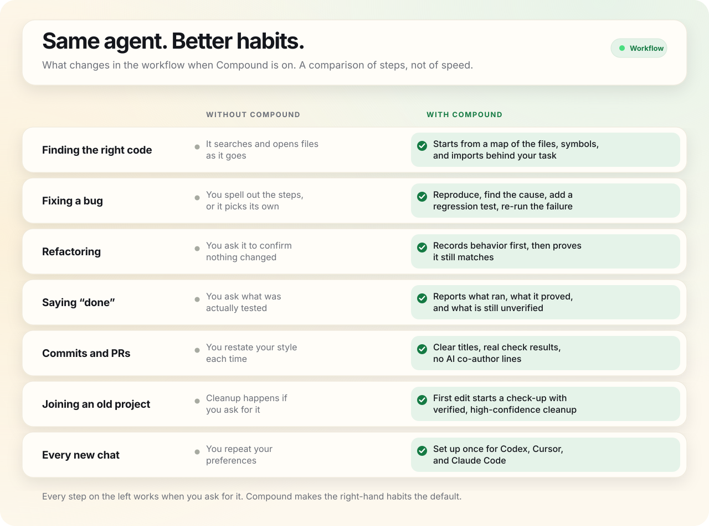
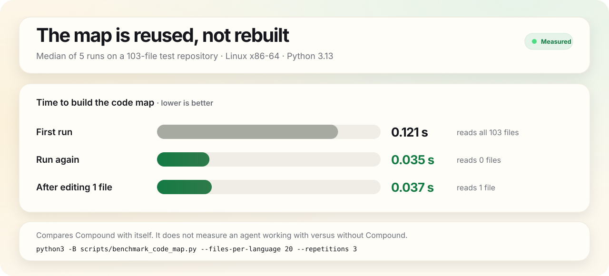

# Compound Skills

**Good engineering habits for your coding agent, plus a live map of your code.**

Compound Skills is a free, open-source plugin for **Codex, Cursor, and Claude Code**. Turn it on once and your agent works the same careful way in every project: it looks before it edits, proves a bug before fixing it, and tells you what it actually checked.


## Why use it



- **Light on context.** Only a one-paragraph rule and five one-line skill descriptions are always loaded. The detailed guides load only when a task needs them.
- **Local.** The code map is built and served on your machine. It needs only Python 3.11+ and Git.
- **One setup, three apps.** The same habits apply in Codex, Cursor, and Claude Code.

## Install

Install once at **User** scope in each app you use, then start a new chat (or run `/reload-plugins` in Claude Code).

**Codex**

```sh
codex plugin marketplace add tobenwarrior/compound-skills
codex plugin add compound-skills@compound-skills
```

**Claude Code**

```text
/plugin marketplace add tobenwarrior/compound-skills
/plugin install compound-skills@compound-skills
```

**Cursor**

1. Open **Customize → Plugins → Add → From GitHub Repository**.
2. Enter `https://github.com/tobenwarrior/compound-skills`, choose **User** scope, then **Import**.
3. Click **Add** or **Install** beside `compound-skills`, and keep its `compound-default` rule set to **Always** in **Customize → Rules** (set it to **Manual** to turn Compound off). See [Cursor's plugin docs](https://cursor.com/docs/plugins).

## Use it

| What you want | Codex | Cursor | Claude Code |
| --- | --- | --- | --- |
| Turn it on for every project (once, from any app) | `$setup-global` | `/setup-global` | `/compound-skills:setup-global` |
| Check that it is on | `$status-global` | `/status-global` | `/compound-skills:status-global` |
| Review and tidy the current project | `$setup` | `/setup` | `/compound-skills:setup` |
| Open the code map | `$map` | `/map` | `/compound-skills:map` |
| Use it in this chat only | `$compound` | `/compound` | `/compound-skills:compound` |
| Remove the global setting | `$compound disable global` | `/compound disable global` | `/compound-skills:compound disable global` |

After that, just ask for what you want. The first time your agent edits a project, Compound runs a short check-up: it reviews the structure and tests, applies only high-confidence cleanup, verifies it, and leaves your uncommitted work alone. Questions and reviews stay read-only. Details: [activation](skills/compound/references/activation.md) and [check-up](skills/compound/references/onboarding.md).

## The code map


- **Explore it.** Hover a file to light up its connections, drag it to pull its neighbors along, and scroll or pinch to zoom.
- **See what a change touches.** **Impact** shows every file that depends on the one you picked, **Trace** finds how two files connect, and **Changed** shows your Git edits and their neighbors.
- **Read without switching apps.** Search files, folders, and symbols, preview source, and copy a compact summary into your chat.
- **Your agent uses it too.** Before broad reads, the agent asks the same map which files matter for the task. It can also find where a symbol is defined and mentioned, or ask a language server you trust.
- **Languages.** Imports are linked for Python, JavaScript, TypeScript, Go, and Rust. Symbols are outlined for those plus Java, C, C++, C#, Ruby, PHP, Swift, and Kotlin.

The map opens at `http://127.0.0.1:43127/` and keeps its data in your user cache, outside the repository. Coverage and limits: [code maps](skills/compound/references/map.md).

## Nine workflows

Compound loads one short guide for each stage of the work.

| Workflow | What your agent does |
| --- | --- |
| [Investigate](skills/compound/references/investigate.md) | Traces how the code really behaves before answering |
| [Design and implement](skills/compound/references/design.md) | Starts from how callers will use it and makes states and ownership explicit |
| [Debug](skills/compound/references/debug.md) | Reproduces the bug, finds the cause, and adds a regression test |
| [Refactor](skills/compound/references/refactor.md) | Records current behavior, then proves it did not change |
| [Performance](skills/compound/references/performance.md) | Measures before and after on the same workload |
| [Review](skills/compound/references/review.md) | Reports concrete problems with location, trigger, and impact |
| [Verify](skills/compound/references/verify.md) | Runs checks that could prove the change wrong and says what is unverified |
| [Repository hygiene](skills/compound/references/repo-hygiene.md) | Flags clutter, oversized files, unused scripts, and `.gitignore` gaps |
| [Git and pull requests](skills/compound/references/git.md) | Writes clear commits and PRs with real check results and human authorship |

## What we have measured



The map remembers what it has already read, so later runs re-read only the files that changed. Reproduce it with `python3 -B scripts/benchmark_code_map.py --files-per-language 20 --repetitions 3`.

This compares Compound with itself. A fair test of an agent working with versus without Compound has not been run yet, so this README makes no claim that Compound makes agents faster. The workflow comparison under [Why use it](#why-use-it) shows how the work changes, not how fast it is.

## Credits

Adapted selectively from Lauren Tan's [pstack](https://github.com/cursor/plugins/tree/main/pstack), with lineage from earlier Karpathy-inspired guidelines. See [SOURCES.md](SOURCES.md), [third-party notices](THIRD_PARTY_NOTICES.md), and the [MIT license](LICENSE).
