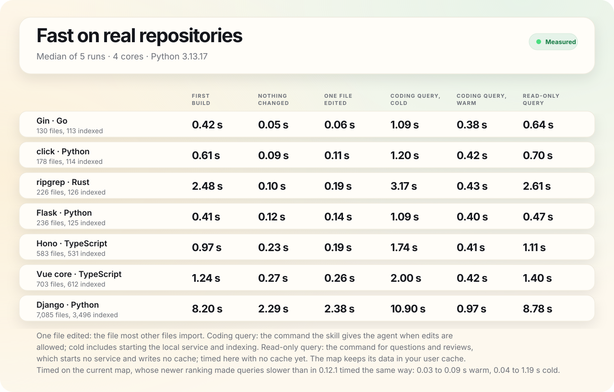
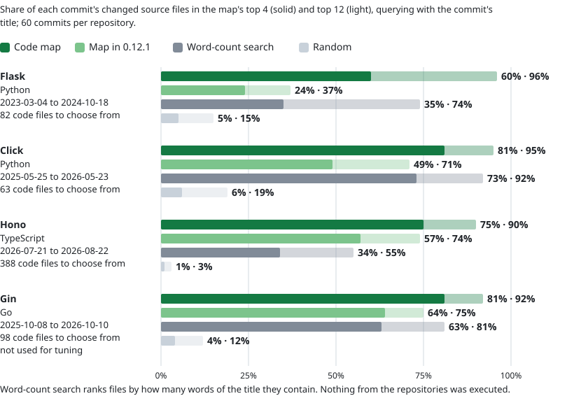
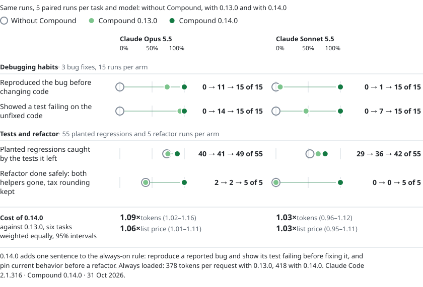
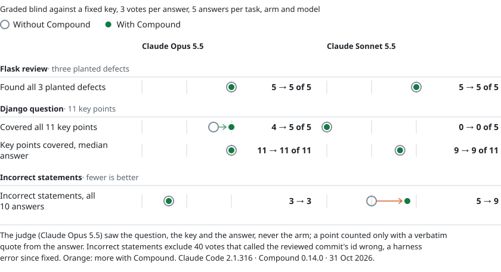

<h1 align="center">Compound Skills</h1>

<p align="center"><strong>Good engineering habits for your coding agent, plus a live map of your code.</strong></p>

<p align="center">Free, open-source (MIT) plugin for Claude Code, Codex and Cursor<br>The code map runs locally with Python 3.11+ and Git</p>

<p align="center"><a href="#install">Install</a> · <a href="#use-it">Use it</a> · <a href="#nine-workflows">Workflows</a> · <a href="#the-code-map">Code map</a> · <a href="#benchmark">Benchmark</a> · <a href="#limits">Limits</a></p>

Turn it on once and it gives your agent the same guidance in every project: reproduce a bug before fixing it, show the new test failing on the unfixed code, pin current behavior before a refactor, and leave AI co-author lines out of commits.

<p align="center">
  <picture>
    <source media="(prefers-color-scheme: dark)" srcset=".github/assets/benchmark-headline-dark.svg">
    
  </picture>
</p>

On three clearly reported bugs in a small library written for this test, Claude Opus 5.5 and Claude Sonnet 5.5 went from never doing the first two to doing them in all 15 fixes each. The median fix for each bug cost 1.37–1.56× as much with Opus and 1.14–1.75× with Sonnet, at list prices. On four real Flask and click bugs, Compound raised reproducing the bug first from 5 to 10 of 12 runs with Opus and from 0 to 12 with Sonnet. [Benchmark](#benchmark) · [Limits](#limits)

## Install

1. Install the plugin at **User** scope in each app you use (below).
2. Start a new chat (`/reload-plugins` also works in Claude Code) and turn Compound on for every project, once, from any app:<br>
   `/compound-skills:setup-global` in Claude Code<br>
   `$setup-global` in Codex<br>
   `/setup-global` in Cursor
3. Start a new chat and just ask for what you want.

### Claude Code

```text
/plugin marketplace add tobenwarrior/compound-skills
/plugin install compound-skills@compound-skills
```

### Codex

```sh
codex plugin marketplace add tobenwarrior/compound-skills
codex plugin add compound-skills@compound-skills
```

### Cursor

1. Open **Customize → Plugins → Add → From GitHub Repository**.
2. Enter `https://github.com/tobenwarrior/compound-skills`, choose **User** scope, then **Import**.
3. Click **Add** or **Install** beside `compound-skills`, and keep its `compound-default` rule set to **Always** in **Customize → Rules** (set it to **Manual** to turn Compound off). See [Cursor's plugin docs](https://cursor.com/docs/plugins).

> [!IMPORTANT]
> Before its first edit in a project, Compound asks the agent for a one-time check-up: review the structure and tests, apply only high-confidence cleanup (which can include deleting source, docs and tests it finds obsolete or redundant), verify it, and leave your uncommitted work alone. Its guide tells the agent not to stage or commit the cleanup just because the check-up ran. We have not measured the check-up itself. Details: [activation](skills/compound/references/activation.md) and [check-up](skills/compound/references/onboarding.md).

<details>
<summary>What first use looked like in our first benchmark (3 Opus runs on 0.12.1)</summary>

In 3 first-use runs with Opus where the first request was a bug fix, the agent read the check-up guide but skipped the check-up as going beyond the request, and said so in its report. It fixed the bug and left the uncommitted work alone, as stock Claude Code also did. In that first session it reproduced the bug first in 1 of 3 runs and showed a failing test in 2 of 3, against 7 and 8 of 8 on the same bug once set up, and used 1.46× the tokens of stock Claude Code.

</details>

## Use it

Each command takes your app's prefix, for example `/compound-skills:map` in Claude Code, `$map` in Codex and `/map` in Cursor.

| What you want | Command |
| --- | --- |
| Turn it on for every project (once, from any app) | `setup-global` |
| Check that it is on | `status-global` |
| Review and tidy the current project | `setup` |
| Open the code map | `map` |
| Use it in this chat only | `compound` |
| Remove the global setting | `compound disable global` |

<details>
<summary>Exact command for each app</summary>

| What you want | Claude Code | Codex | Cursor |
| --- | --- | --- | --- |
| Turn it on for every project (once, from any app) | `/compound-skills:setup-global` | `$setup-global` | `/setup-global` |
| Check that it is on | `/compound-skills:status-global` | `$status-global` | `/status-global` |
| Review and tidy the current project | `/compound-skills:setup` | `$setup` | `/setup` |
| Open the code map | `/compound-skills:map` | `$map` | `/map` |
| Use it in this chat only | `/compound-skills:compound` | `$compound` | `/compound` |
| Remove the global setting | `/compound-skills:compound disable global` | `$compound disable global` | `/compound disable global` |

</details>

Questions and reviews are meant to stay read-only, and in our runs no review or question changed the repository, with or without Compound (23 of the 32 reviews wrote scratch files in /tmp while trying to run the code).

## Nine workflows

Compound has one short guide for each kind of work and tells the agent to read the one that fits. In our runs the agent read the matching guide in 78 of 96 runs with Compound; Opus skipped it in 7 of 8 Django questions and Sonnet in 6 of 8 refactors. The table says what each guide asks for; the benchmark below measured only some of it.

| Workflow | What the guide asks for |
| --- | --- |
| [Investigate](skills/compound/references/investigate.md) | Trace how the code really behaves before answering |
| [Design and implement](skills/compound/references/design.md) | Start from how callers will use it and make states and ownership explicit |
| [Debug](skills/compound/references/debug.md) | Reproduce the bug, find the cause, and add a regression test |
| [Refactor](skills/compound/references/refactor.md) | Record current behavior, then prove it did not change |
| [Performance](skills/compound/references/performance.md) | Measure before and after on the same workload |
| [Review](skills/compound/references/review.md) | Report concrete problems with location, trigger, and impact |
| [Verify](skills/compound/references/verify.md) | Run checks that could prove the change wrong and say what is unverified |
| [Repository hygiene](skills/compound/references/repo-hygiene.md) | Flag clutter, oversized files, unused scripts, and `.gitignore` gaps |
| [Git and pull requests](skills/compound/references/git.md) | Write clear commits and PRs with real check results and human authorship |

## The code map


- **Explore it.** Hover a file to light up its connections, drag it to pull its neighbors along, and scroll or pinch to zoom.
- **See what a change touches.** **Impact** shows the files that import the one you picked, directly or through other files, as far as the map resolves imports. **Trace** finds how two files connect, and **Changed** shows your Git edits and their neighbors.
- **Read without switching apps.** Search files, folders, and symbols, preview source, and copy a compact summary into your chat.
- **Your agent can ask it too.** Before searching a repository, Compound has the agent query the map once, unless the task names its file, and offers lookups of where a symbol is defined and mentioned. With the 0.12.1 wording only 1 of the 96 benchmark runs queried the map, and none used the symbol lookup. After we reworded that step, 43 of 48 runs on questions and edits in Flask, Hono and Django did, against 0 of 48 with the old wording; compared with the old wording, questions took 1.38× the tokens and 1.16× the list-price cost per pair, edits cost about the same, and answers scored about the same (method below). In the 0.14.0 benchmark, 59 of the 60 runs with Compound ran a map query.
- **Languages.** Imports are linked for Python, JavaScript, TypeScript, Go, and Rust. Symbols are outlined for those plus Java, C, C++, C#, Ruby, PHP, Swift, and Kotlin.

<details>
<summary>How we measured the reworded map step</summary>

In 0.12.1 the skill offered the map only as a fallback when the host had no suitable index, and in 77 of 94 runs that loaded the skill the agent searched or read code in the same turn, before the skill's text arrived. The skill now asks for one map query before any further search, read or edit, unless the task names its file or supplies the code, and the routing rule says to run it before searching. We compared the two wordings in Claude Code 2.1.316, 4 pairs per task and model, on three questions (Flask error handlers, Hono routing, Django `select_for_update`), two edits that name the command or method to change, a cookie bug planted in Hono and reported only by its symptom, and a question about a named file; agents could read the code but not run it. The map was queried in 43 of 48 runs, once each and as the first search in 41, against 0 of 48: all 24 questions, all 12 Opus edits and 7 of 12 Sonnet edits. Neither wording queried it for the named file. Per pair, questions took 1.38× the tokens, 1.16× the list-price cost and 1.23× the time (geometric means); edits took 0.98×, 1.00× and 1.04×. A blind judge scored answers and fixes about the same. Rewording the skill alone, without the rule sentence, reached 30 of 48 (2 of 12 Sonnet edits). Rules saved by `setup-global` or `setup` before 0.13.0 lack the map sentence until you update and run it again. These are widely used repositories the models have likely seen in training; we have not measured unfamiliar code.

</details>


The map opens at `http://127.0.0.1:43127/` and keeps its data in your user cache, outside the repository. Coverage and limits: [code maps](skills/compound/references/map.md).

### How fast is it?

<picture>
  <source media="(prefers-color-scheme: dark)" srcset=".github/assets/map-speed-dark.svg">
  
</picture>

Six of the seven repositories build in under 2.5 seconds the first time and in under 0.3 seconds when nothing changed; Django, with 7,085 files, takes 8.20 and 2.29 seconds. Once the local service is running, an agent's later queries take about 0.4 seconds, and 0.97 on Django. Timed on 0.13.0; 0.14.0 did not change the map code. The newer ranking (below) made queries slower than in 0.12.1 timed the same way: later queries by 0.03 to 0.09 seconds, a coding task's first query by 0.04 to 1.19 seconds, and a question or review by up to 0.97 seconds.

### Does it find the files a change touches?

<picture>
  <source media="(prefers-color-scheme: dark)" srcset=".github/assets/map-retrieval-dark.svg">
  
</picture>

Usually, and more often than a word-count search. For 240 real commits that were not used to tune the map, 60 each from Flask, Click, Hono and Gin, we queried the map with each commit's title and checked whether the source files the commit changed came near the top. On average it put 74% of them in its top 4, against 51% for word-count search and 4% at random, and it was ahead on 73 commits to the search's 11; on Click the gap was small enough to be noise. The map in 0.12.1 put 48%. Part of the gain comes from listing tests lower: a word search that also skips common words and lists tests last put 67% in its top 4, about level with the map on Click and Gin. The map is built to show how files connect, which a word search does not; we have not measured how much that helps.

<details>
<summary>How the ranking works and how we tested it</summary>

It was clearly ahead on Flask (60% against 35%, ahead on 21 commits to the search's 4), Hono (75% against 34%, 27 commits to 0) and Gin (81% against 63%, 15 commits to 2). On Click it was slightly ahead (81% against 73%, 10 commits to 5), a gap small enough to be noise.

The map weighs the query's rarer words in file paths, symbols and the text of its 50 leading candidates, favors larger and widely imported code files, and lists tests lower unless the query mentions tests. We tuned it on the 60 most recent such commits of Flask, Click and Hono; Gin, a Go project, was used only for this check. Part of the gain comes from listing tests lower, since only non-test files were scored: a word search that also skips common words and lists tests last put 67% in its top 4, about level with the map on Click and Gin. Each commit's parent was copied into a fresh repository without history, so the map's co-change hints played no part. The newer ranking costs a little time: timed back to back on the seven repositories above, later queries took 0.03 to 0.09 seconds longer than in 0.12.1 and a coding task's first query 0.04 to 1.19 seconds longer, slower on every repository, while repeat runs of the same version differed by up to 0.14 seconds (0.42 on Django). First builds took 0.10 to 0.43 seconds longer on five repositories and 0.06 and 0.18 seconds less on Gin and Django; only on Flask and Hono did the five runs of the two versions not overlap.

<picture>
  <source media="(prefers-color-scheme: dark)" srcset=".github/assets/map-retrieval-detail-dark.svg">
  
</picture>

</details>

## Benchmark

We gave Claude Code the same six tasks with and without Compound 0.14.0: three bug reports, a refactor, a code review and a question about Django. Each ran 5 times per arm and model, side by side in isolated sandboxes, next to a third arm running 0.13.0 ([what changed](#what-changed-in-0140)). Then we ran four real bugs from Flask and click, starting while the last repetition was finishing ([real bugs](#real-bugs)). The harness is in [bench/](bench/README.md), so you can rerun all of it ([how we measured](#how-we-measured)).

<picture>
  <source media="(prefers-color-scheme: dark)" srcset=".github/assets/benchmark-habits-dark.svg">
  
</picture>

- **Both models reproduced the bug before fixing it.** With Compound, Opus and Sonnet each did in 15 of 15 bug fixes, against 0 of 15 without, and both showed the new test failing on the unfixed code just as often.
- **The refactor was finished safely.** It asked to remove two rounding helpers, but the tax helper rounded differently, so a plain swap changes some tax amounts. With Compound, both models removed both helpers and kept tax rounding in all 5 runs, each leaving a test that catches the plain swap. Without it, Opus did so in 2 of 5 runs and Sonnet in none, and no run left such a test. We rewrote the refactor guide after our first benchmark's runs of this same task, so this result is partly in-sample.
- **Stronger tests, mostly on the refactor.** The tests each run left behind caught more of the regressions planted for its task: 49 of 55 with Compound against 40 without on Opus, 42 against 29 on Sonnet. On the three bugs alone, Opus's tests caught about as many either way (41 against 40 of 45) and Sonnet's caught more (37 against 29).
- **The same fixes.** Every bug-fix run fixed its bug, with or without Compound.
- **Almost no AI co-author lines.** 29 of the 30 bug fixes with Compound committed without one (one Sonnet run kept it); stock Claude Code added one in all 30. Claude Code's own `attribution` setting can also remove it.
- **It costs more.** With the six tasks weighted equally, Compound used 1.56× the context tokens and 1.56× the list-price cost with Opus, and 1.55× and 1.67× with Sonnet ([cost](#cost)).

<details>
<summary>Full results, with the statistics</summary>

- **Reproduced first and failing test shown.** Opus and Sonnet each did both in 15 of 15 bug fixes with Compound, against 0 of 15 without. Exact McNemar tests on the 15 pairs per model: p < 0.001 each.
- **Test strength.** Per run, the share of its task's planted regressions that its own tests caught rose by 0.22 on average with Opus and 0.26 with Sonnet over the four coding tasks (20 pairs each; sign-flip test p = 0.03 and p = 0.001). Opus's rise comes from the refactor, where runs without Compound left no test that catches the planted changes (0.80 on its 5 pairs, 0.02 on the 15 bug-fix pairs); Sonnet's also shows on the bug fixes alone (0.18, p = 0.03). Sonnet without Compound left a test that fails on the buggy code and passes on the fix in 13 of 15 bug fixes, against 15 of 15 with it; Opus did in all 15 in both arms.
- **Refactor.** Done safely, meaning both helpers removed, tax rounding kept and the suites passing: Opus 5 of 5 with Compound against 2 of 5 without, Sonnet 5 of 5 against 0 of 5. All 8 runs without Compound that changed tax rounding said so in their reports. With 5 pairs, neither difference reaches p < 0.05 on its own: p = 0.25 for Opus and p = 0.06 for Sonnet.
- **Commits.** All 30 bug fixes in both arms committed. With Compound, 28 used Conventional Commits titles such as `fix: …`; stock Claude Code used none.
- **Cost.** Weighting the six tasks equally (the geometric mean of the 30 paired ratios per model, 5 per task), Compound used 1.56× the context tokens with Opus (95% interval 1.47–1.65) and 1.55× with Sonnet (1.40–1.71), and cost 1.56× (1.48–1.64) and 1.67× (1.53–1.84) at list prices. Summed over each model's 30 pairs: 1.56× the tokens and 1.54× the cost with Opus ($6.04 against $3.91), 1.42× and 1.62× with Sonnet ($2.28 against $1.41). Context tokens are the input tokens each request sent, cached context included.
- **Stopping and one rerun.** We planned 6 repetitions and stopped after 5, a decision made after seeing interim results; the usage left went to the real bugs. One Sonnet group (the refund bug, repetition 4) lost its log of Python calls when the real-bug runs started alongside it, so we fixed the harness and ran that group again. We also widened the refund detector during the runs to match totals printed as `-$99.99`; rescoring with it changed no result. No task, key or grader changed.

</details>

### What changed in 0.14.0

0.14.0 adds one sentence to the always-on rule: reproduce a reported bug and show its regression test failing before fixing it, and pin current behavior with a test before a refactor. Its refactor guide now says to keep behavior and still finish the change, asking first only when no behavior-preserving path exists. In the same runs, against 0.13.0:

<picture>
  <source media="(prefers-color-scheme: dark)" srcset=".github/assets/benchmark-changes-dark.svg">
  
</picture>

The same release also asks for fewer startup steps, a shorter final report and no retries of blocked commands in reviews; together they did not measurably cut cost. In one Sonnet review, the batched startup command was blocked by the review's read-only permissions, so that run never ran its map query. The always-loaded part grew from 378 to 418 tokens per request.

### Real bugs

Four bugs that Flask and click fixed upstream between July and September 2026: `app.run()` failing on an IPv6 `SERVER_NAME`, the test client losing the session with an IPv6 `base_url`, pickling a click option, and a click progress bar that stops at 14/20. Each run got the project at the fix's parent, with its history and test suite, and a report that describes only the symptom. The upstream fix's own new tests stayed hidden, and the project's whole suite had to pass. These bugs were new to the benchmark, so unlike the six tasks they show how 0.14.0 does on work it was not tuned on.

<picture>
  <source media="(prefers-color-scheme: dark)" srcset=".github/assets/benchmark-real-dark.svg">
  
</picture>

Both arms fixed the same bugs: every run fixed the two Flask bugs and the pickling bug, and none fully fixed the progress bar. Its report describes a loop over the bar, and every run fixed that path, but upstream's tests also cover the same bug through `bar.update()`. Stock Claude Code already reproduced some of these bugs first: Opus in 5 of 12 runs, against 10 with Compound; Sonnet went from 0 to 12.

### What it looks like

The same example slot as in the first benchmark: rep 1 of the December bug on Claude Opus 5.5. Both runs fixed the bug, added a test, noticed that plain EOM terms were wrong too and committed. The highlighted sentences appear only in the report with Compound.

<picture>
  <source media="(prefers-color-scheme: dark)" srcset=".github/assets/benchmark-reports-dark.svg">
  
</picture>

Only the report with Compound says “Before the fix it failed (`2023-12-31 != 2024-12-31`)”, “Calling `due_date` directly with the example from your report now returns `2025-01-30`”, “I found no other code in `src` doing the same month arithmetic” and that the commit “has no Claude co-author trailer”. Medians over the December bug's 5 Opus pairs, with Compound against without: 1.49× the tokens, 1.56× the list-price cost and 1.47× the time.

### Every Opus bug-fix run, step by step

<picture>
  <source media="(prefers-color-scheme: dark)" srcset=".github/assets/benchmark-steps-dark.svg">
  
</picture>

Without Compound, 14 of 15 runs started by editing the source; the other ran Python first, but only tried pytest, which this library does not have. With Compound, 15 of 15 ran the unfixed code or showed a failing test before their first source edit, 15 of them a failing test.

### Cost

<picture>
  <source media="(prefers-color-scheme: dark)" srcset=".github/assets/benchmark-cost-dark.svg">
  
</picture>

For each bug, the median Opus fix took 1.14–1.50× the context tokens, 1.37–1.56× the cost ($0.05–0.07 more) and 4–14 seconds longer; single fixes ranged from 1.16× to 2.11× the cost. Reviews cost the most extra: Sonnet's Flask review took 3.10× the tokens, single pairs from 1.61 to 4.98 times. With Compound, every Sonnet review loaded the guides and tried to run the code, which the benchmark blocks; without it, most answered after a single command. The always-loaded part is 418 tokens per request.

### Reviews and answers

A blind judge graded every review and Django answer against a fixed key, with three votes per answer.

<picture>
  <source media="(prefers-color-scheme: dark)" srcset=".github/assets/benchmark-answers-dark.svg">
  
</picture>

Every review found all three planted defects in both arms, and the answers covered about as many Django key points. The judge counted as many incorrect statements with and without Compound for Opus, but more with it for Sonnet, 9 against 5, mostly in Django answers. With Compound, every review also tried to run the code, which the benchmark's permissions block: 21 blocked commands in the Opus reviews and 16 in the Sonnet ones, against 15 and 3 without.

### How we measured

Claude Code 2.1.316 in headless mode with Claude Opus 5.5 and Claude Sonnet 5.5 at default effort, on 31 October 2026. **Without** was stock Claude Code; **With** added Compound 0.14.0 as a plugin plus the global rule its `setup-global` writes, and a third arm ran 0.13.0 the same way. The tasks, prompts, answer keys and graders are the ones frozen for our first benchmark, which ran 0.12.1 with 8 pairs per task. Everything is in [bench/](bench/README.md).

<details>
<summary>Method: setup, isolation, tasks, scoring and detectors</summary>

- **Agent.** Claude Code 2.1.316 in headless mode with Claude Opus 5.5 and Claude Sonnet 5.5 at default effort, on 31 October 2026. Tool approvals were granted the same way in every arm, and web access was off.
- **Arms.** **Without** was stock Claude Code. It ships its own debug, verify and code-review skills but used none of them in any run. **With** added Compound 0.14.0 as a plugin plus the global rule its `setup-global` writes; the one-time check-up was already recorded and the map cache started empty. A third arm ran Compound 0.13.0 the same way.
- **Isolation.** Every run got its own copy of the repository and of one shared Claude configuration, in a sandbox with identical paths in every arm that hid the other runs and the answer keys. The runs of a group started together, on one CPU each, and the arm order rotated.
- **Tasks.** Three bug reports and a refactor in a small Python billing library written for this test, whose own tests miss the bugs. A review of a Flask commit with three planted defects. A question about the HTTP QUERY support in Django's unreleased 6.2, across its 7,085 files. No prompt mentions tests, Compound or the map. The real bugs are described above.
- **Scoring.** Hidden tests; 11 planted regressions (3 for each bug, 2 for the refactor) run against the tests each agent left on that task; a logging wrapper around `python` in every arm that records what ran on which version of the code; and a blind automated judge (Claude Opus 5.5, the same model as one of the agents under test) for the review and the question, with three votes per answer for **Without** and **With** and one for 0.13.0. A point counts only with a quote from the answer. Tokens are context tokens: the input each request sent, cached context included.
- **Detectors.** The habit detectors are the ones two arm-blind AI labellers (Claude Opus 5.5 agents run by a labelling script, not people) checked in the first benchmark: after a second pass they agreed with them on 45 to 47 of 48 Opus traces and on all 48 Sonnet traces. The detectors' one known miss, a wrong refund total printed as `-$99.99`, is now matched too.
- **Corrections.** The rebuilt Flask fixture has a new commit id, but the judge's copy of the commit still showed the old one, so 40 judge votes called the commit id wrong; we dropped those complaints and fixed the harness. Starting the real-bug runs replaced the shared `python` logger under one running Sonnet group, so we fixed the harness to give every run its own copy and ran that group again. In the first benchmark, grading crashed on two Opus pairs and a faulty resume repeated three, so 12 finished Opus runs were left out; nothing was left out this time.

</details>

<details>
<summary>What else we found</summary>

- **The map was nearly always used.** With 0.14.0, 59 of the 60 runs on the six tasks ran a map query, and none used the symbol lookup.
- **Little overhead on a general question.** For a general Python question (5 runs per model), the agent never invoked the Compound skill; only the always-loaded 418 tokens were added.
- **A plain rule, in the first benchmark.** On 0.12.1, a five-sentence rule asking for the same debugging and testing habits, without the plugin (Opus, 3 unpaired runs per task), reproduced the December bug first and showed a failing test in 3 of 3 runs, with about as many tokens as Compound used there. Its commits kept the AI co-author line, which the rule did not mention. We did not measure what Compound's other guides or the map add over such a rule.

</details>

## Limits

- **Run in Claude Code.** Codex and Cursor load the same guides, so we expect them to behave similarly; the numbers on this page come from Claude Code.
- **Partly tuned on these tasks.** 0.14.0's new rule sentence and refactor guidance were written after our first benchmark showed these weaknesses on the same six tasks, so those gains are partly in-sample. The four real bugs were new: there, 0.14.0 raised reproducing the bug first from 5 to 10 of 12 runs with Opus and from 0 to 12 with Sonnet.
- **Mostly one small library.** The six-task bug fixes and the refactor used one small library written for this test, with clearly reported bugs, so both arms fixed them. The four real Flask and click bugs are closer to everyday work, but they are only four bugs.
- **Small samples.** Five pairs per task and three per real bug can miss small effects, and the general-question control ran 5 times per model.
- **Read, not run.** In the Flask review and the Django question, every arm could read the code but not run it.
- **The judge.** The automated judge for the review and the question was Claude Opus 5.5, the same model as one of the agents under test.
- **A plain rule might do much of this.** In our first benchmark, a five-sentence rule without the plugin matched the debugging habits on one bug, and 0.14.0's always-on rule now asks for them directly. We have not measured what Compound's guides and map add over such a rule alone.
- **Not every result favors Compound.** It costs more with both models, reviews cost the most extra ([cost](#cost)), and with Sonnet the judge counted more incorrect statements with Compound, 9 against 5, mostly in Django answers.
- **Measured on 0.14.0.** The six tasks ran on 0.14.0 and 0.13.0; the map's ranking and the reworded map step were measured separately ([the code map](#the-code-map)). Rules saved by an earlier `setup-global` or `setup` keep the old text until you update to 0.14.0 and run it again.
- **The code map.** Its ranking was tuned on other commits of Flask, Click and Hono (Gin was used only for the check); the newer ranking made later queries 0.03 to 0.09 seconds and a coding task's first query 0.04 to 1.19 seconds slower than 0.12.1; the reworded step was measured on widely used repositories the models have likely seen in training, not on unfamiliar code; and we have not measured how much seeing how files connect helps. Coverage and limits: [code maps](skills/compound/references/map.md).
- **The check-up.** We have not measured the one-time check-up itself.

## Credits

Adapted selectively from Lauren Tan's [pstack](https://github.com/cursor/plugins/tree/main/pstack), with lineage from earlier Karpathy-inspired guidelines. See [SOURCES.md](SOURCES.md), [third-party notices](THIRD_PARTY_NOTICES.md), and the [MIT license](LICENSE).
