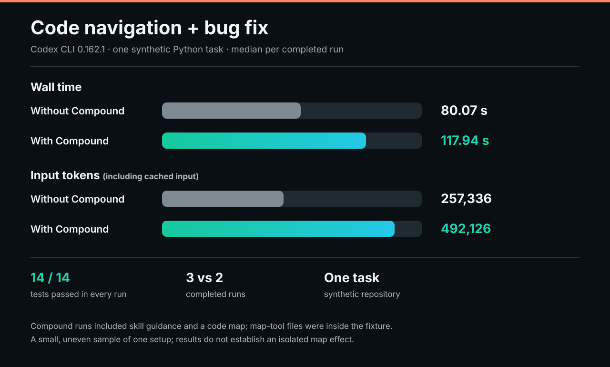

# Compound Skills

**Build cleaner software. Keep your agent's context focused.**

A compact engineering plugin for **Codex, Cursor, and Claude Code** providing practical workflows for architecture, implementation, debugging, refactoring, and review, paired with a zero-dependency local code map and symbol navigator.

- **Clearer architecture:** design around callers, explicit ownership, meaningful states, and interfaces that hide complexity.
- **Automatic code maps:** orient agent work with compact structural context, then explore an interactive repository graph with source previews, Git changes, impact analysis, and import tracing.
- **Evidence behind changes:** reproduce failures, preserve behavior during refactoring, and verify observable results.
- **Consistent commits and PRs:** concrete titles, concise explanations, truthful validation, and no AI co-author credits across all three apps.
- **Set up once:** make Compound the default across all your projects in Codex, Cursor, and Claude Code, or scope activation to one project or chat.
- **Existing-project cleanup:** run `setup` to reassess architecture, dependencies, scripts, docs, tests, and Git conventions, applying verified cleanup while reporting larger decisions.
- **Focused context:** keep only a tiny routing rule always active; load detailed workflow references on demand.

## Install

Install once at **User** scope in each app you use, then start a new chat (or run `/reload-plugins` in Claude Code).

### Codex

```sh
codex plugin marketplace add tobenwarrior/compound-skills
codex plugin add compound-skills@compound-skills
```

### Claude Code

```text
/plugin marketplace add tobenwarrior/compound-skills
/plugin install compound-skills@compound-skills
```

### Cursor

1. Open **Customize → Plugins → Add → From GitHub Repository**.
2. Enter `https://github.com/tobenwarrior/compound-skills`, choose **User** scope, then **Import**.
3. Click **Add** or **Install** beside `compound-skills`. See [Cursor's plugin docs](https://cursor.com/docs/plugins).

## Enable once, then work normally

Run global setup **once from any one app**:

| Action | Codex | Cursor | Claude Code |
| --- | --- | --- | --- |
| Enable across all projects | `$setup-global` | `/setup-global` | `/compound-skills:setup-global` |
| Check global defaults | `$status-global` | `/status-global` | `/compound-skills:status-global` |
| Remove global defaults | `$compound disable global` | `/compound disable global` | `/compound-skills:compound disable global` |

Global setup configures Codex and Claude Code together and adds Compound's local state directory to the native Codex/Cursor write-path lists so first-use onboarding completion is remembered. In Cursor, keep the bundled `compound-default` rule set to **Always** in **Customize → Rules**.

| App | Global rule |
| --- | --- |
| Codex | `~/.codex/AGENTS.md` (plus existing nonempty `AGENTS.override.md`) |
| Cursor | Bundled `compound-default` rule (`Always` in user-scoped plugin) |
| Claude Code | `~/.claude/rules/compound-skills.md` |

Before the first write-authorized task in a repository, Compound runs a bounded onboarding pass (stored in `~/.cache/compound-skills/onboarding.sqlite3` or `COMPOUND_SKILLS_STATE_DIR`): inspect structure and checks, audit hygiene, apply high-confidence cleanup, and verify changes while preserving uncommitted work. Read-only requests stay read-only. Details: [onboarding](skills/compound/references/onboarding.md) and [activation](skills/compound/references/activation.md).

## Reassess an existing project

| Codex | Cursor | Claude Code |
| --- | --- | --- |
| `$setup` | `/setup` | `/compound-skills:setup` |

Reruns project assessment even after prior setup: inspects the code map, architecture, dependencies, scripts, docs, tests, and Git conventions; applies verified cleanup; and preserves unfinished work and the Git index. For chat-only activation without writing files, run `compound session` or bare `compound`.

## See your codebase

| App | Command |
| --- | --- |
| Codex | `$map` |
| Claude Code | `/compound-skills:map` (or `/map`) |
| Cursor | `/map` |

Pass an optional focus query such as `map pricing`. The live viewer opens at **`http://127.0.0.1:43127/`** (`COMPOUND_MAP_PORT` overrides):

- **Interactive repository graph:** folder colors, organic clusters, zoom/pan/drag, search highlights, up to 5,000 indexed files and 20,000 drawn links.
- **Structural navigation:** browse folders, files, or symbols; inspect direct and transitive importers; trace shortest recorded import paths.
- **Git & source preview:** view changed files, branch state, co-change neighbors, and read-only 64 KiB source previews; copy up to 2,500 characters of focused context.

Use `map status` to inspect the loopback service and `map stop` to stop it. Python 3.11+ and Git are required, with zero runtime dependencies. Python receives AST outlines; JS/TS receives outlines, exports, and local import resolution (`tsconfig`/`jsconfig` aliases and workspace packages); Go and Rust receive declaration outlines and bounded local module/import edges; Java, C/C++, C#, Ruby, PHP, Swift, and Kotlin receive heuristic declaration outlines. Each pass reads at most 64 MiB (1 MiB per file), keeping metadata outside the repository and honoring ignore, private-file, and no-follow symlink checks. Details: [code maps](skills/compound/references/map.md).

### Agent navigation helpers

Set `COMPOUND_SKILL_DIR` to the installed `compound` skill directory:

```sh
# Exact-name outline matches and bounded lexical occurrences (read-only)
python3 -B "$COMPOUND_SKILL_DIR/scripts/symbol_lookup.py" --repo . --symbol Example

# Repeated-query acceleration via local service in-memory postings cache
python3 -B "$COMPOUND_SKILL_DIR/scripts/symbol_lookup.py" --repo . --symbol Example --service

# Optional semantic definitions and references via an explicitly specified local LSP server
python3 -B "$COMPOUND_SKILL_DIR/scripts/lsp_lookup.py" --repo . --file src/main.cpp --line 4 --column 5 --server-command-json '["clangd","--background-index=false"]'
```

## Nine engineering workflows

| Workflow | Focus |
| --- | --- |
| [Investigate](skills/compound/references/investigate.md) | Trace behavior through callers, configuration, state, and side effects |
| [Design and implement](skills/compound/references/design.md) | Start from caller examples, explicit ownership, and valid states |
| [Debug](skills/compound/references/debug.md) | Reproduce the failure, isolate root cause, and add a regression check |
| [Refactor](skills/compound/references/refactor.md) | Preserve behavior baselines while simplifying responsibilities and layers |
| [Performance](skills/compound/references/performance.md) | Measure a representative baseline, isolate bottlenecks, and verify correctness |
| [Review](skills/compound/references/review.md) | Report concrete findings with locations, trigger conditions, and impact |
| [Verify](skills/compound/references/verify.md) | Match verification to the behavioral, integration, or packaging claim |
| [Repository hygiene](skills/compound/references/repo-hygiene.md) | Audit root clutter, oversized files, unreferenced scripts, and ignore gaps |
| [Git and pull requests](skills/compound/references/git.md) | Write clear commit/PR titles, report verified checks, and keep human attribution |

## Benchmark: navigation and bug fix



On this task, all five completed runs fixed the bug and passed 14 tests. The Compound runs took longer and used more input tokens in this small sample. The task used a synthetic Python repository and Codex CLI 0.162.1 on macOS arm64; the comparison includes Compound's skill guidance and map generation, not just the map. Three runs used ordinary repository tools; two used Compound. The map runs used different map commands and included map-tool files inside the fixture; copying those files was outside the timed runs. This result does not isolate the map's effect or predict performance on other projects. Input-token totals include cached input.

Use `$map` to explore a repository visually, or Compound's focused map to orient an agent before it inspects source.

## Repository hygiene

The bundled [checker](skills/compound/scripts/repo_audit.py) audits root clutter, scratch paths, file-size thresholds, worktrees, `.gitignore` gaps, and unreferenced scripts, with JSON output, strict mode, and baseline tracking (`--write-baseline`). See [repository hygiene](skills/compound/references/repo-hygiene.md) and [maintainer guide](CONTRIBUTING.md).

## Credits

Adapted selectively from Lauren Tan's [pstack](https://github.com/cursor/plugins/tree/main/pstack), with lineage from earlier Karpathy-inspired guidelines. See [SOURCES.md](SOURCES.md), [third-party notices](THIRD_PARTY_NOTICES.md), and [MIT license](LICENSE).
